# G3D Amber Cliff — «La Falaise d'Ambre», the island that speaks French (ADR-0028)

A third island, bigger than Spark Harbour (radius 46 m against 34 m). Everything written and said on it is French,
whatever the game's language is. Hold **T** for the translation. It is drawn as a French-Belgian album page:
one even black line, flat colour with one soft shade, a watercolour sky.

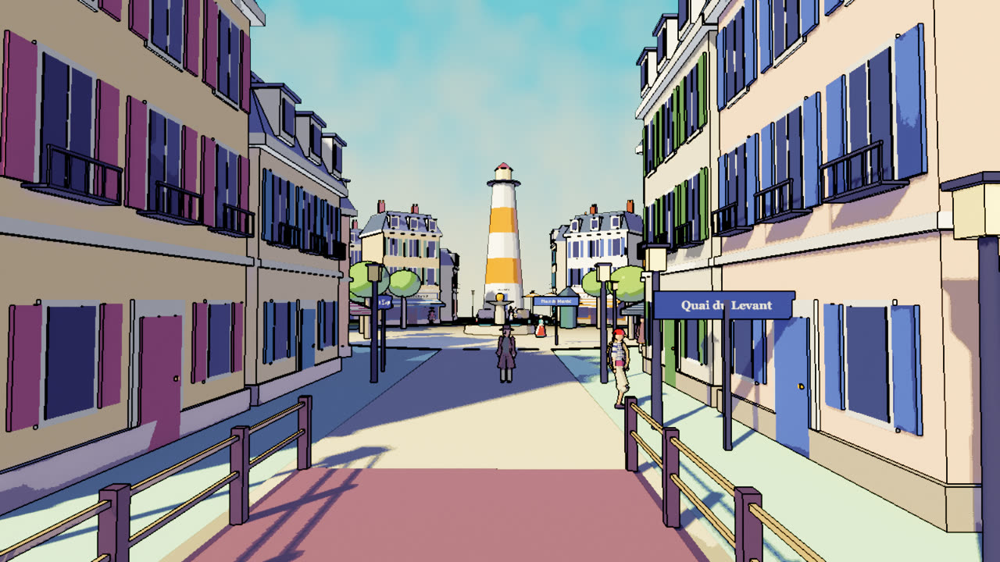

| The market square and the bank | Bureau de change, the lighthouse behind |
|---|---|
| 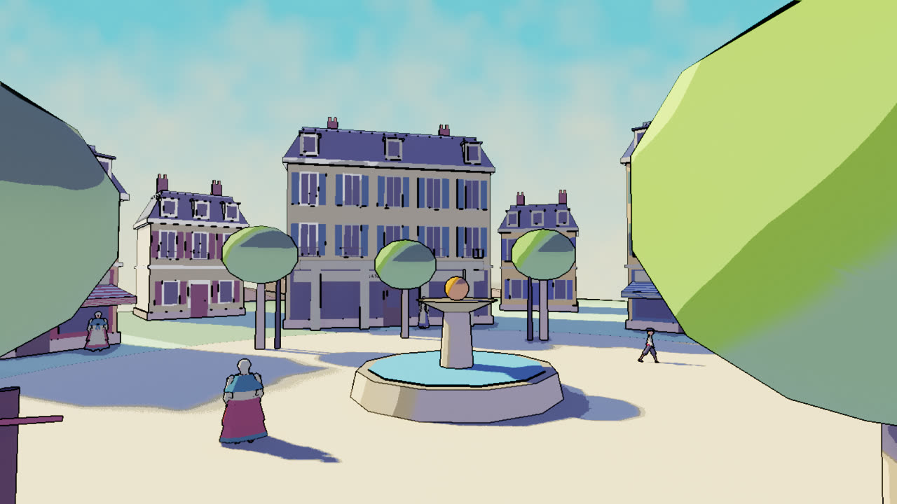 | 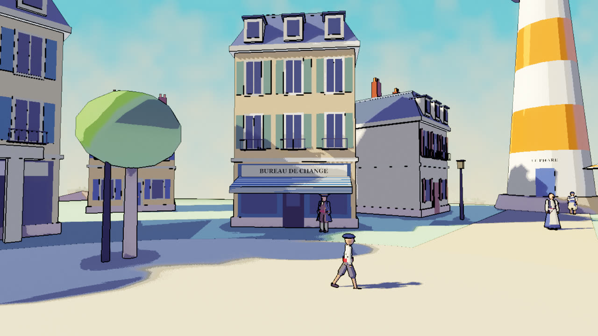 |

| The café terrace | From above |
|---|---|
| 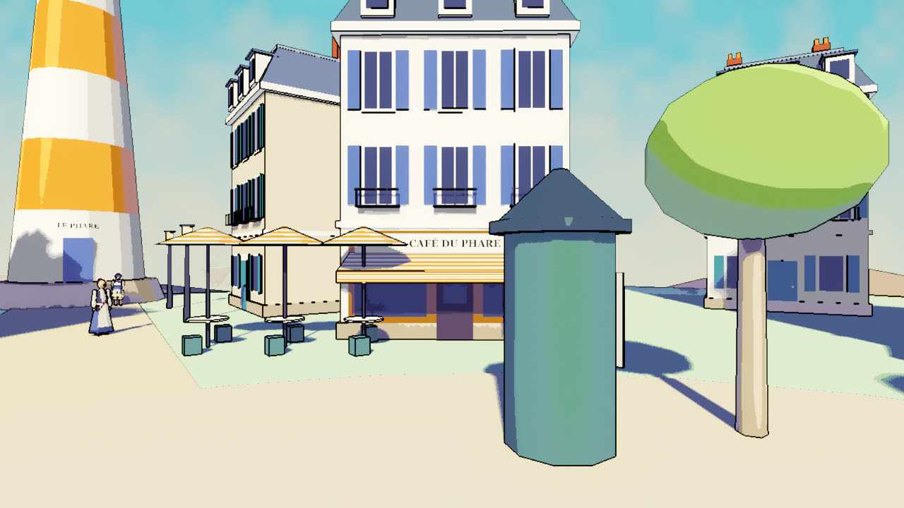 | 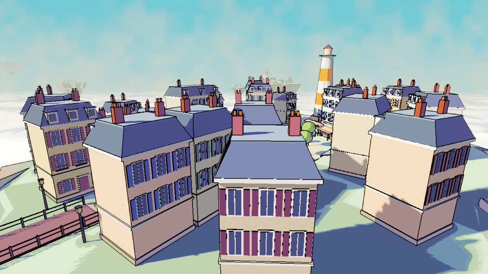 |

Second mode (V): a black-and-white album page — the line and fine one-way strokes in the shade.

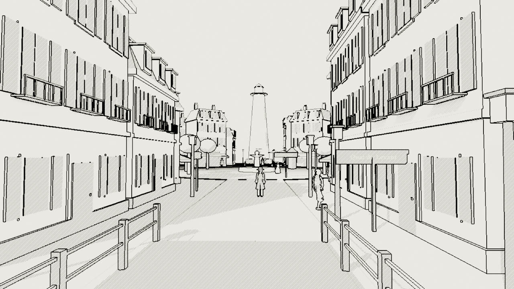

## Reading French, and asking for help
The island's title, the prompts and the signs are French. With **T** held, the prompt and the nearest sign are shown
in the game's language; let go and it is French again.

| As met | T held (game in Russian) |
|---|---|
| 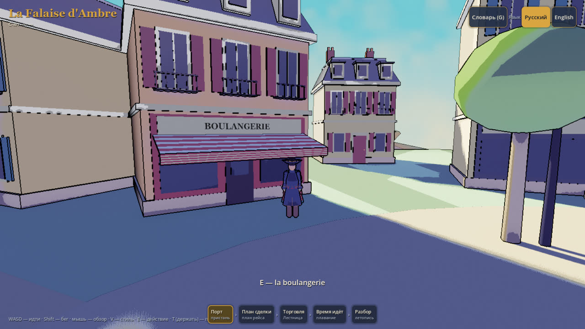 |  |

## Talks: comic pages in French
The same pages as ADR-0027; T shows the gloss in every balloon.

| Bureau de change, page 1 | the same with T held |
|---|---|
| 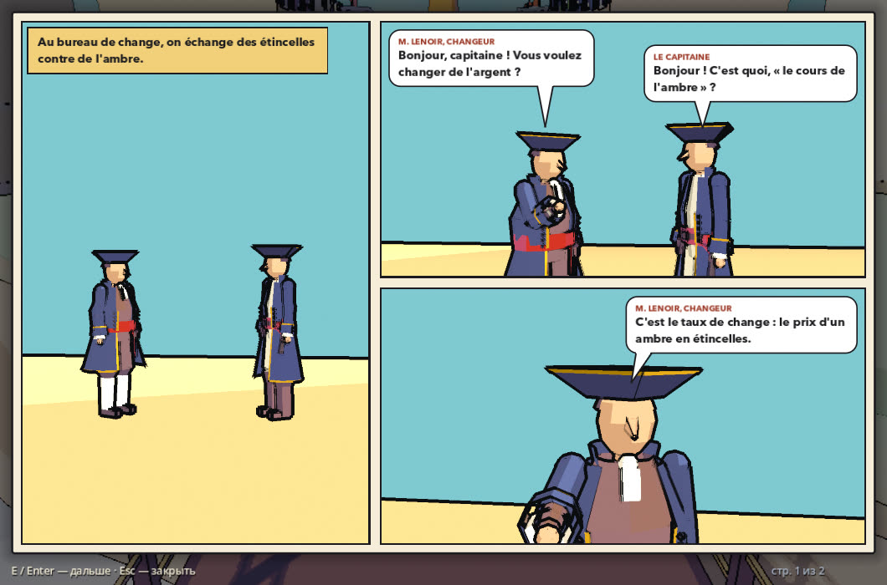 |  |

| Bureau de change, page 2 | The bakery |
|---|---|
| 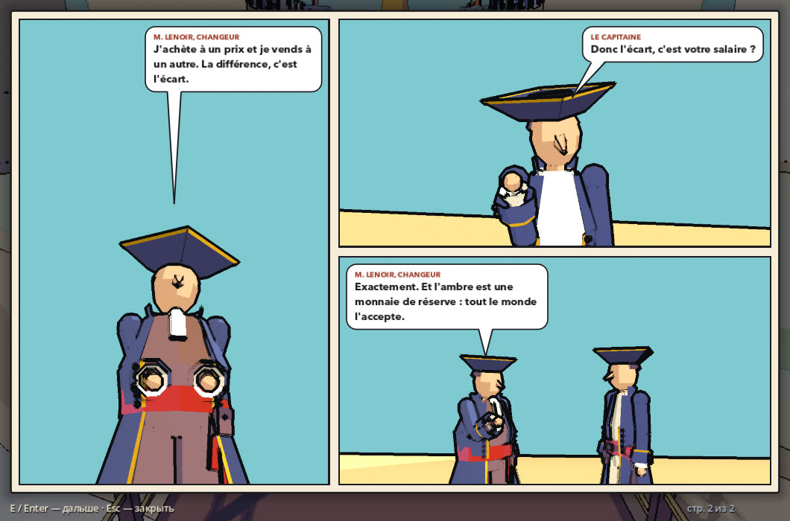 | 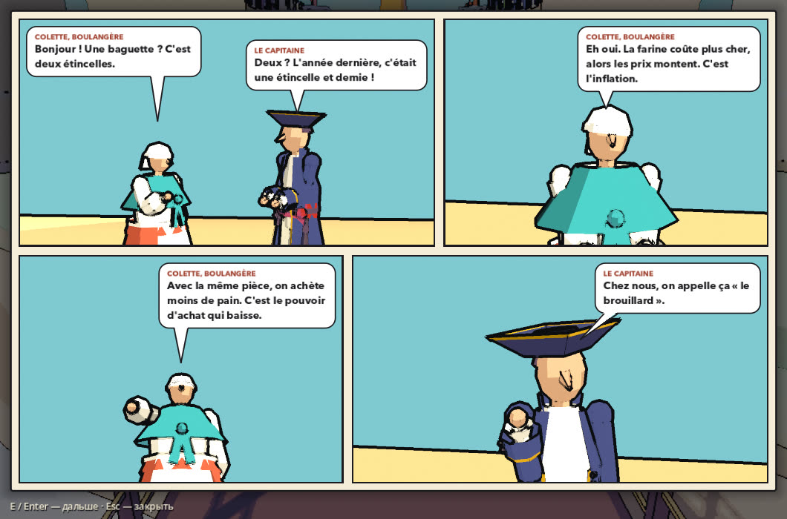 |

| The lighthouse | The bank, T held, game in English |
|---|---|
| 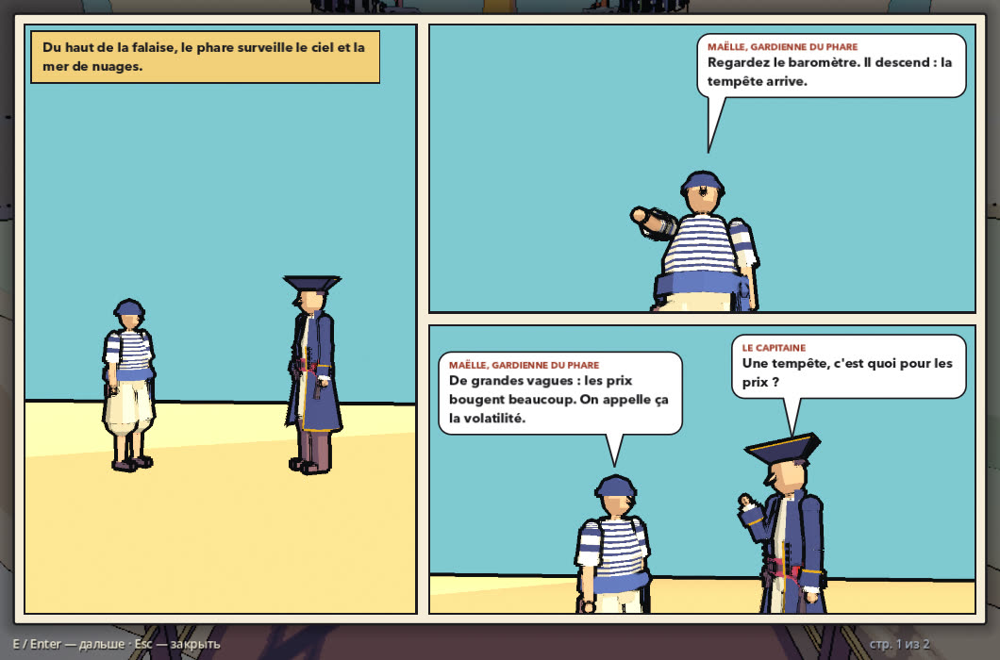 | 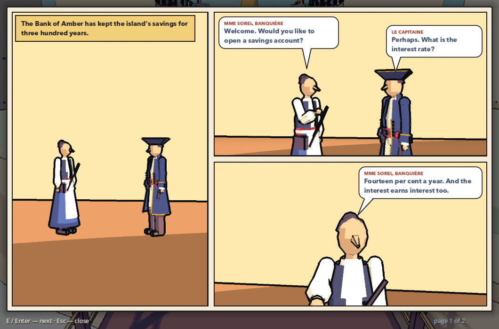 |

## What each place teaches (the real term, and the lore name beside it)
| Place | Who | French words | Idea |
|---|---|---|---|
| Bureau de change | M. Lenoir | le taux de change (« le cours de l'ambre »), l'écart, une monnaie de réserve | exchange rate, spread, reserve currency |
| Banque d'Ambre | Mme Sorel | l'épargne, le taux d'intérêt, les intérêts composés (« le jardin du Quai ») | savings, compound interest, rate against inflation |
| Boulangerie | Colette | le prix, l'inflation (« le brouillard »), le pouvoir d'achat | inflation |
| Café du Phare | Lucien | les dépenses, une épargne de précaution (« les provisions »), un budget | the safety cushion |
| Librairie | Anatole | un carnet de bord, un journal de transactions | the trade journal |
| Le Phare | Maëlle | la tempête, la volatilité, un ordre stop (« l'ancre »), le risque | volatility and the stop |
| in the streets | Yann, Rose, Léo, M. Hector, Inès | le flux d'ordres, l'offre et la demande, la saisonnalité, économiser, une obligation, le coupon, un fonds indiciel, la diversification | order flow, seasonality, saving, bonds, index funds |

## Getting there
A blue signpost «La Falaise d'Ambre» on the Spark Harbour wharf (north rail): E takes the packet boat. On the quay
of Amber Cliff, E by the boat goes back. No trading day is needed. On arrival the island's wind restyles the captain
(recording: [attune.gif](g3d-amber/attune.gif)):

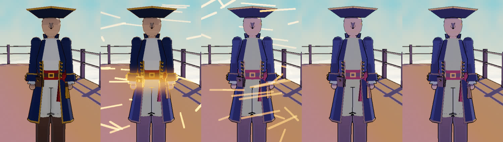

## Where things live
- Words: `game3d/i18n/amber.csv` (`keys,fr,ru,en`). Staging of the talks: `game3d/data/talks.json` (`"speak": "fr"`).
- The town: `game3d/scripts/amber_cliff.gd`. The tongue: `game3d/scripts/core/island_tongue.gd`.
- The look: row `amber` in `island_style.gd`, branch `tech == 2` in `shaders/ink.gdshader`.

## How to rerun
```
godot --path game3d --resolution 1600x900 -- --views=<dir> --only=amber --ink=1     # or --ink=2
godot --path game3d --resolution 1600x900 -- --read=<dir>                           # prompts and signs, then with T
godot --path game3d --resolution 1600x900 -- --talk=<dir> --island=amber [--gloss] [--lang=en]
godot --path game3d --resolution 1600x900 -- --attune=<dir> --island=amber
godot --path game3d --resolution 1600x900 -- --audit=<dir> --only=amber
```

## Checked
- World audit on Amber Cliff: 0 findings after fixes (15 072 of 15 099 lattice cells reached from the quay; 60
  villager strolls finished; 54 objects). Found and fixed on the way: café tables in the street (two strollers stuck),
  a parasol at head height.
- GUT 100 green (`test_amber_cliff.gd`, and the walk tests now cover the third island).
- Frame rate at 1920×1080 (laptop, display cap 120): average 117–119 on all three islands; 1 %-low 59–77 Spark
  Harbour, 66–69 Silk Reach, 61–97 Amber Cliff; worst frame 19.5 ms.

## Not checked / open
- Not played by hand; T was "held" by the tool with a synthetic key event.
- The French is a first draft at about A2–B1 and has not been read by a French speaker.
- The islanders wear the harbour costumes: there is no concept sheet for them or for the town houses.
- The far view of the island from Spark Harbour is plain blocks (the town is built only when the captain is there).
- With `--pbr` the island is built from the same plain materials; it was not looked at in that mode.
