# G3D characters — rebuilt from the concept sheets

Aika had an image model draw concept sheets from our brief (`docs/design/concepts/`, index in `docs/design/README.md`).
This pass rebuilds the people of the 3D game to match them.

## The sheets
| | |
|---|---|
| 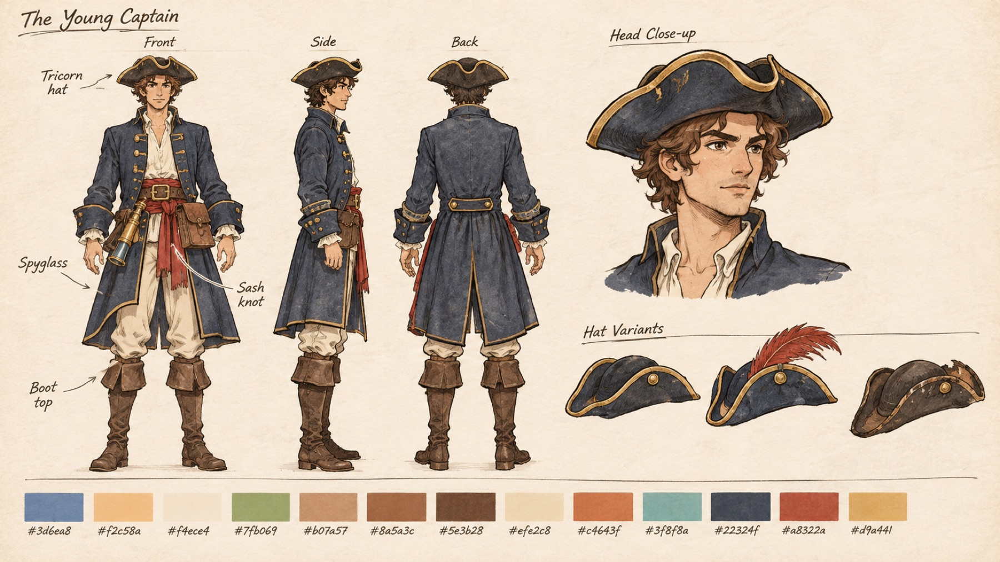 | 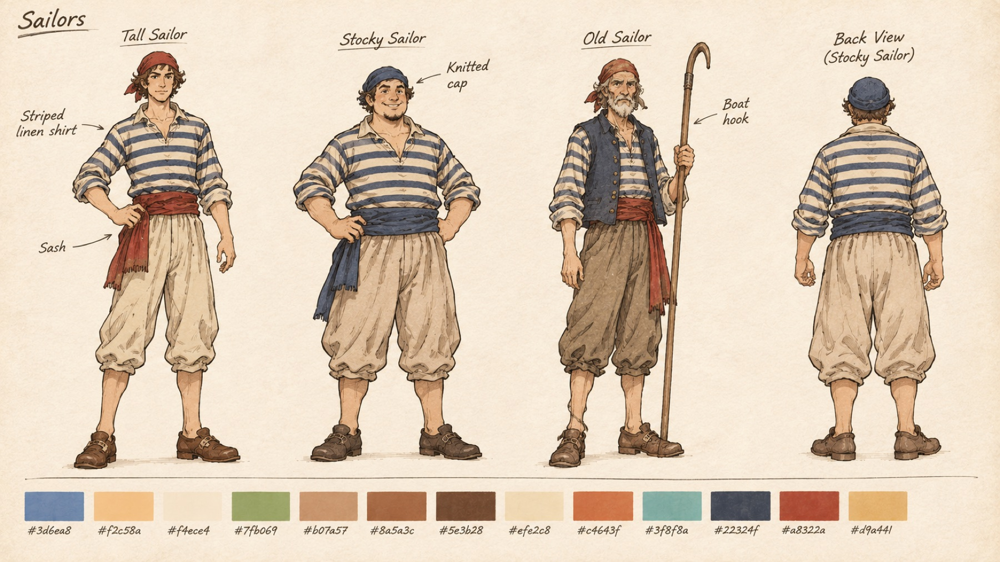 |
| 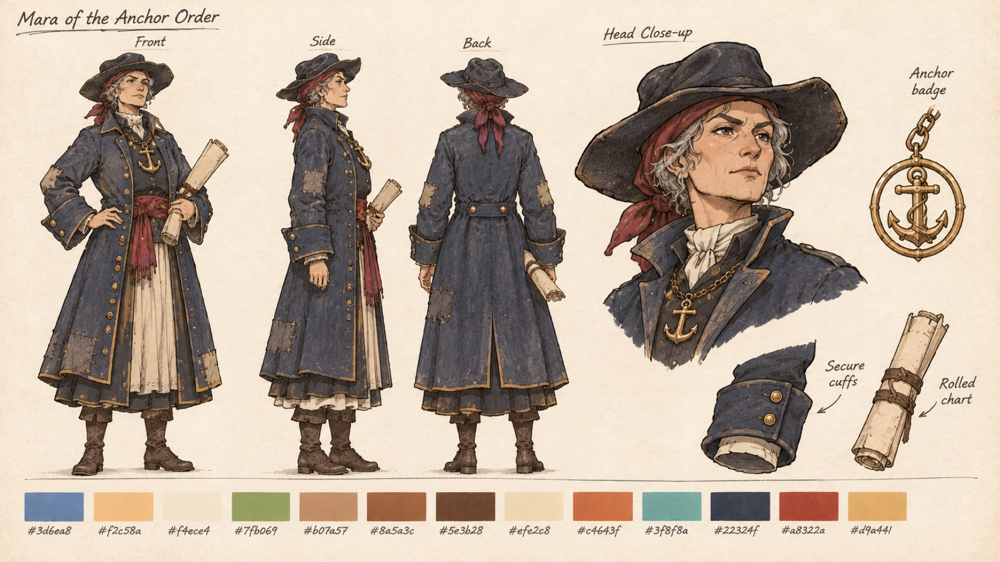 | 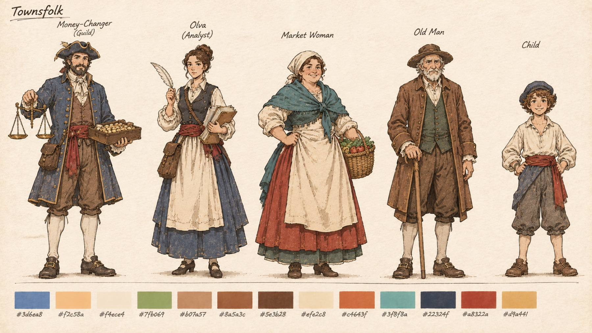 |
| 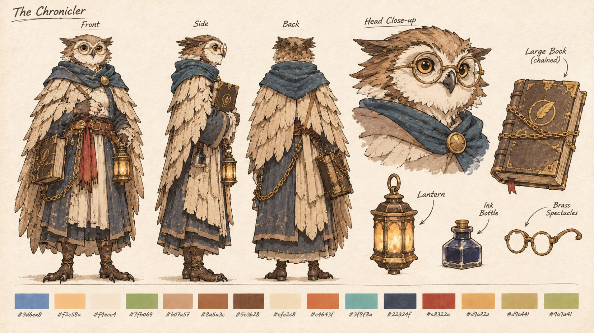 | |

## Before / after
Before: the costumes of PR #19, made without a sheet (five roles).

| Before | After |
|---|---|
| 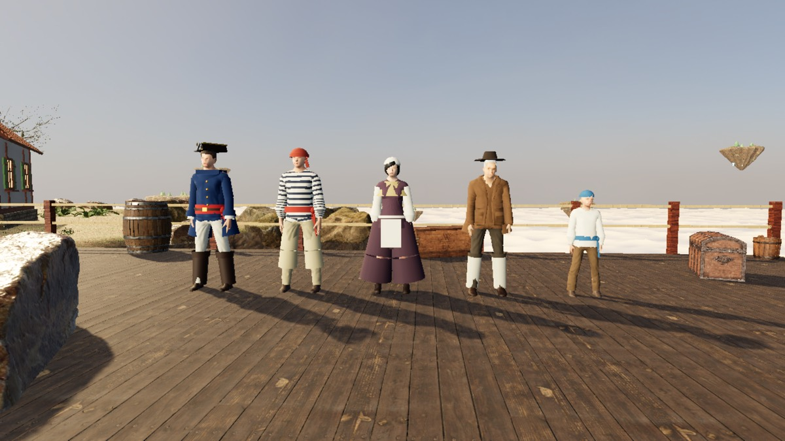 | 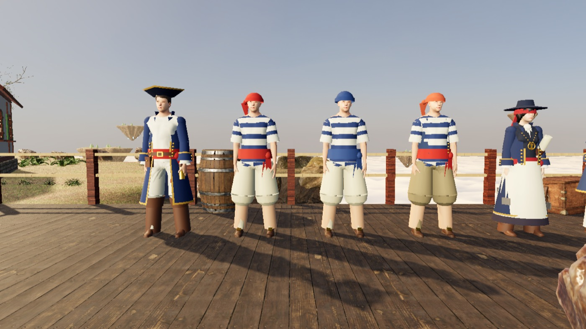 |
| 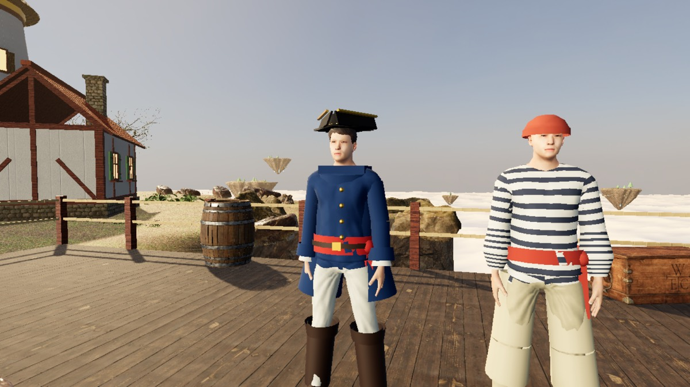 | 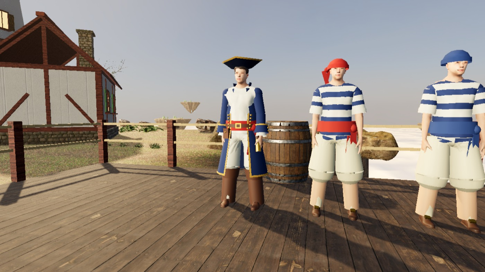 |

After, the whole cast (captain, three sailors, Mara, money-changer, Olva, market woman, old man, child, the Chronicler):

| | | |
|---|---|---|
|  | 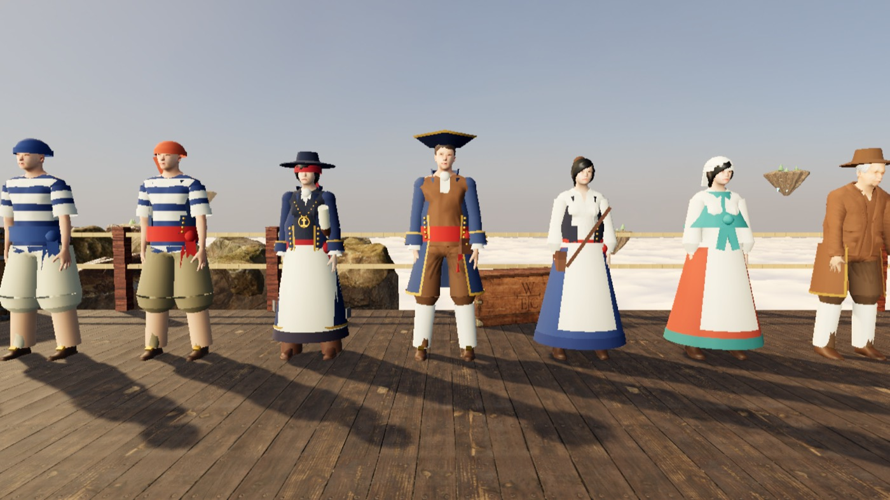 | 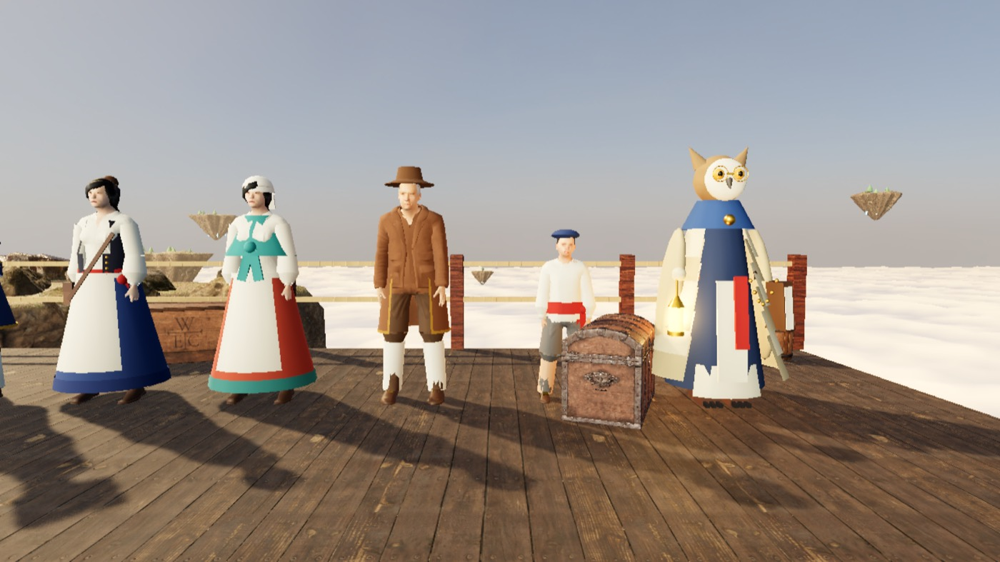 |

From behind, and in the game (walking, running, the square):

| | |
|---|---|
| 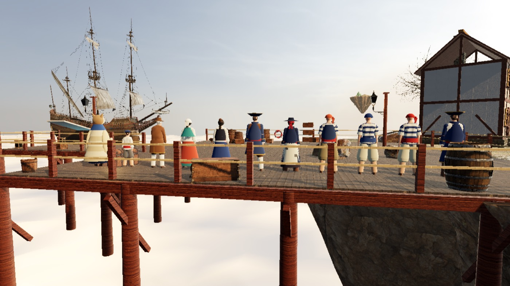 | 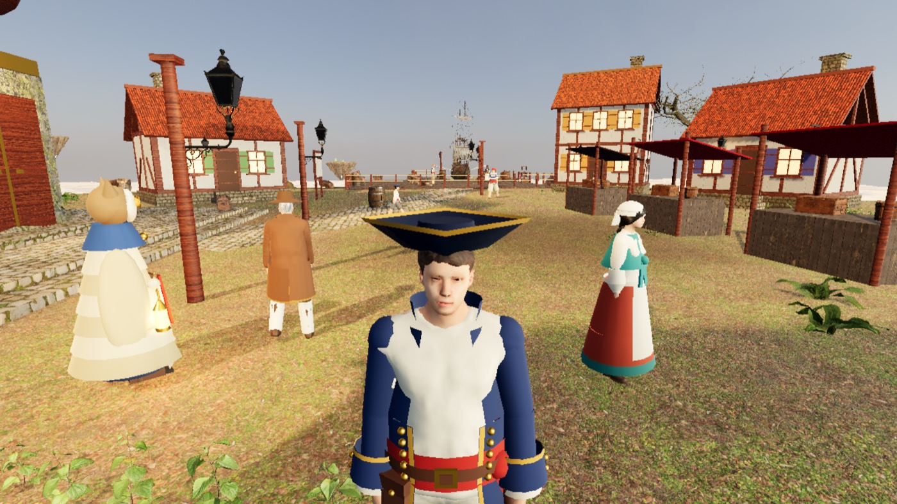 |
| 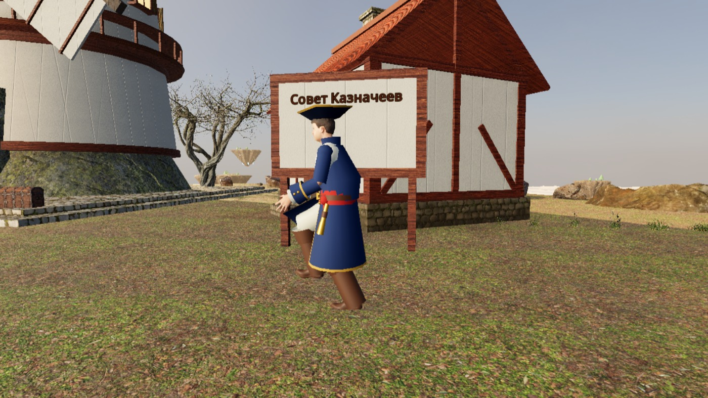 | 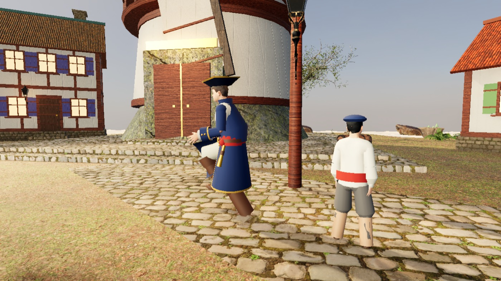 |

Without the MakeHuman people on disk the stand-ins wear the same designs:

| | | |
|---|---|---|
| 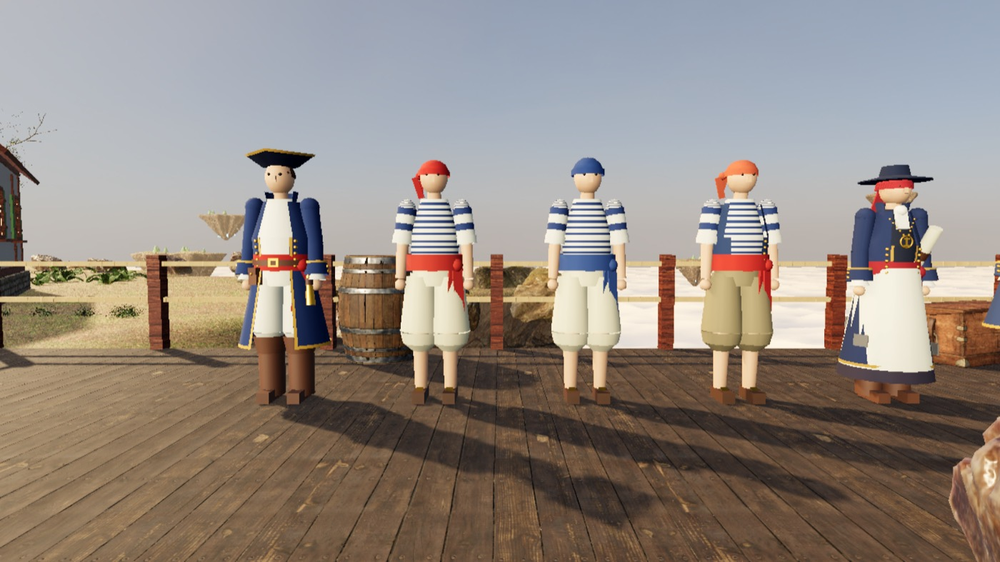 | 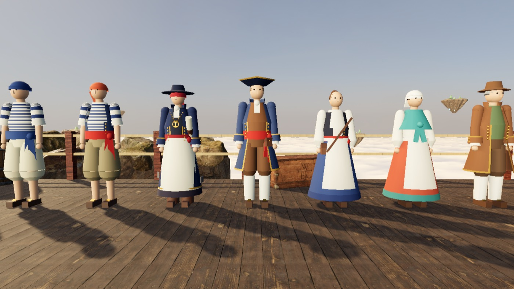 | 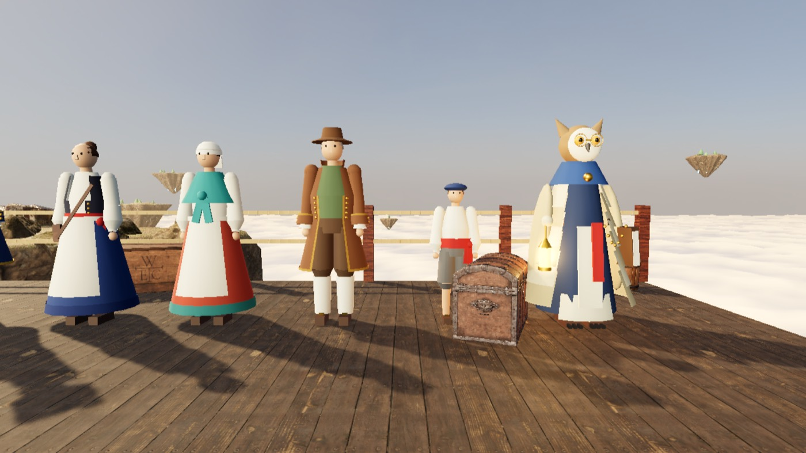 |

## What changed
- Eleven roles instead of five, each a function that reads like its sheet (`game3d/scripts/costume.gd`).
- The captain: tricorn with a gold edge and three turned-up sides, long open navy coat with gold edging, buttons and
  wide cuffs, cream shirt and breeches, red sash under a belt with a brass buckle, pouch, spyglass, brown sea boots.
- Sailors: striped shirts with sleeves rolled above the elbow, wide sashes with a hanging end, baggy slops gathered
  below the knee, bare calves, buckled shoes; bandana with a side knot, knitted cap, or a waistcoat.
- Mara: wide felt hat over a red headscarf, long patched storm coat, cravat, the anchor badge on a chain, a rolled chart.
- Townsfolk: the money-changer, Olva with bodice, apron and satchel, the market woman with shawl and kerchief, the old
  man in a long brown coat with stockings, the child in a beret.
- The Chronicler is now what the lore says — a creature, an owl scholar with a feather cloak, spectacles, a chained
  book and a lit lantern — not an old man.
- New shapes: open shells (coats open at the front, skirts in halves, aprons that lie on the skirt), a three-sided brim.

## Limits (honest)
- These are flat-coloured simple shapes on four MakeHuman bodies, not sculpted clothes: no cross-hatching, no curls, no
  cloth folds, faces are the MakeHuman ones. Body builds do not vary (the "stocky" sailor is not stocky).
- Up close a coat edge can cut into the shirt, and a trouser leg can show through a boot or a bare calf.
- Checked on still pictures; not watched in play. GUT 77/77 with and without the people.
- Houses, the Exchange, the ship and props have no sheets yet and were not changed.
