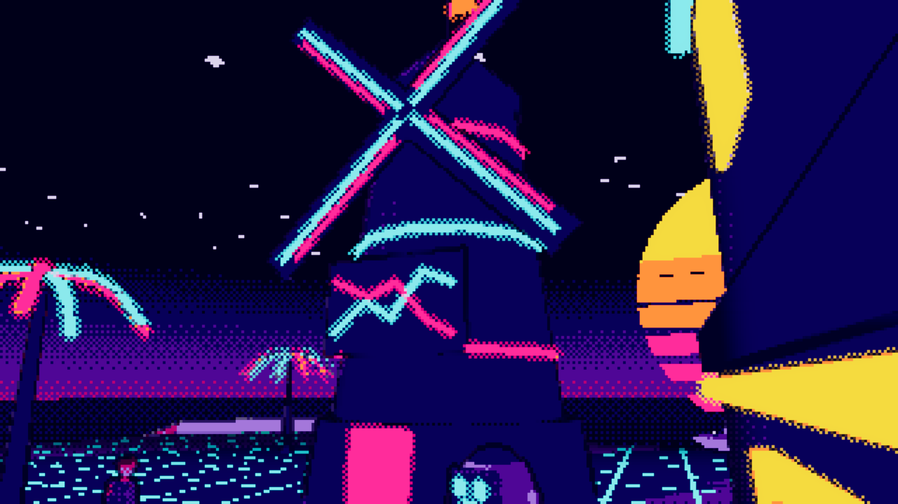
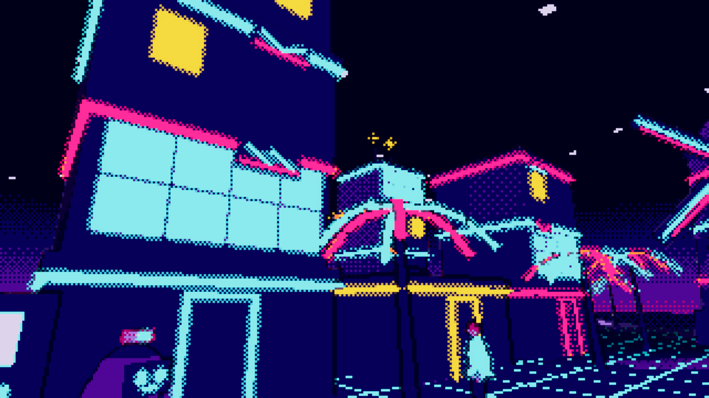
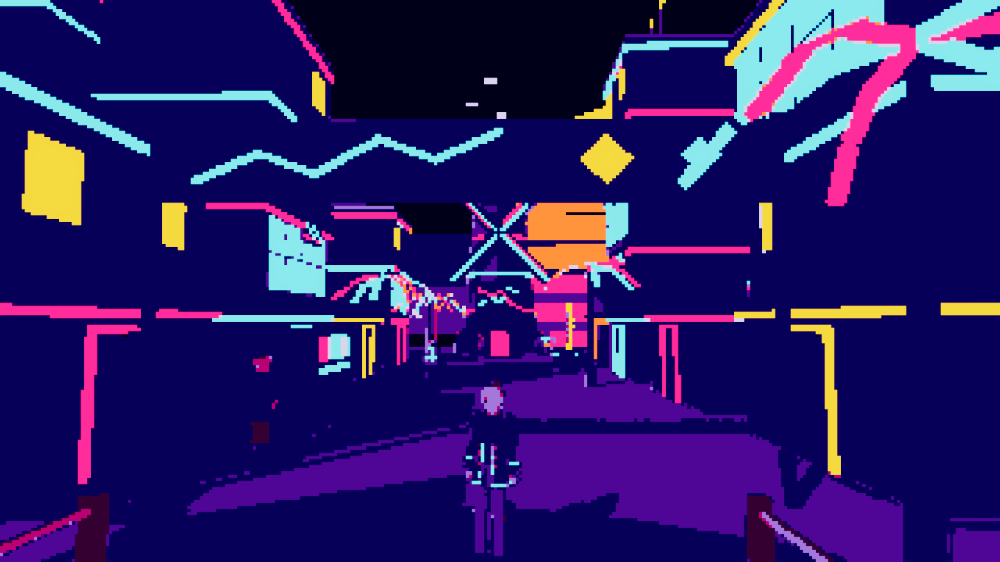
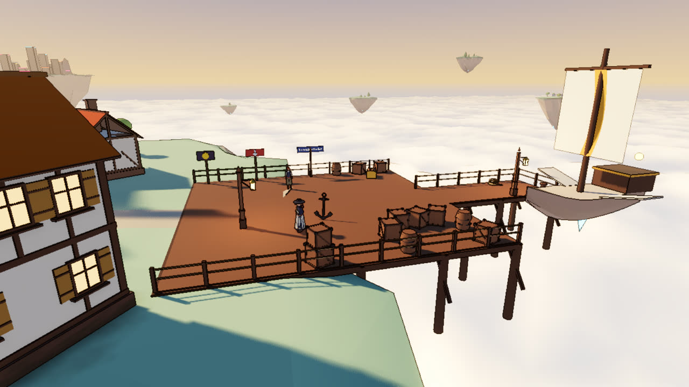
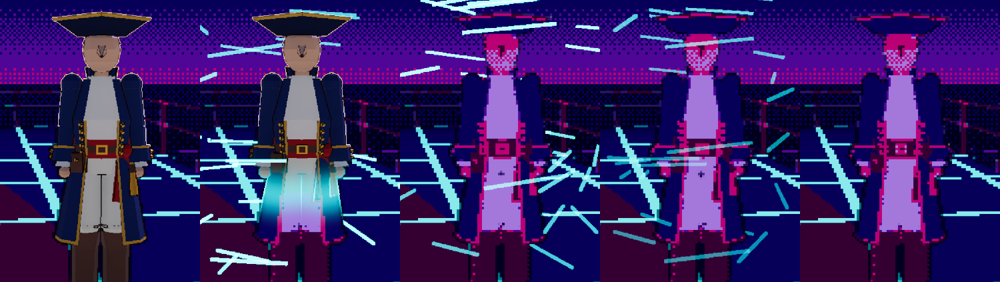

# G3D — the crypto island: a neon town in synthwave pixel art (ADR-0031)

A fifth island, from Aika's six sheets (`docs/design/concepts/41…46`). **A place and a style only**: nothing is
traded there; how crypto works in the game waits for her answers to intent 03 (question 10).


| The town from the pier side | The Exchange That Never Closes |
|---|---|
|  |  |

| Towers | The wind coin on the square |
|---|---|
|  |  |

## The technique: synthwave pixel art
- **Big pixels**: 180 rows whatever the window (320×180 at 16:9); each is the average of four samples of its cell.
- **Twelve colours**: night `#1b1035`, deep violet, violet, lavender, pale; plum and magenta for warm things; neon
  pink, orange, gold, cyan; teal. Bodies are sorted by brightness into five tones; anything bright and saturated
  stays a neon.
- **Ordered dithering** only in the narrow zone where two tones meet, so walls are flat colour.
- **The sky** is drawn by the effect: bands from night down to magenta, a few fixed stars, a striped sun.
- **The grid**: lines every two metres on the ground, in world space, cyan near and teal further off.
- **Glow by dithering**: a checkerboard halo two big pixels wide round neon only.
- V gives the plain version: no dithering, no grid, no halo.



## No real brands
The sheets show ₿, another real coin's mark and the tickers BTC and ETH. The project forbids real brand looks, so:
- the game's coin is its own **wind coin** («монета ветра»): gold, with a wind curl, as on the props sheet. It
  stands as a monument on the square and is the sign on the packet-boat post;
- boards show chart lines and arrows, no letters;
- in the repository's copies of sheets 41, 44 and 45 the real marks are covered;
- a test fails if `₿`, `BTC`, `ETH`, "bitcoin" or "ethereum" (ru or en) appears in the talks, the strings or the
  island's code.

## Easy on the eyes — what was done and measured
- **Nothing blinks.** The technique uses no clock at all (a test checks that): neon is steady, the grid does not
  scroll, the sun does not move. With the camera standing still the picture changes by **0.7 of 255** between
  frames — the people walking.
- **Glow only at sources.** Neon is what the island's builder made emissive and saturated: bands, door frames,
  some windows, palms, screens. Share of bright pixels in the fixed views: 7 %, 14 %, 11 %, 17 %, 17 %.
- **On the move** (`--stroll --island=crypto`, 12 m along the street, a frame every 0.1 s): **19.1 of 255** — less
  than the noir island (29.7), more than the watercolour one (11.4). What changes is the stepping of big-pixel
  edges and of the grid lines; the grid is dropped before its lines come closer than about three big pixels.
  Recording: [walking.gif](g3d-crypto/walking.gif). Whether it is comfortable is for Aika's eyes.
- The screen is dark (it is night), but not black: the darkest tone is `#1b1035`.


## The island
- A pier, a street of **block towers** after sheet 42 (stacked storeys, a neon band round each, a neon door frame,
  lit windows, a wall of cyan glass on one storey, boards with chart lines, antennas on the tall ones), **neon
  palms**, and at the end of the street **the Exchange That Never Closes**: a tower with four neon blades, a red
  flag, a doorway of light, a board of two crossing lines.
- Props after sheet 45: the wind-coin monument, a mining machine, a vending machine, a ticker board over the street.
- **Getting there**: a third post on the Spark Harbour wharf — a dark board with a gold coin; E takes the packet
  boat. On the island, E by the boat goes back.



## The captain is redrawn in pixels on landing


Recording: [captain-pixel.gif](g3d-crypto/captain-pixel.gif).

## Islanders and bots (sheet 44) and what they say
Four people (costume roles from the existing garments) and three robots built in code. In comic pages each is its
figure from the sheet — one face each.

| The trading bot at the exchange | The dreamer |
|---|---|
|  |  |

| Who | Idea, real term beside the lore |
|---|---|
| The trading bot | the market never closes; place the order and the stop beforehand |
| The trader | high volatility; leverage («заёмные паруса») and how fast a position is cut |
| The miner (stands by his machine; no talk yet) | — |
| The mining bot | the network fee, and why hurrying costs more |
| The dreamer | the fear of missing out (FOMO) |
| The analyst | a coin has no financial report: its price is demand and trust |
| The news bot | everything that has been is known; what will be, nobody knows |

Words: `game3d/i18n/talk.csv` (`TALK_CRYPTO_*`, `TALK_BOT_*`). A talk about mining and a fixed supply is written
(`crypto_miner`) but the miner stands still and is not yet a spot to talk at. Nobody recommends anything.

## How to rerun
```
godot --path game3d --resolution 1600x900 -- --views=<dir> --only=crypto --ink=1     # --ink=2: the plain version
godot --path game3d --resolution 1600x900 -- --attune=<dir> --island=crypto
godot --path game3d --resolution 1600x900 -- --stroll=<dir> --island=crypto [--still]
godot --path game3d --resolution 1600x900 -- --talk=<dir> --island=crypto --only=bot_trader
godot --path game3d --resolution 1600x900 -- --audit=<dir> --only=crypto
```

## Checked
- World audit of the island: 0 findings (8149 of 8212 lattice cells reached from the pier; 36 villager strolls).
  Found and fixed on the way: a palm planted inside the mining machine, the coin's collider wider than the coin,
  a machine low enough to be climbed and fallen from.
- GUT 113 green (4 new in `test_crypto_isle.gd`; the walk tests and the captain contract cover the fifth island).
- Frame rate at 1920×1080: average 118 (display cap 120), 1 %-low 57–69, worst frame 19.4 ms.

## Not done, not checked
- Not played by hand.
- **1 %-low was 57 in one of six views** — under 60. The same measure on other islands today ranged 55–100
  between runs of the same code; this technique is the heaviest so far (about 14 texture reads a pixel).
- No trading, no hall: the inside of the exchange (the wall of charts, the gears) is not built.
- Not built from the sheets: outside stairs, the wallet chest, the broken neon sign, the flying ships, the
  crystals' own colours (the island's crystals are the usual ones, drawn cyan by the technique).
- Costumes are approximations (no puffer jacket shape, no gas mask, no visor); the people and bots have one face each.
- The wind sign on the coin is three strokes with hooks; at 180 rows it reads only from close by.
- The miner has no talk spot. The island has only a working name.
- The other four islands were not re-audited: nothing of theirs changed.
