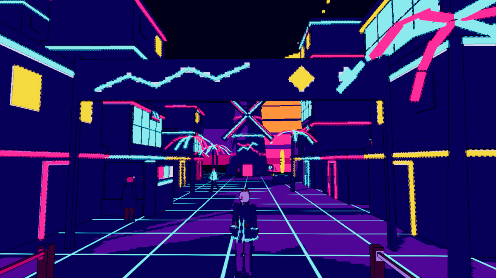
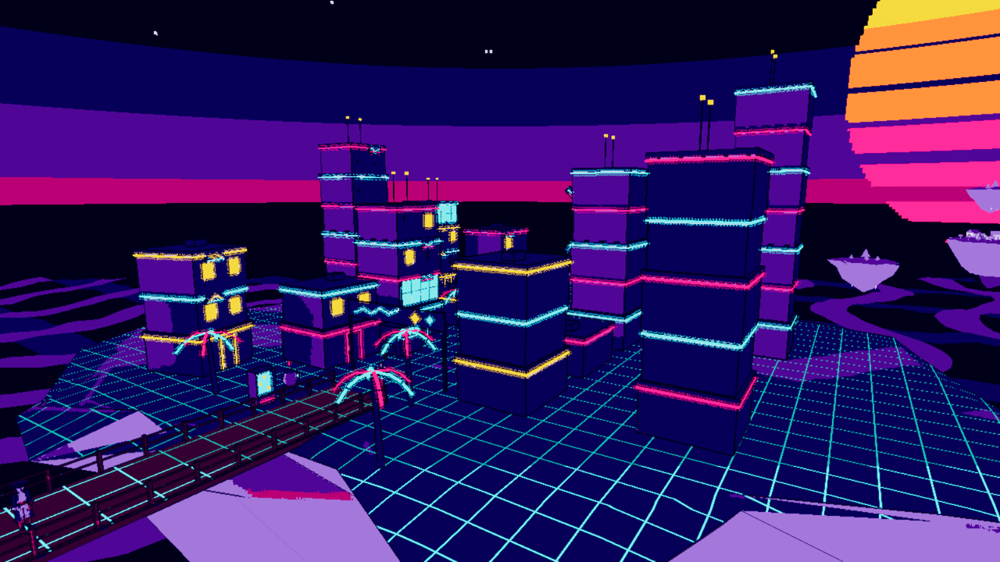
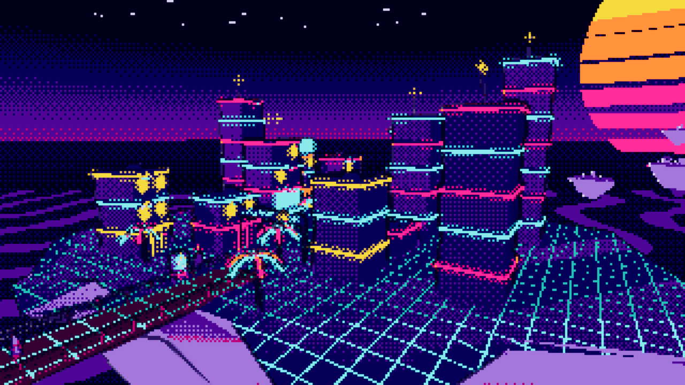
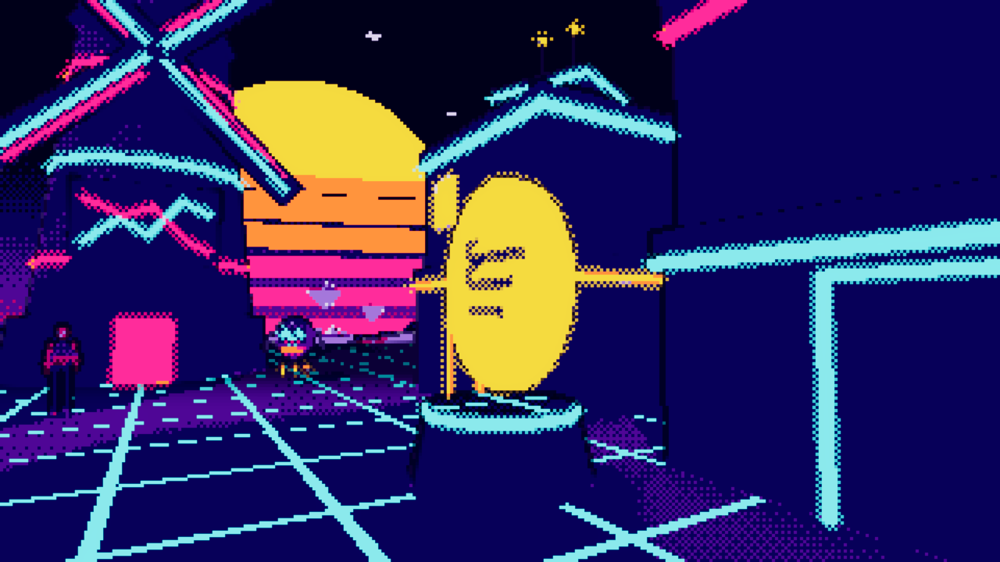
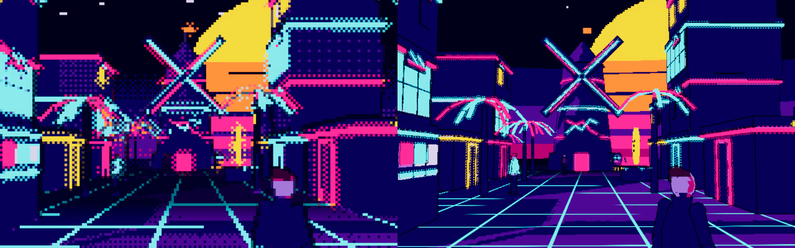
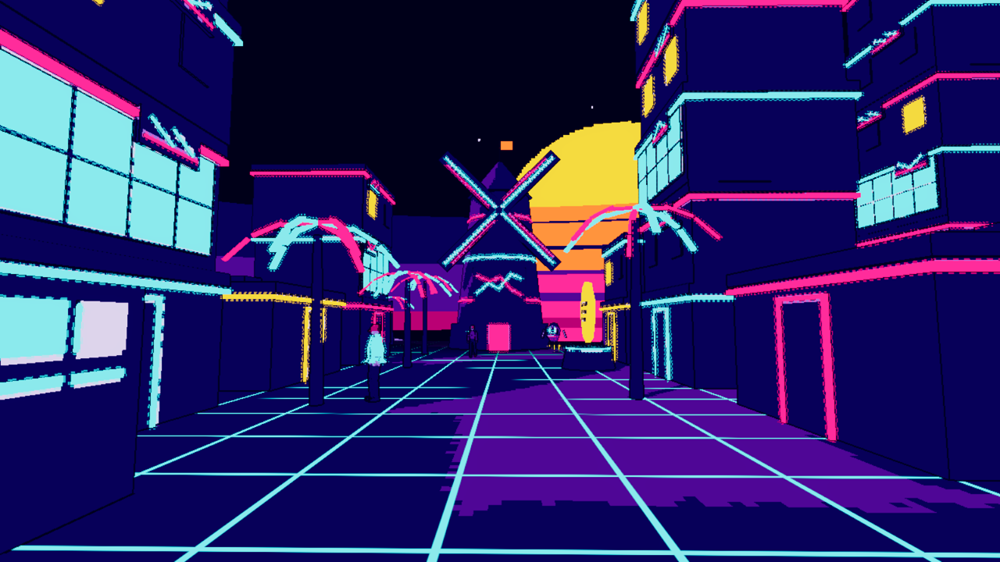
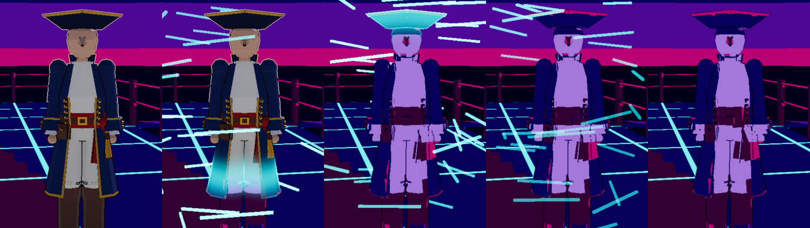
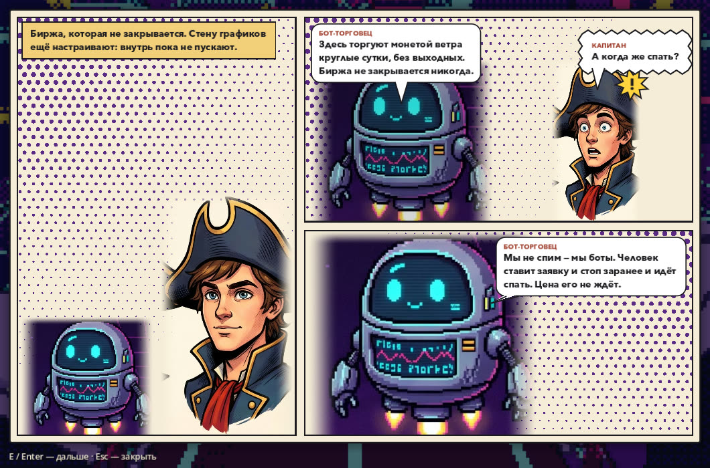
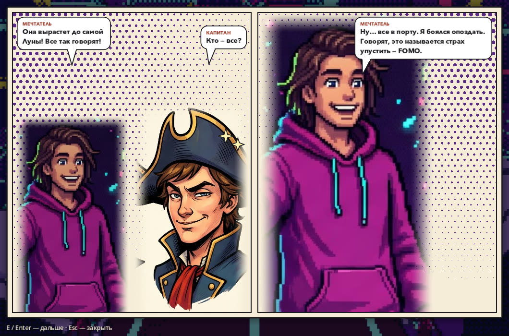

# G3D — the crypto island: a neon town in synthwave pixel art (ADR-0031)

A fifth island, from Aika's six sheets (`docs/design/concepts/41…46`). **A place and a style only**: nothing is
traded there; how crypto works in the game waits for her answers to intent 03 (question 10).



| The town from the pier side | The Exchange That Never Closes |
|---|---|
|  |  |

| Towers | The wind coin on the square |
|---|---|
|  |  |

## The technique: synthwave, with pixels that belong to the world
The first version cut the whole screen into big pixels (320×180) with dithering. Aika: "too pixelated, hard to look
at, it swarms in the eyes". Now:
- **object edges are sharp**; the chunky part is the paint on surfaces, in squares 14 cm wide **fixed to the world**
  — they stay on the wall when the camera walks or turns;
- **no dithering** over the picture: five flat tones by brightness; the only checkerboard is a small halo round neon;
- the same twelve synthwave colours, the striped sun, the grid (lines at least a pixel wide, fading out before they crowd);
- the sky is drawn in cells of direction, so it turns with the world;
- nothing is animated. V gives the plain version (no grid, halo or outline).

| Before | After |
|---|---|
|  |  |
|  |  |
|  |  |

The same frame of a turning camera, enlarged (before, after):



Plain version (V):


## No real brands
The sheets show ₿, another real coin's mark and the tickers BTC and ETH. The project forbids real brand looks, so:
- the game's coin is its own **wind coin** («монета ветра»): gold, with a wind curl, as on the props sheet. It
  stands as a monument on the square and is the sign on the packet-boat post;
- boards show chart lines and arrows, no letters;
- in the repository's copies of sheets 41, 44 and 45 the real marks are covered;
- a test fails if `₿`, `BTC`, `ETH`, "bitcoin" or "ethereum" (ru or en) appears in the talks, the strings or the
  island's code.

## On the move and on the turn
Recordings, a frame every 0.1 s — walking 12 m along the street: [before](g3d-crypto/before/walking.gif),
[after](g3d-crypto/walking.gif); standing and turning 2° a frame: [before](g3d-crypto/before/turning.gif),
[after](g3d-crypto/turning.gif).

| Mean change between frames, of 255 | Before | After |
|---|---|---|
| camera standing still | 0.70 | 0.66 |
| walking | 19.1 | 16.9 |
| turning | 28.5 | 24.6 |

The numbers fall only a little, and that is honest: this measure counts every pixel that changes, and most of the
change is bright neon sliding across a dark screen, which a turn must do. What the rework removed is of another
kind — squares that jump from cell to cell and dots that swarm — and the measure hardly sees it; the enlarged
frames and the recordings do. **Whether it is comfortable now is for Aika's eyes.**



## The island
- A pier, a street of **block towers** after sheet 42 (stacked storeys, a neon band round each, a neon door frame,
  lit windows, a wall of cyan glass on one storey, boards with chart lines, antennas on the tall ones), **neon
  palms**, and at the end of the street **the Exchange That Never Closes**: a tower with four neon blades, a red
  flag, a doorway of light, a board of two crossing lines.
- Props after sheet 45: the wind-coin monument, a mining machine, a vending machine, a ticker board over the street.
- **Getting there**: a third post on the Spark Harbour wharf — a dark board with a gold coin; E takes the packet
  boat. On the island, E by the boat goes back.


## The captain is redrawn in pixels on landing


Recording: [captain-pixel.gif](g3d-crypto/captain-pixel.gif).

## Islanders and bots (sheet 44) and what they say
Four people (costume roles from the existing garments) and three robots built in code. In comic pages each is its
figure from the sheet — one face each.

| The trading bot at the exchange | The dreamer |
|---|---|
|  |  |

| Who | Idea, real term beside the lore |
|---|---|
| The trading bot | the market never closes; place the order and the stop beforehand |
| The trader | high volatility; leverage («заёмные паруса») and how fast a position is cut |
| The miner (stands by his machine; no talk yet) | — |
| The mining bot | the network fee, and why hurrying costs more |
| The dreamer | the fear of missing out (FOMO) |
| The analyst | a coin has no financial report: its price is demand and trust |
| The news bot | everything that has been is known; what will be, nobody knows |

Words: `game3d/i18n/talk.csv` (`TALK_CRYPTO_*`, `TALK_BOT_*`). A talk about mining and a fixed supply is written
(`crypto_miner`) but the miner stands still and is not yet a spot to talk at. Nobody recommends anything.

## How to rerun
```
godot --path game3d --resolution 1600x900 -- --views=<dir> --only=crypto --ink=1     # --ink=2: the plain version
godot --path game3d --resolution 1600x900 -- --attune=<dir> --island=crypto
godot --path game3d --resolution 1600x900 -- --stroll=<dir> --island=crypto [--still]
godot --path game3d --resolution 1600x900 -- --talk=<dir> --island=crypto --only=bot_trader
godot --path game3d --resolution 1600x900 -- --audit=<dir> --only=crypto
```

## Checked
- World audit of the island: 0 findings (8149 of 8212 lattice cells reached from the pier; 36 villager strolls).
  Found and fixed on the way: a palm planted inside the mining machine, the coin's collider wider than the coin,
  a machine low enough to be climbed and fallen from.
- GUT 113 green after the rework (4 in `test_crypto_isle.gd`, which now also checks that the technique lays nothing
  out on a screen grid and does not dither the picture; the walk tests and the captain contract cover the fifth island).
- Frame rate at 1920×1080 after the rework: average 292–349, 1 %-low 243–279, worst frame 4.2 ms (this run was not
  capped by the display). The rework is cheaper than the first version: about 8 texture reads a pixel, not 14.

## Not done, not checked
- Not played by hand.
- No trading, no hall: the inside of the exchange (the wall of charts, the gears) is not built.
- Not built from the sheets: outside stairs, the wallet chest, the broken neon sign, the flying ships, the
  crystals' own colours (the island's crystals are the usual ones, drawn cyan by the technique).
- Costumes are approximations (no puffer jacket shape, no gas mask, no visor); the people and bots have one face each.
- The wind sign on the coin is three strokes with hooks: a simple sign, not the curl of the sheet.
- The world audit was not re-run after the rework: only the drawing changed.
- The miner has no talk spot. The island has only a working name.
- The other four islands were not re-audited: nothing of theirs changed.
