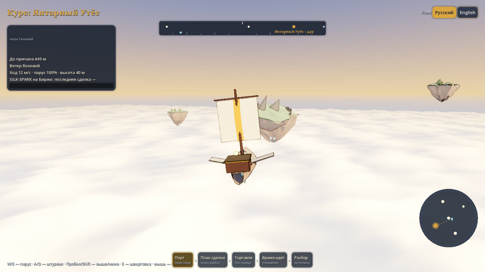
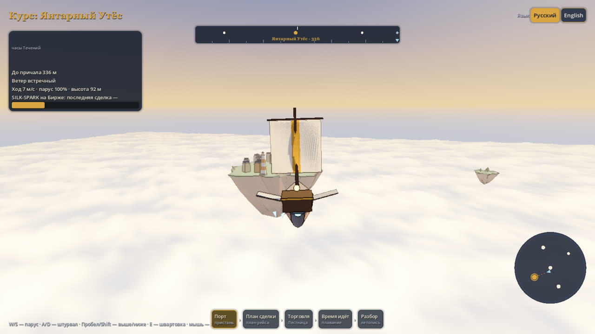
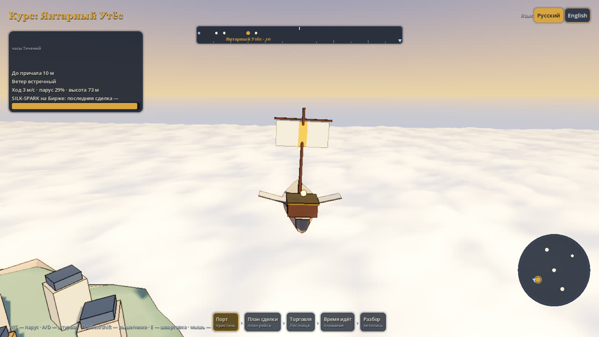
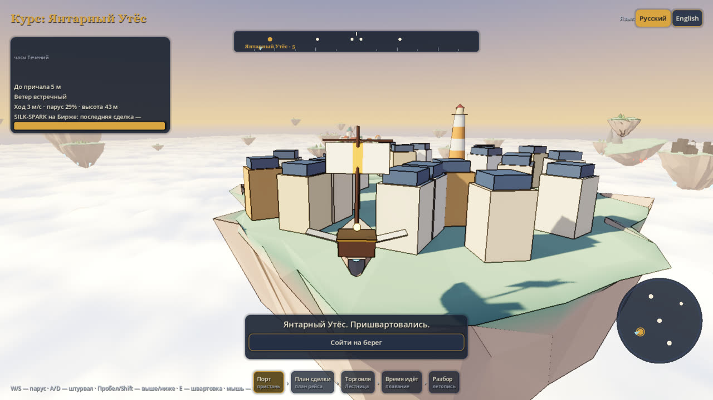
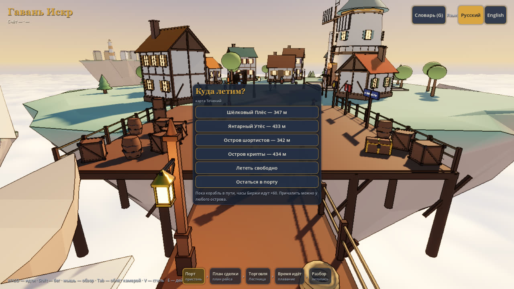
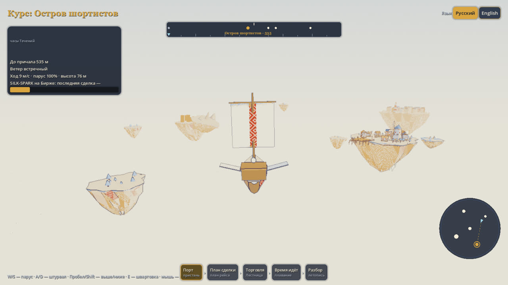

# G3D — the player flies the ship (ADR-0032)

Sailing was a ride along one curve with Space for the sail, and three islands were reached by a fade. Now the
player takes the wheel and flies «Попутчик» over the cloud sea between all five islands.

Recording (harbour → Amber Cliff, a helmsman steering by the compass, a frame every 0.5 s): [flight.gif](g3d-flight/flight.gif)

| Cast off from Spark Harbour | Under way, against the wind |
|---|---|
|  |  |

| Coming down off Amber Cliff's pier | Moored |
|---|---|
|  |  |

## How it works for the player
- **At any pier, E at the ship opens the chart**: the other islands with their distance, "fly free", "stay in port".
  The choice only puts a mark on the compass — the ship may moor at any island.

  
- **Keys**: W/S let out and take in the sail, A/D the wheel, Space up, Shift down, E moor, mouse drag looks round,
  the wheel of the mouse moves the camera in and out.
- **Wind matters**: full sail makes 14 m/s in still air, 21 with the wind astern, 7 against it; with no sail the ship
  drifts at 3.5. The HUD says fair / cross / head wind; a pennant on the compass shows where it blows.
- **Compass** (top): a dot for every island where it lies from the bow, the marked one in brass with its distance.
  **Chart** (bottom right): the world from above, the ship as an arrow, the rim is the edge of the world.
- **Mooring**: within 16 m of a pier and under 9 m/s the prompt "E — moor" appears. Too fast near the marked pier,
  the HUD says to take in sail.
- **Islands are solid**; one can fly over them or, where the rock is shallow, under them. **The world has an
  edge**: 620 m from the middle the Current pushes the ship back and a line on the HUD says so.
- **Time runs while under way**: the exchange clock goes ×60 from casting off to mooring, as before, and the Anchor
  is watched; a longer way round costs exchange time.
- **The storm** of the first voyage of a day now lies across the way by distance flown (30–72 % of the straight
  distance to the marked island; of 400 m when flying free): the ship is slower and gusts push her sideways.
- **Mara's rule holds**: casting off asks the day loop for the SAILING state exactly as before — with cargo and no
  Anchor the ship does not leave. The signposts on the Spark Harbour wharf remain as shortcuts that mark their
  island and cast off the same way; the instant "packet boat" is gone.
- On landing the island's wind restyles the captain, as before.

A voyage begun on Silk Reach is drawn in Silk Reach's technique until landing (here in a storm):



## Where things live
| File | What |
|---|---|
| `game3d/scripts/flight_model.gd` | The rules of flight, pure: sail, wheel, height, wind, solid islands, the edge, mooring |
| `game3d/scripts/ports.gd` | Every island as the ship sees it (berth, rock, name) and a helmsman for tests and the demo |
| `game3d/scripts/voyage.gd` | The scene: keys → model → picture; clock ×60, storm, Anchor watch, mooring |
| `game3d/scripts/ui/flight_compass.gd`, `flight_chart.gd`, `flight_chart_panel.gd` | Compass strip, round chart, the "where to?" chart |

## How to rerun
```
godot --path game3d --resolution 1600x900 -- --flight=<dir> --island=harbour --to=amber     # a frame every 0.5 s
godot --path game3d --resolution 1600x900 -- --flight=<dir> --island=silk --to=shorts --storm
godot --path game3d --resolution 1600x900 -- --flight=<dir> --island=harbour --chart          # the chart at the pier
godot --path game3d --resolution 1920x1080 -- --flight=<dir> --island=harbour --to=crypto --measure
```

## Checked
- GUT 125 green. New: `test_flight_model.gd` (11: wind, wheel, sail, height limits, the edge cannot be crossed, an
  island is solid, over and under, bearing, mooring, every port can be left, **a helmsman reaches every island from
  every other in three winds** — 60 flights) and `test_voyage_flight.gd` (5: start at the berth, moor at another
  island than the one marked, flying free and the storm, compass and chart geometry, the chart at the pier and the
  day loop's refusal). `test_voyage_model.gd` went with the model it tested.
- Frame rate under way at 1920×1080: average 433, 1 %-low 412 (calm, from Spark Harbour); 384 / 378 in a storm from
  Silk Reach.

## Not done, not checked
- **Not flown by hand.** Every flight here was steered by the helmsman in `Ports.steer` or by tests; how the wheel
  feels (turn rate, how fast speed builds, the camera) nobody has judged yet.
- No server was running: the clock labels are empty in the pictures, ×60 and the Anchor watch were not exercised
  live (their code is unchanged).
- `--demo` (the M3 screenshot run) was not re-run; its hooks are kept, its voyage pictures will differ.
- The helmsman's storm flight from Silk Reach to the short sellers' island did not reach the pier within the tool's
  75 seconds (677 m flown against the wind); no test covers a whole voyage in a storm.
- Far islands are simple shapes until landed on; the small decorative islets are not solid.
- A head wind halves the speed and there is no tacking: flying straight into the wind is just slow.
- No auto-pilot for the player, no beacon lights on the piers, no sound.
