# G3D — the index island: a canal town painted in oil (ADR-0035, supersedes 0033)

The index island has a second look, from Aika's eight sheets (`docs/design/concepts/59…66`): a town of the Dutch
Golden Age in soft oil paint. The first look — the pastel toy town — read as childish for a grown-up method; it is
kept for another island (`G3D-toy-town.md`). **Still a place and a style only**: nothing can be bought here; how
index investing works in the game waits for intent 03 (question 9).

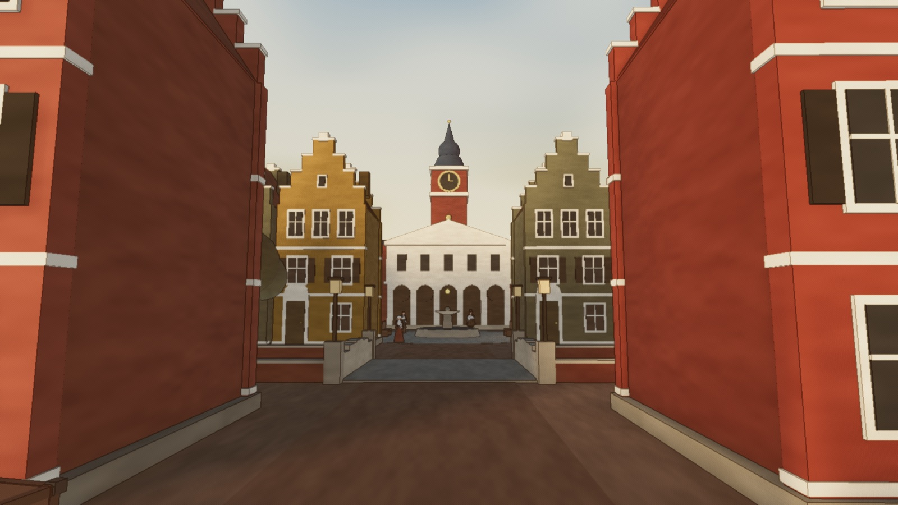

| The town from above the pier | The canal from the street's bridge |
|---|---|
| 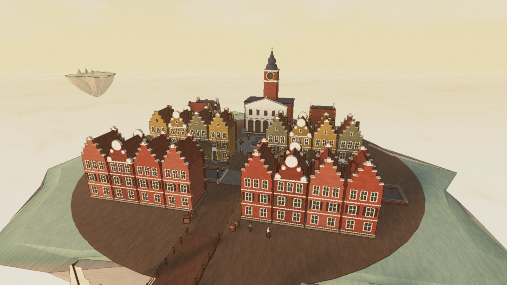 | 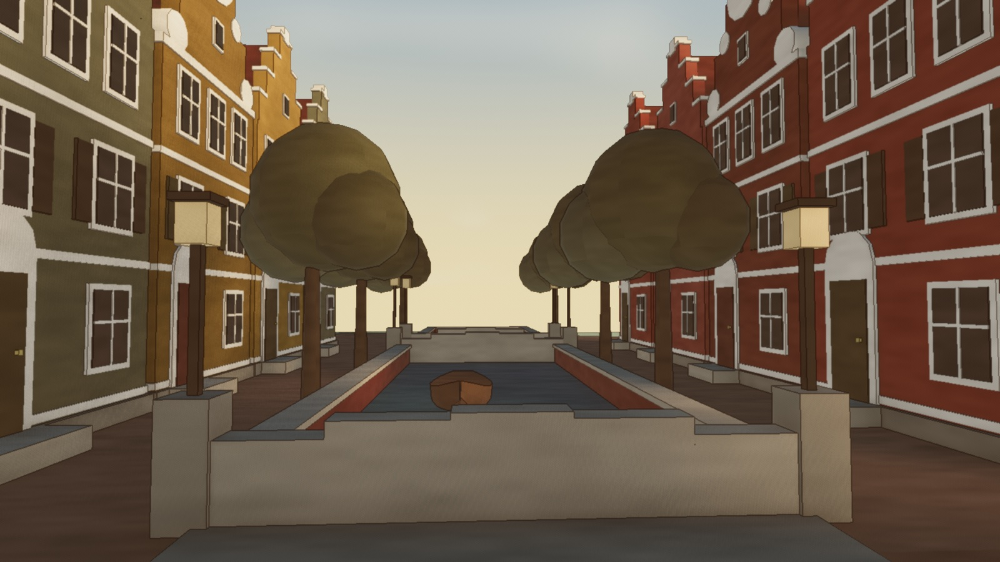 |

| The quay: doors, lindens, lanterns | The Exchange under its clock tower |
|---|---|
| 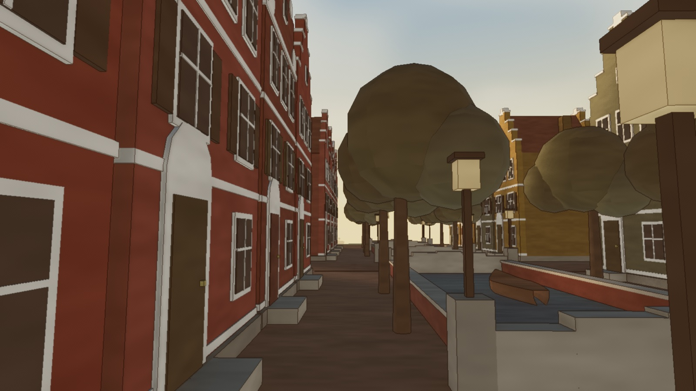 | 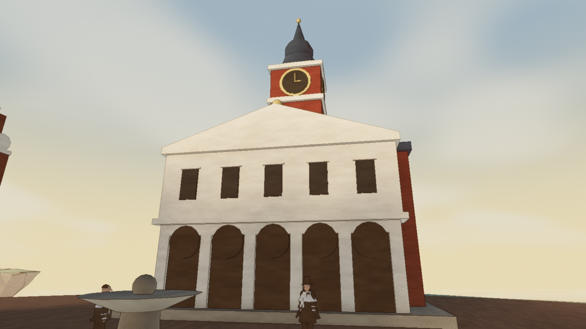 |

| The square: the fountain, the cheese stall, gables | The pier and the sky ships |
|---|---|
| 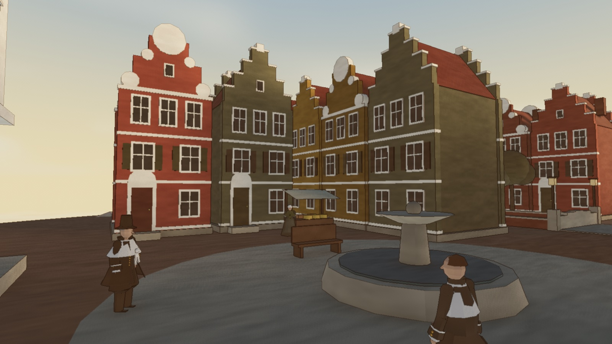 | 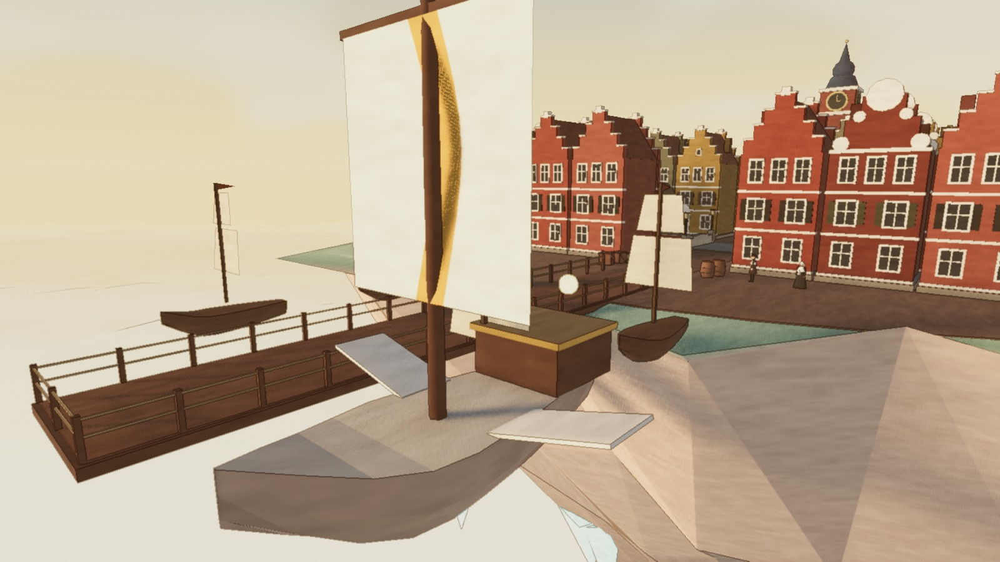 |

## The technique: soft oil paint
- **Muted, warm colour**: a third of the saturation taken out, everything leaning to ochre; darks go to warm
  umber and never to black, lights to cream.
- **Melted shading**: a blur of 1.5 pixels runs the facets of the low-poly light together; silhouettes stay
  clear, with a soft umber edge instead of an ink line.
- **Brush strokes that belong to the world**: slow noise laid out along each surface in world space (on the
  captain: in the captain's own space) varies the paint by a few percent in long strokes. It stays on the wall.
  There is no "oil filter" over the screen: those boil.
- **Golden haze** over distance; a sky gold below and grey-blue above with big soft clouds fixed to the world.
- **Canvas**: a faint weave, 2.5 % — the only layer that lies on the screen.
- **A low, soft sun**: 16° above the horizon on this island (the others keep 34°) — a row of the style table can
  now set its own hour.
- Nothing is animated by the effect. V gives the plain version — umber and cream:

  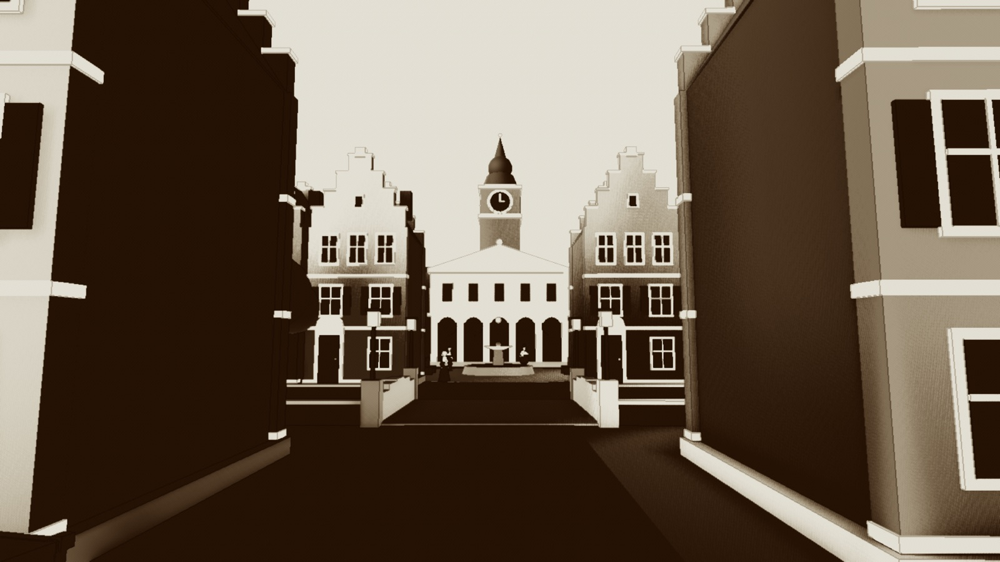

## Easy on the eyes — measured
Mean change between neighbouring frames, of 255 (a frame every 0.1 s):

| | Index island, in oil | for scale |
|---|---|---|
| camera standing still | 0.01 | the toy town 0.10, race 0.28, crypto 0.66 |
| walking 12 m up the street | 14.0 | toy 4.7, race 10.2, watercolour 11.4, crypto 16.9, noir 29.7 |
| standing and turning 2° a frame | 12.5 | toy 7.0, race 15.8, crypto 24.6 |

Standing, nothing moves at all. Walking, the number is the highest after crypto and noir: the street begins between
two tall red walls that fill a third of the frame each and slide past. It is the town's geometry and colour, not a
pattern — but it is not as calm as the toy town was. Recordings: [walking](g3d-index/walking.gif),
[turning](g3d-index/turning.gif).

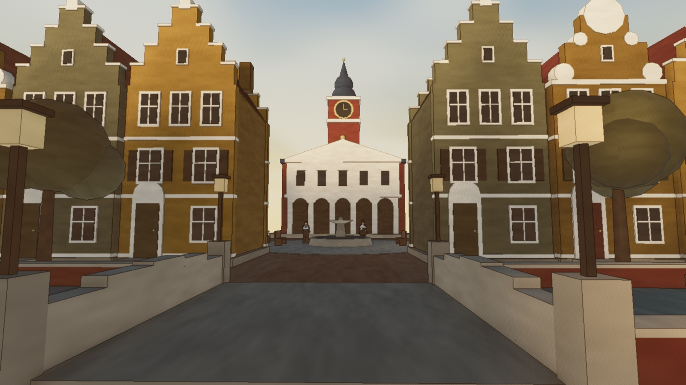

## The town
- **The canal** crosses the town between brick quay walls, closed at both ends, with three stone crossings: the
  street's wide bridge and two footbridges. Boats lie on it.
- **Twenty narrow houses** with stepped or bell gables stand in two rows along the quays and round the square:
  brick, ochre and olive fronts, cream bands and window frames, shutters, arched doors up a step, tiled roofs in
  red and slate blue. A test checks that no two neighbours share a front.
- **The Exchange** closes the street: a cream front with an arcade of five arches and a pediment, brick wings,
  a brick clock tower with a slate spire. Its gates are shut — the courtyard waits for the mechanics.
- **The fountain still drops a coin** every four seconds: the regular contribution.
- Lindens on the quays, lanterns on the bridges, a cheese stall, benches, barrels and crates, sky ships at the pier.
- The pier, the berth and the row in `Ports` are unchanged: the island is where it was on the chart.

## Its people, of every age (sheet 63)
The merchant before the Exchange, the cheese woman at her stall, a young woman, a young father with his child, an
old couple. The island does not say "this is the right answer" (intent 03): next to the method and its real terms
— index fund, diversification, regular contributions, the fund's fee (TER), compound interest — they tell the
costs: the basket lost a third, even a half; it took years to come back; the neighbour who sold at the bottom;
boredom as the hardest part; nothing here is quick. A test checks that the costs are said. Nobody recommends anything.

| | |
|---|---|
| 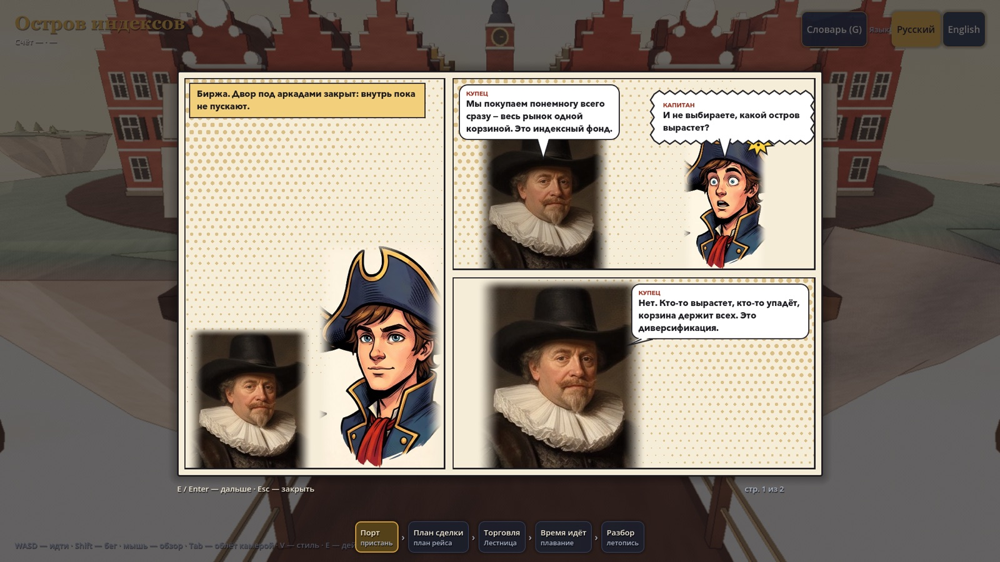 | 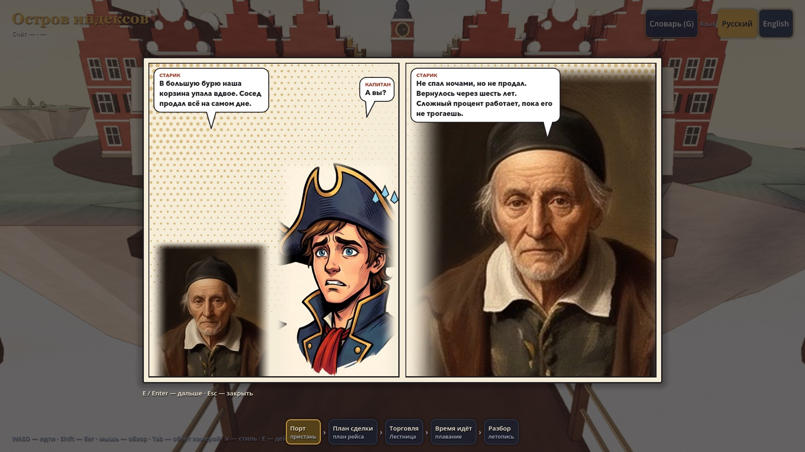 |

## The captain is redrawn in oil on landing
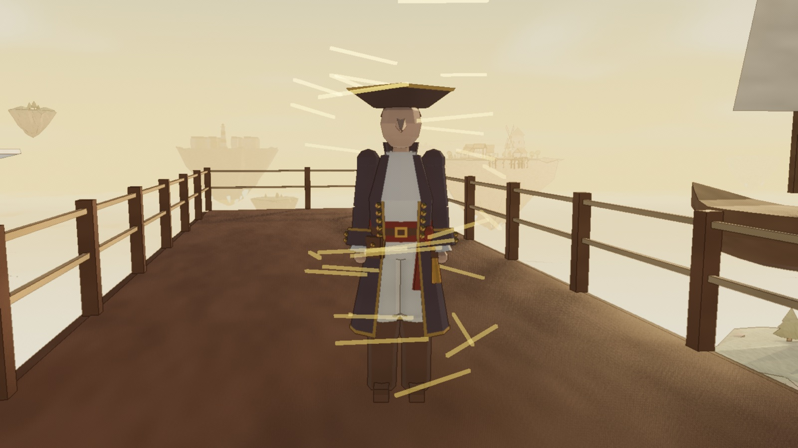

Recording: [captain-oil.gif](g3d-index/captain-oil.gif).

## Numbers
- World audit on the island: **0 findings** (604 free points of 927, 9 400 of 9 552 cells reachable, 60 villager routes). On the way it caught: a parapet low enough to climb into the canal, the
  Exchange's columns being walked through, bench backs hanging in the air, a stroller stuck by the merchant.
- Frame rate at 1920×1080: average 100–119 over the captain's camera and seven fixed views; 1 % low 64–95.
  In the first run after a shader change one camera jump dipped to 42 for a moment.
- GUT: 136 tests, all green (the island's six rewritten; one of them keeps the toy technique alive).

## Not built
- **The overcast day** of sheet 65: it belongs with the market's phases.
- The inside of the Exchange (the courtyard, the board), the windmill of sheet 61, the family album as a thing to
  open, the growing garden, flower boxes, carved ornaments and iron railings.
- The canal is water at street level between parapets, and the bridges are level: the islands' ground is one
  flat cap. From above it reads as a full canal, not a deep one.
- Costumes are approximate (no ruff or lace as such, no cane); one face each, and the portraits are rectangles
  cut from the dark sheet.

## How to see it
`godot --path game3d` → sail from the harbour (the chart at the ship) to «Остров индексов»; or
`godot --path game3d -- --views=<dir> --only=index`, `--stroll=<dir> --island=index [--still|--turn]`,
`--attune=<dir> --island=index`, `--talk=<dir> --island=index --only=index_exchange`.
