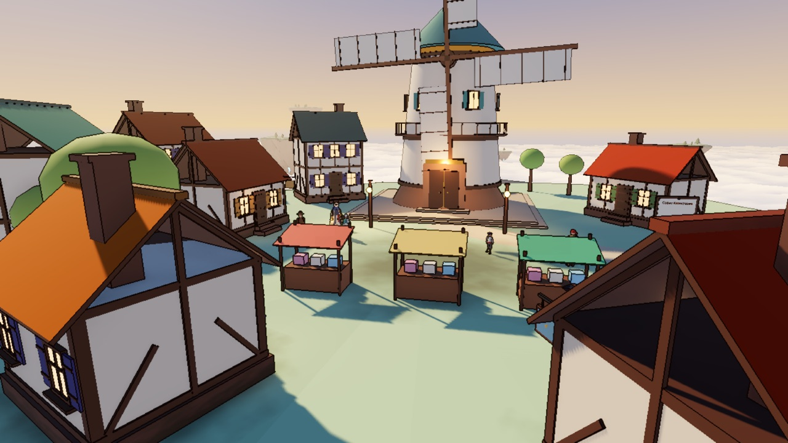
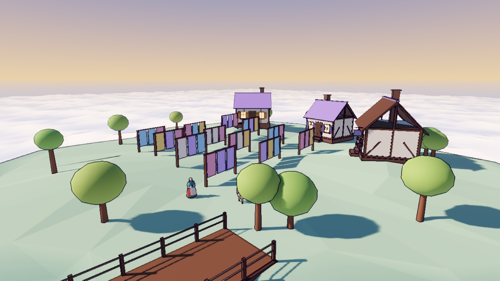
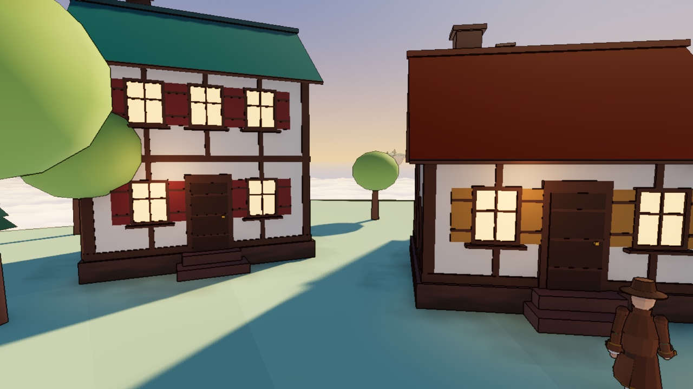
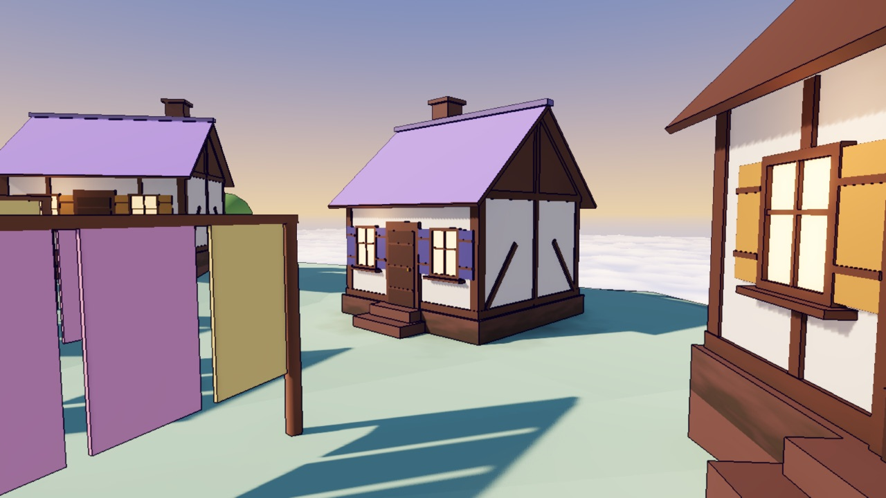
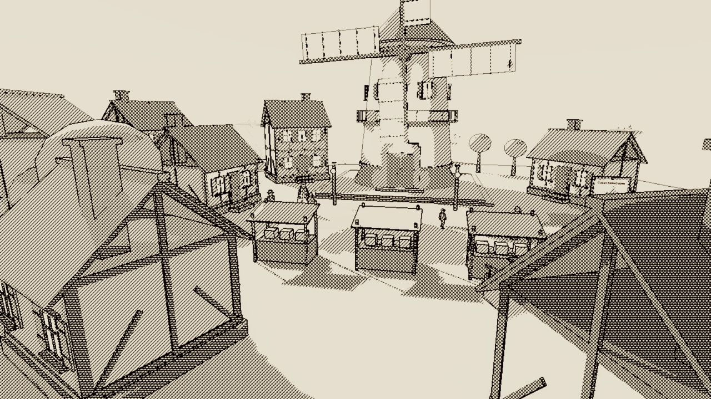
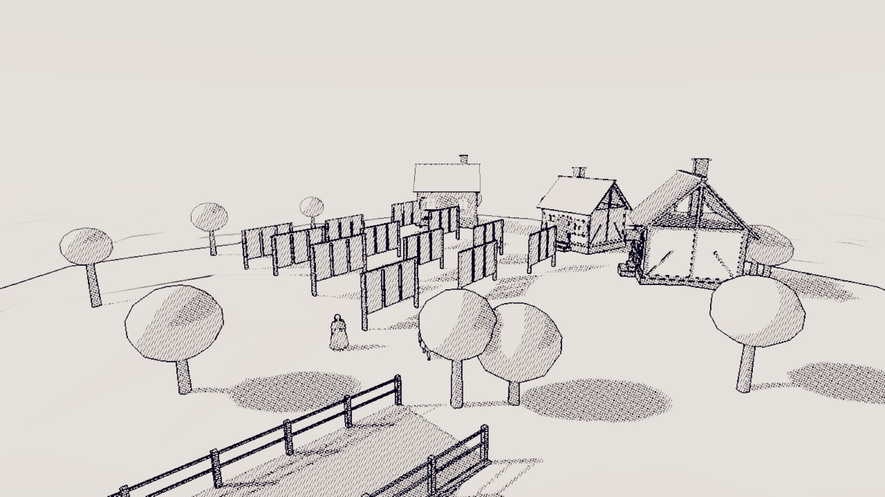
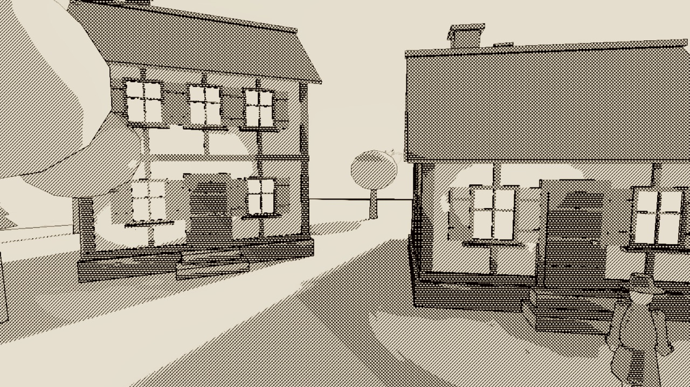
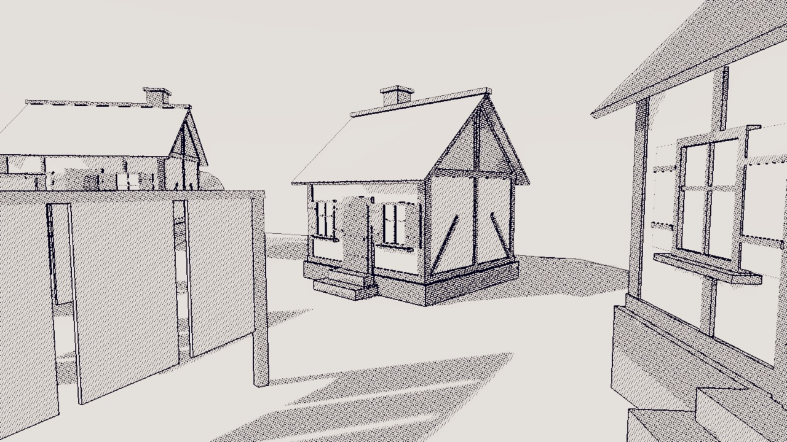
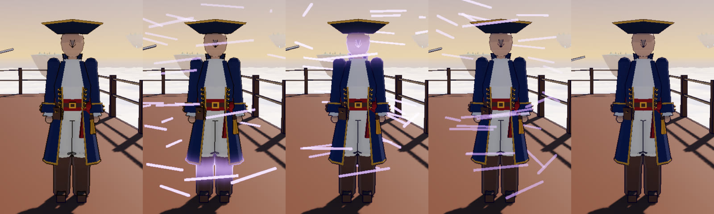
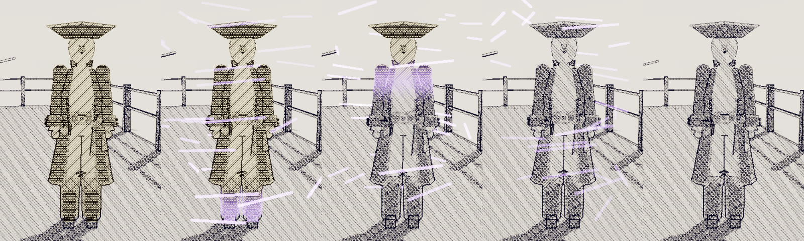

# G3D: every island its own variant of the style, and the wind that restyles the captain

ADR-0025 (Proposed). Aika's ask: the islands differ "only a little" — palette, the line's thickness and colour, the
hatching, the light — and when the captain steps onto a new island, the island acts on them: a short piece of magic,
and the captain is drawn the way this island is drawn.

## The two variants

One table, `game3d/scripts/island_style.gd`. Spark Harbour is the look of ADR-0024 exactly as approved.

| | Spark Harbour (home) | Silk Reach |
|---|---|---|
| Line colour | warm sepia-black | indigo, the dye of the silk racks |
| Line width | 1.3 px | 1.05 px, finer, like thread |
| Colours under the line | as painted | 4% cooler |
| Engraving paper | warm cream | cooler, a little pink |
| Hatching | strokes at 45°, 9 px apart | turned by 20°, 7 px apart, like a weave |
| Sun | amber, 1.35 | paler, 1.25 |
| The island's wind | brass yellow | lilac |

A test keeps the variants small: tint within 10% of white, line width within 30% of home, light within 15%.

| | Spark Harbour | Silk Reach |
|---|---|---|
| Outline |  |  |
| Outline, houses |  |  |
| Engraving (V) |  |  |
| Engraving, houses |  |  |

## The island's wind

The captain lands on Silk Reach still drawn the Spark Harbour way. After a moment the island's wind gathers round
them, a wave runs from the boots to the hat, the line it passes lights up in the island's colour, and above the wave
the captain is the old style, below it the new. Two seconds; the captain can walk meanwhile. Sailing back to Spark
Harbour does the same in brass yellow. `Game.attuned` remembers whose style the captain wears.

Outline — frames at 0.3, 1.1, 1.5, 1.9 and 3.1 s:

Engraving — the same frames; here the change is plain: warm paper and wide strokes above the wave, cool paper and a
close weave below:

Moving: [outline](g3d-islands/attune-ink1.gif), [engraving](g3d-islands/attune-ink2.gif) (10 frames a second).

How it is done: the ink post-effect draws with two styles at once. It finds each pixel's place in the world from
the depth buffer; what stands in a 0.95 m column round the captain above the wave's height gets the old island's
numbers, everything else the new. No captain materials change. The swirl is 28 thin streaks made in code.

Record it again: `godot --path game3d --resolution 1280x720 -- --attune=<dir>` (`--ink=2` for the engraving).

## Numbers
- GUT 83 → 88.
- fps at 1080p, harbour and Silk Reach views: 115–119 average. The 1%-low was 55–91 in these runs; the same runs
  with the previous shader gave the same 56–76, and the morning's runs of the same code gave 88–102, so the dips
  are the laptop's state, not this change. The floor of 60 is therefore not shown to hold in the 1%-low today.

## Not done, not checked
- Not played by hand: the sail from one island to the other with the wind at the end was only run by the tool.
- With the ink switched off (V, mode 0) the restyle cannot be seen: only the swirl and the light remain.
- In the outline mode the difference on the captain is small (line colour and width, a slightly cooler tint). That
  is "only a little" as asked; if it should be easier to see, the numbers are one table row.
- The Exchange hall is always drawn the Spark Harbour way (it stands there). The voyage keeps the style of the
  island the ship left.
- Only two islands exist in the game, so there are two rows.
