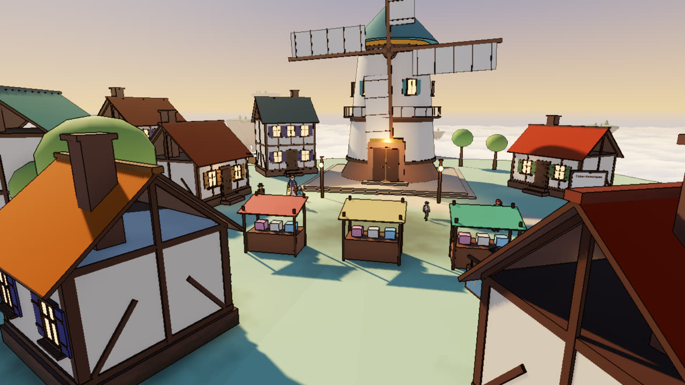
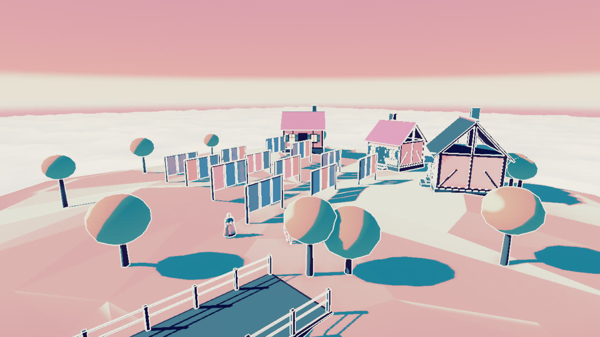
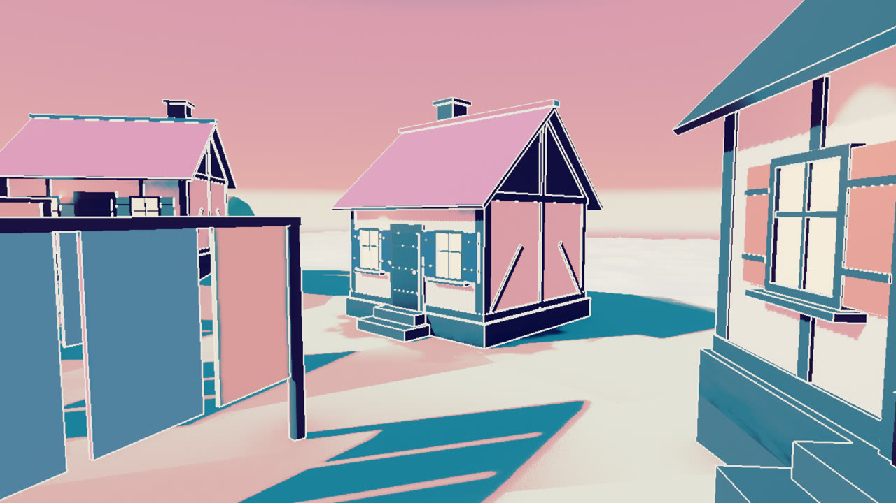
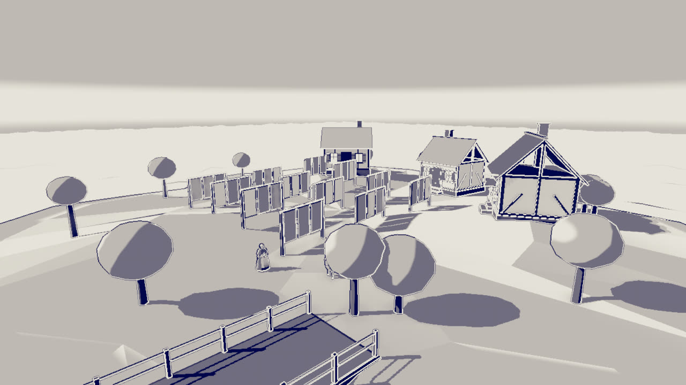
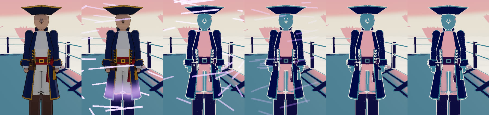
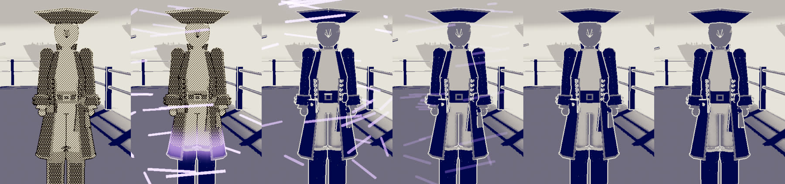

# G3D looks — every island in its own technique (ADR-0026)

Aika: "the islands still look the same". Now an island's row in `game3d/scripts/island_style.gd` names a
**technique**, and the one post-effect (`game3d/shaders/ink.gdshader`) draws it. Spark Harbour is unchanged.

| Spark Harbour — `ink`: dark pen line, flat colour | Silk Reach — `dye`: printed silk |
|---|---|
|  |  |

Silk Reach close up, and its second mode (V): a two-colour print, indigo on cream.

| | |
|---|---|
|  |  |

What `dye` does: colours are sorted by brightness into four dye baths (indigo, teal, rose, cream) and keep about a
quarter of their own colour; the line is light, like the wax line of resist dyeing; a fine weave lies on top.

## The island's wind still restyles the captain
The captain lands drawn in pen and ink, the wind gathers, the wave runs from boots to hat, and above it the old
technique is left. Frames 0.2 s … 3.0 s; recordings: [outline](g3d-looks/attune.gif), [print](g3d-looks/attune-print.gif).




## How to rerun
```
godot --path game3d --resolution 1600x900 -- --views=<dir> --only=silk --ink=1   # or harbour, --ink=2
godot --path game3d --resolution 1600x900 -- --attune=<dir> --ink=1
```

## Checked / not checked
- GUT 88 green (`test_island_style.gd`: no two islands share a technique; home has the ADR-0024 numbers).
- Not played by hand. With the effect off (V) the islands look alike, as before.
