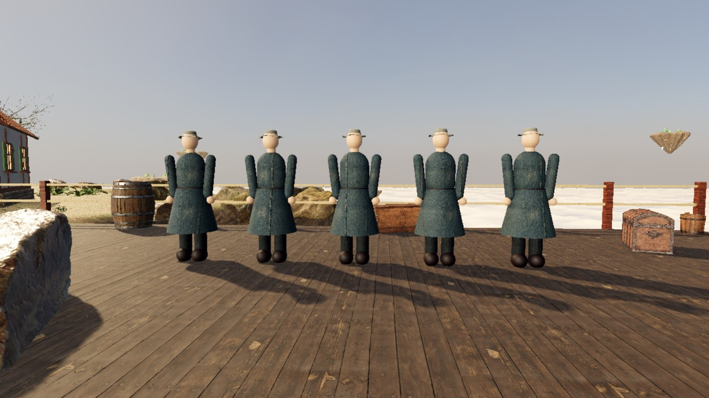
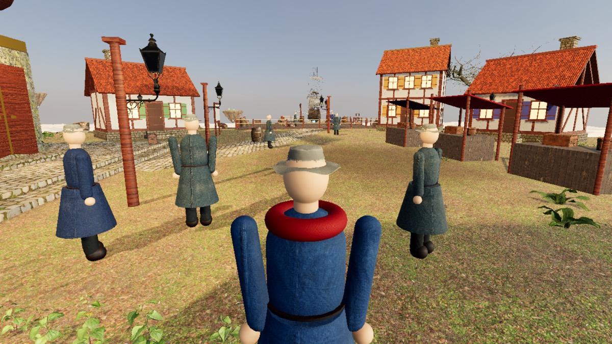
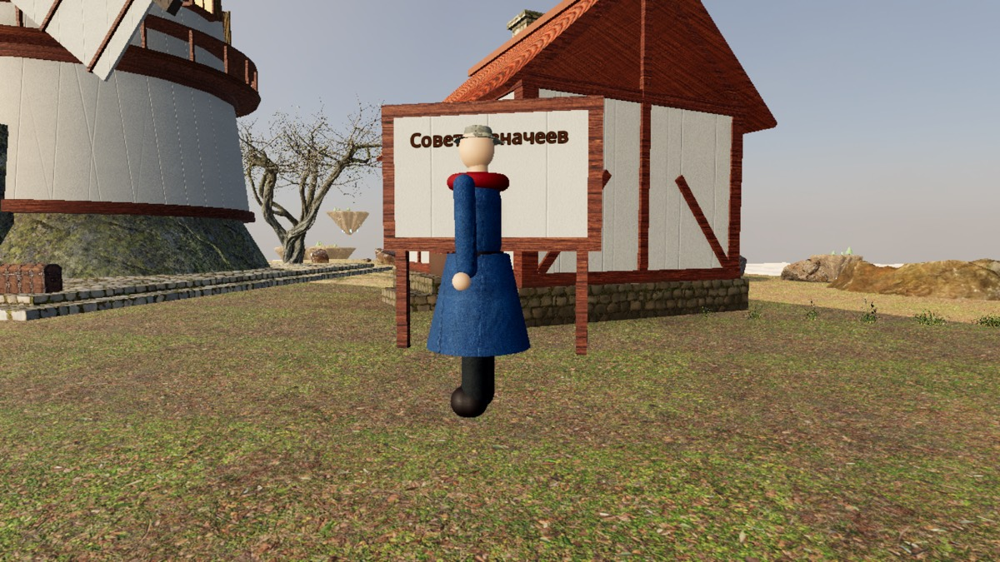
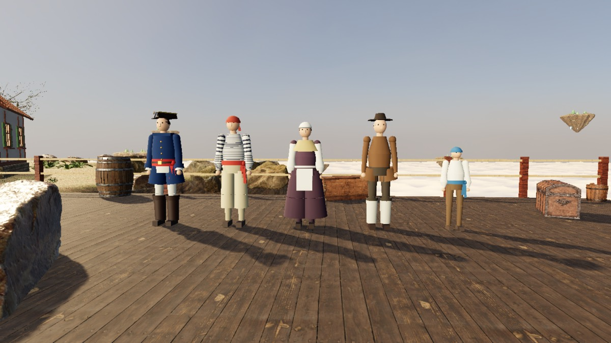
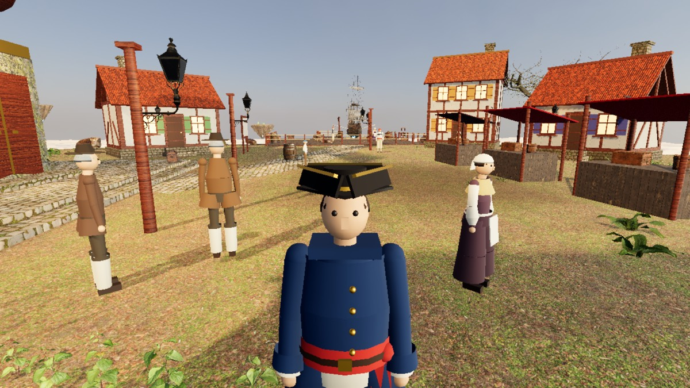
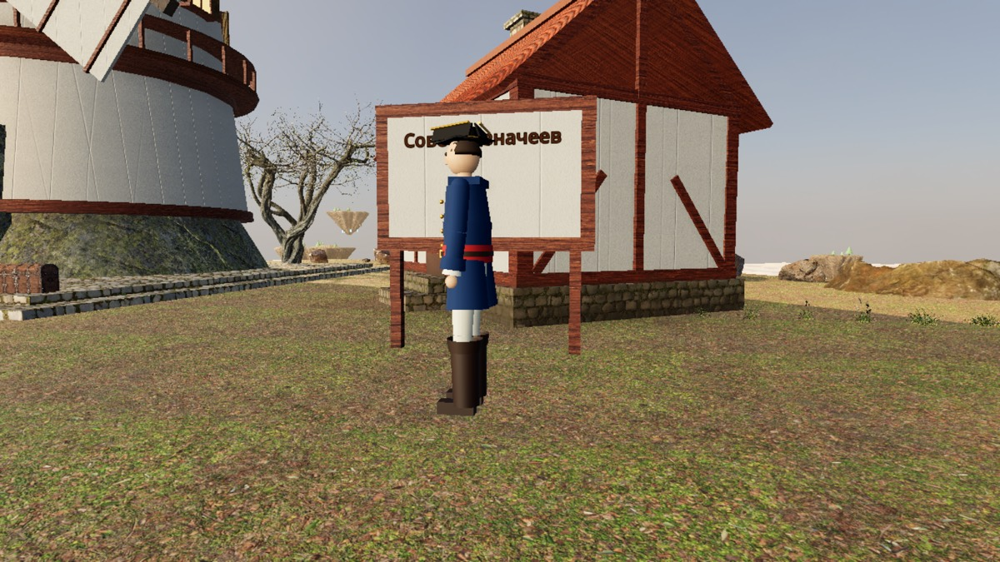
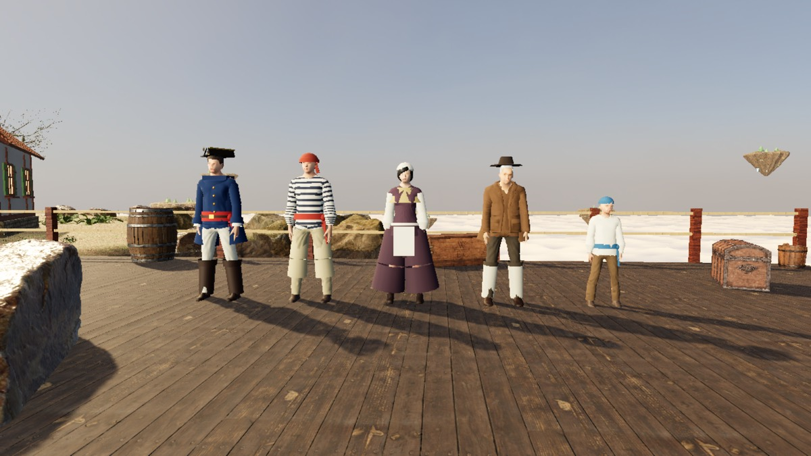
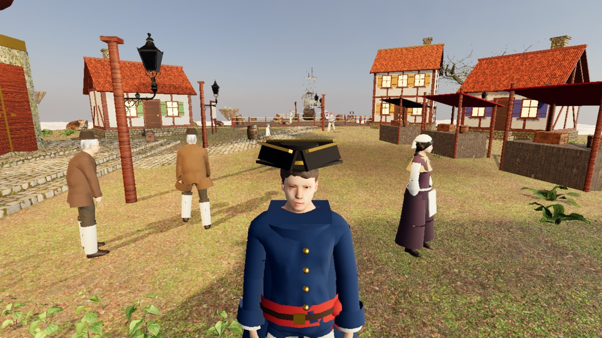
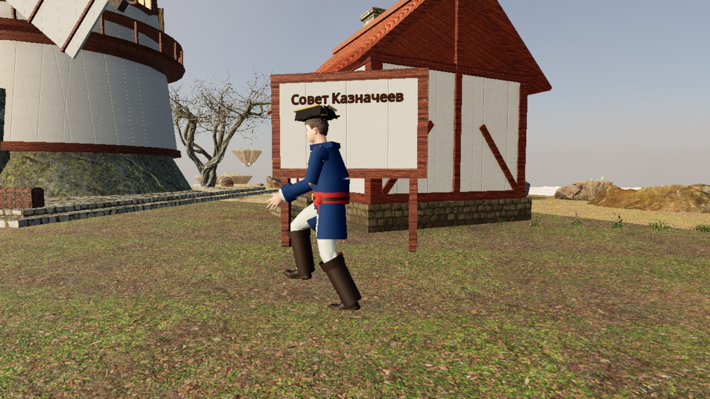

# G3D people — why the characters looked simpler on `main`, and the fix

Aika ran `main` after PR #19 with a fresh `make assets` and saw simpler characters than in the pictures of
`docs/demo/G3D-polish.md`.

## What happened
Nothing simplified the models, and it is not LODs or the costumes. **The MakeHuman people were not on disk.** They are
built with Blender (`game3d/tools/people/build.sh`); they are not in `assets.lock`, so `make assets` never downloads
them. A fresh `game3d/assets/` has the Poly Haven art but no `models/people/*.glb`, and the game silently showed its old
stand-in: five copies of one capsule figure in a teal coat and a fisherman's hat. `Costume` (PR #19) only dressed real
people, so the stand-in had no costume at all. The pictures in PR #19 were taken in a checkout that had the people.

## Before / after (live game, `--gait` and `--people` runs)

| | Line-up of the five roles | The square, the captain's camera | The captain walking |
|---|---|---|---|
| `main`, no people on disk (what Aika saw) |  |  |  |
| Fix, still no people on disk |  |  |  |
| Fix, people on disk |  |  |  |

## The fix
- `Costume.stand_in(role)`: when the people are missing, the person is built whole in code **in the same costume** —
  captain in tricorn, coat, sash and boots; sailor in stripes, bandana and slops; trader, townsman, child. Five different
  figures instead of five copies. It has no skeleton, so it glides and bobs (no gait, no foot IK).
- `make assets` now says so when the people are missing, and builds them if `BLENDER` and `MH_ASSETS` are set. The game
  prints a warning at start.
- Ольва Перо was a capsule figure even with the people on disk (she had no model assigned); she is a dressed trader now.
- GUT 74 → 75: the stand-in exists for every role, the roles differ, the tricorn is on.

## Not solved here
A fresh clone still cannot get the real people without Blender + MPFB + the MakeHuman asset pack. The four files are
11.6 MB of CC0 output. Where they should live is Aika's call (see the PR).
