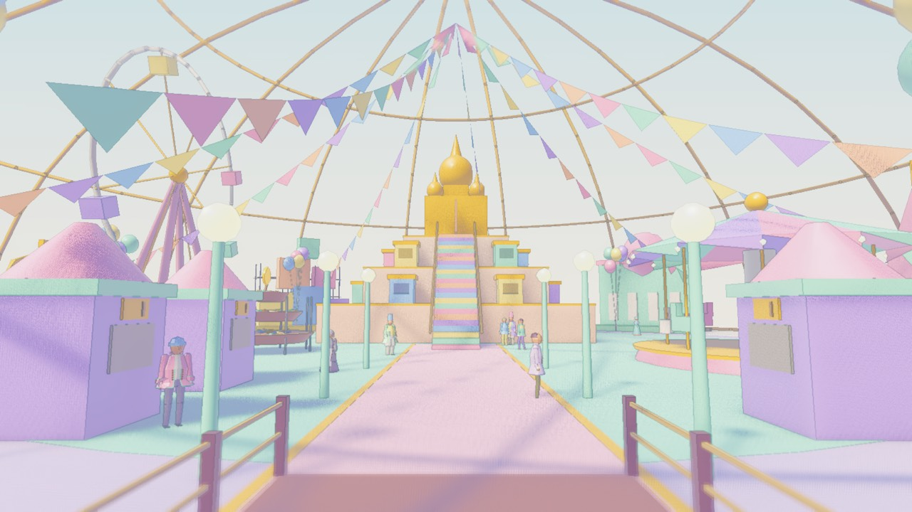
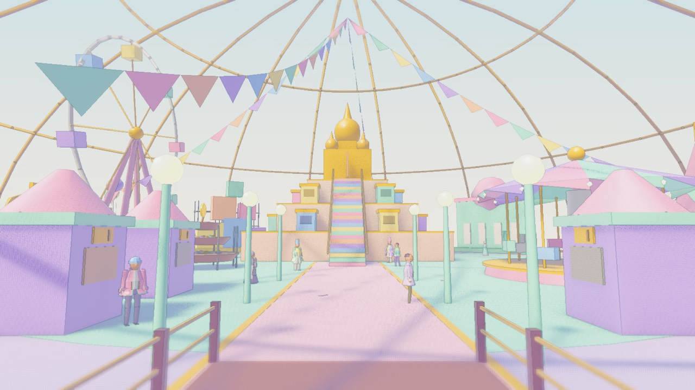
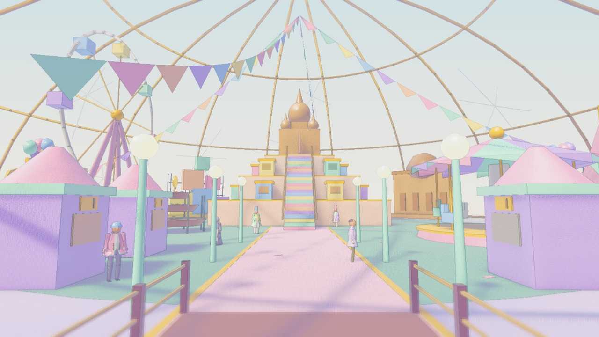
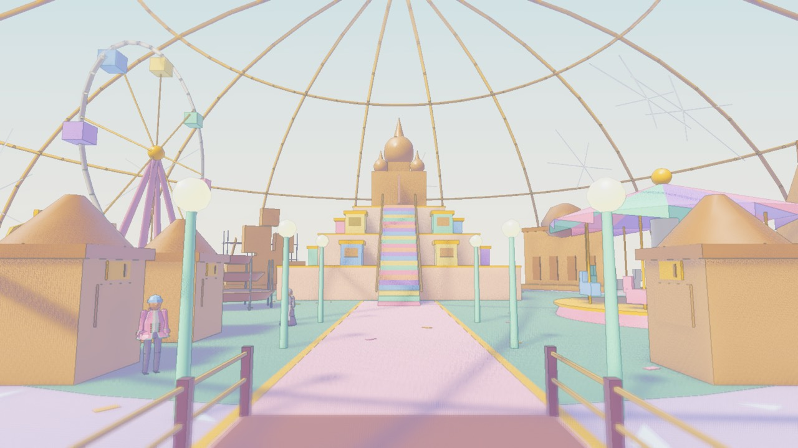
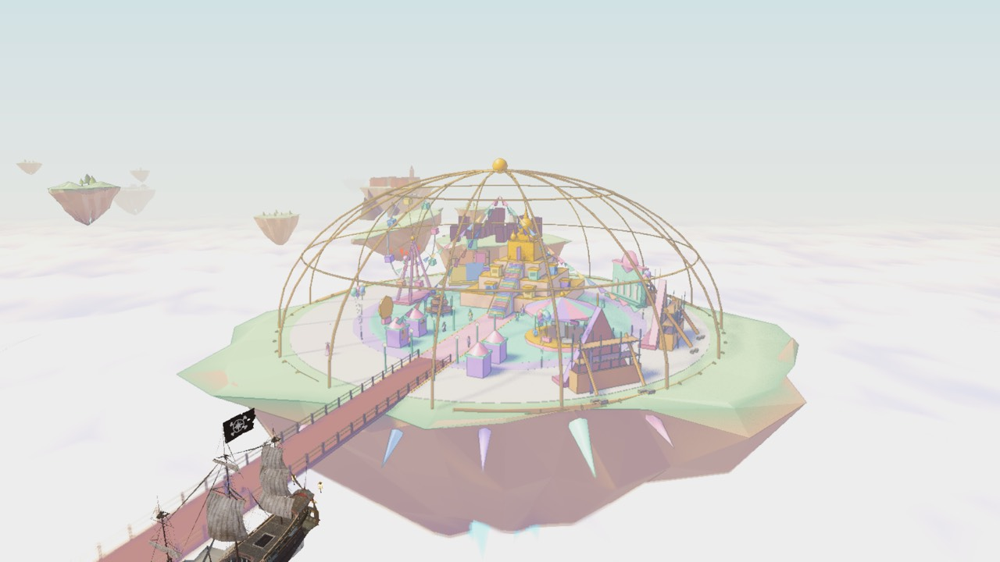
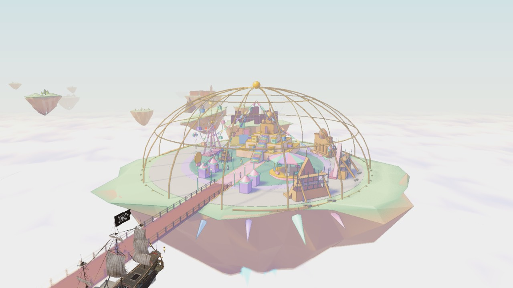
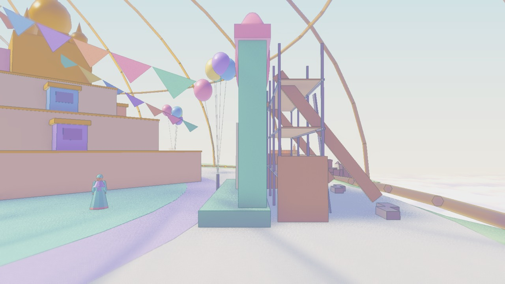
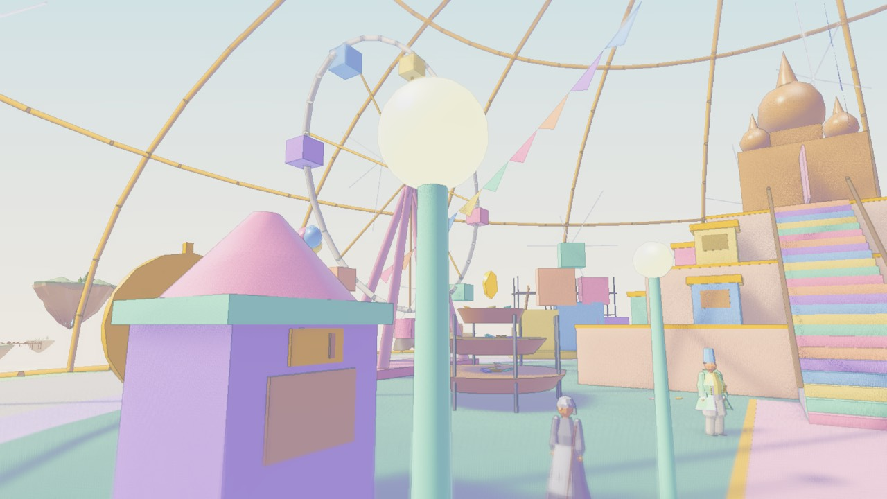
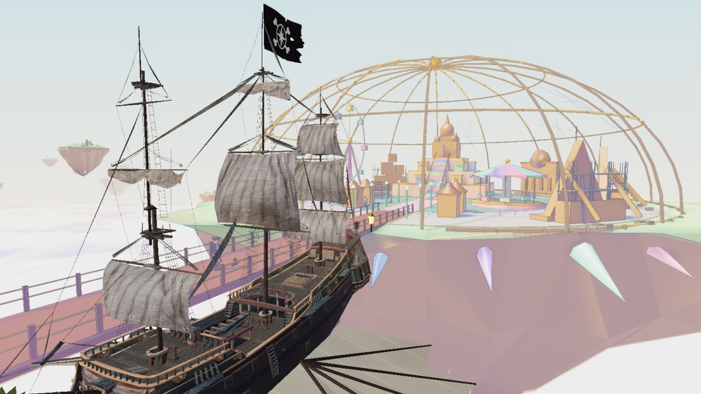

# G3D — the pyramid island (ADR-0038)

A pastel fairground under a gold-ribbed glass dome, after Aika's sheets 73–79. Every front is a facade on plywood and
grey scaffolding; the fair decays a stage per landing (`PyramidIsle.stage(visits)`). Captured with
`--views=<dir> --only=pyramid --stage=N` at 1920×1080.

| Stage 1 — shining, crowded | Stage 2 — fewer people, rides slower |
|---|---|
|  |  |
| **Stage 3 — cracks, bare plywood, booths shut** | **Stage 4 — panes gone, shards and tickets on the ground** |
|  |  |

From the approach, stages 1–4:

| | |
|---|---|
|  |  |
|  |  |

Behind a front (stage 1), the rides at stage 3, the pier at stage 4:

**Frame rate** (`--fps --only=pyramid`, 1920×1080, window on top): stage 1 — the captain's camera 116.7 average,
1 % low 58.1; the fixed views 116–119 average, lows 56–85. Stage 4 — 118.0 average, low 67.1; views 118–119,
lows 62–91.

**Not built** (ADR-0038 §6): the roller coaster, hot-air balloons and the airship of sheet 73; the lettering on
sheets 75 and 78 (pictograms instead); rides that carry people.
