# G3D — the race island: the Grand Prix of the Winds as an art-deco poster (ADR-0034)

A seventh island, from Aika's seven sheets (`docs/design/concepts/52…58`): our own sky race — sky skiffs with sails
and air screws on a track in the air. **A place and a style only**: nothing is raced or repaired there; how a race
and a pit stop work in the game waits for intent 03 (question 13). No real racing brand, team or logo.

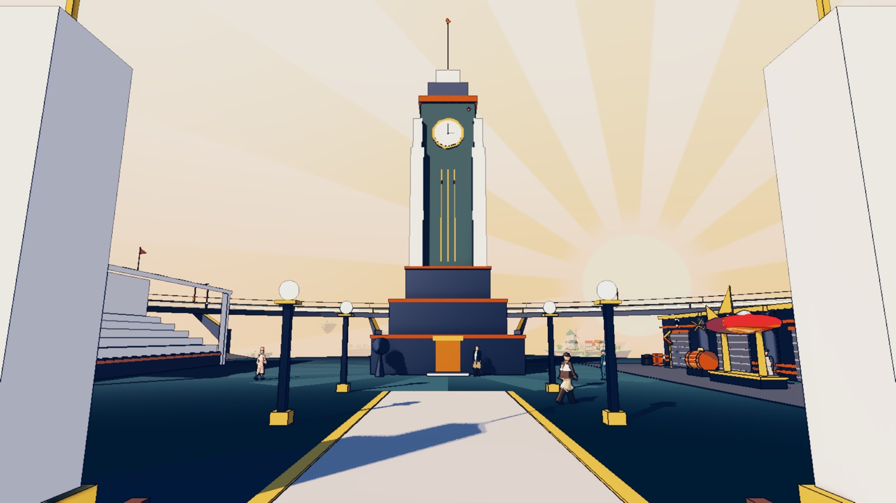

| The island from above the pier: the track in the air round it | The timing tower |
|---|---|
| 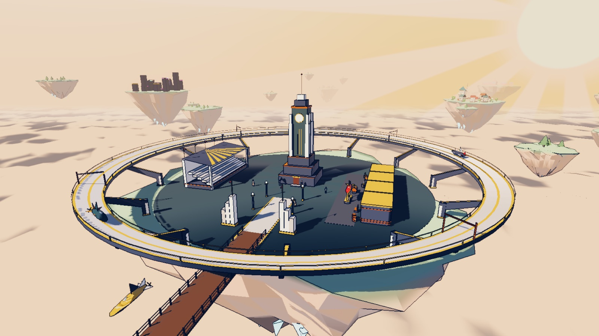 | 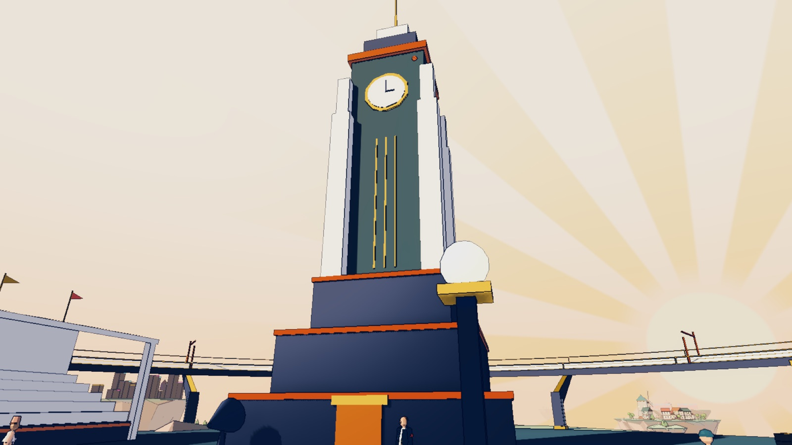 |

| The pit lane: four boxes, «Феникс» on the lift, the fuel cart | The grandstand under its sunburst canopy |
|---|---|
| 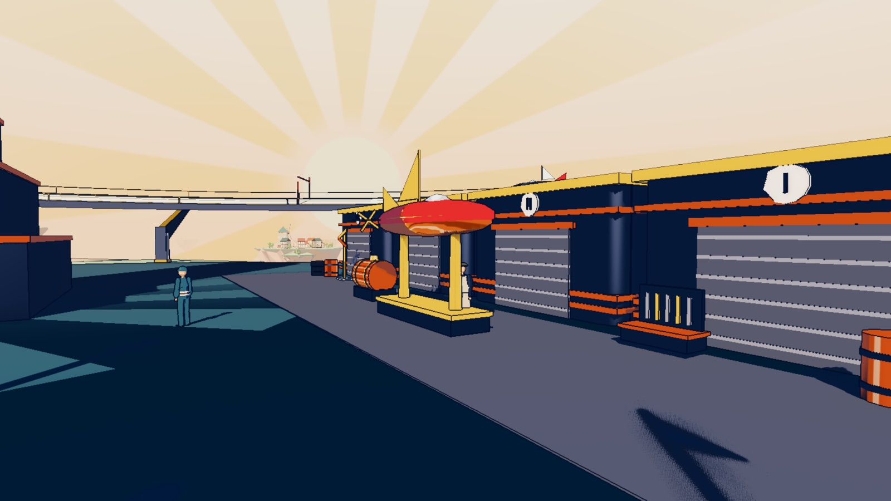 | 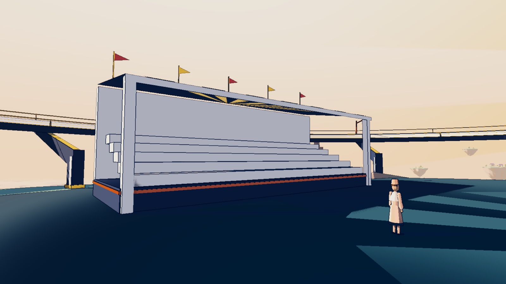 |

| Under the track: the ribbon, the rails, a signal gate, an arm | The pier, the ship and «Адмирал» |
|---|---|
| 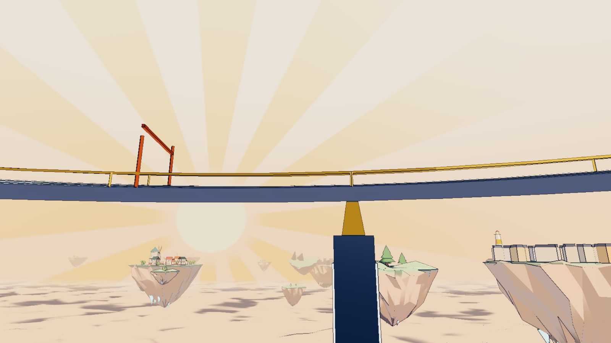 | 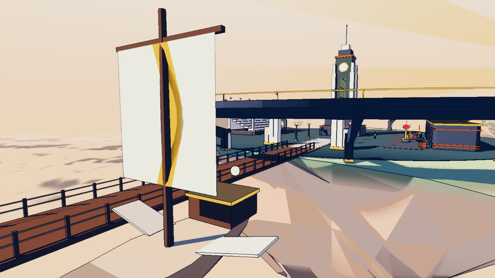 |

## The technique: a streamline poster
- **Flat poster colour**: every surface keeps its hue and is printed in a few flat tones; shade leans to navy,
  light to ivory.
- **Metal in clean stripes**: brass and copper get a bright and a dark band chosen from the surface's **normal** —
  a curved barrel is striped, a flat plate is one tone. The bands belong to the surface and do not crawl.
- **A thin navy line** on edges; anything truly red is the one signal red.
- **The poster's sky**: peach low, ivory high, a low sun behind the tower and twelve wide brass rays. They are
  fixed to the **world**, like a real sun, not to the screen: turning the head moves them as the horizon moves.
- Nothing is animated by the effect, and nothing is laid out on the screen (a test reads the shader for that).
  V gives the plain version — ivory and navy, no stripes, no rays:

  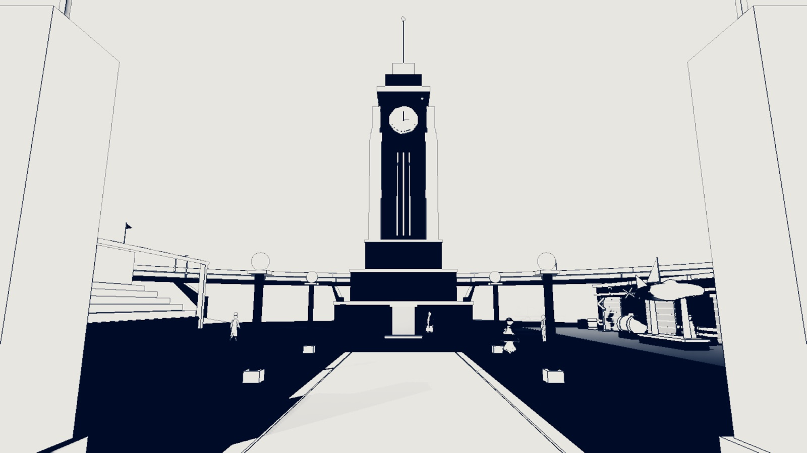

## Easy on the eyes — measured
Mean change between neighbouring frames, of 255 (a frame every 0.1 s):

| | Race island | for scale |
|---|---|---|
| camera standing still | 0.28 (three people walking in view) | index 0.10, crypto 0.66, noir 1.1 |
| walking 12 m up the avenue | 10.2 | index 4.7, watercolour 11.4, crypto 16.9, noir 29.7 |
| standing and turning 2° a frame | 15.8 | index 7.0, crypto 24.6 |

About as calm as the watercolour island, well below crypto and noir; livelier than the pastel town because navy
shade lies next to ivory. The contrast is in big flat shapes, not in a pattern. Recordings:
[walking](g3d-race/walking.gif), [turning](g3d-race/turning.gif).

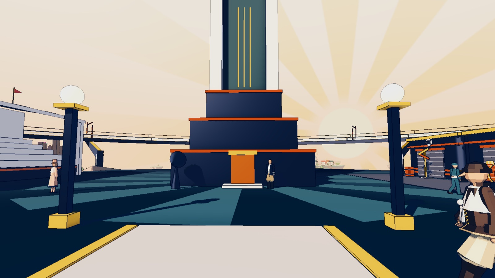

## The island
- **The track**: a banked ivory ribbon with brass bands and a brass middle line, 5 m wide, 46 m from the centre and
  6.6 m up — beyond the island's fence and above every head — on twelve navy arms from stepped feet on the rim,
  with brass rails and four red signal gates. It is scenery: nobody reaches it yet.
- **The timing tower** in the middle: three navy steps with copper bands, a teal shaft with stepped ivory fins and
  brass lines, a clock on each face, a copper crown, a mast with a red light. Its door is a talk with the marshal.
- **The pit lane**: four numbered boxes with rounded shoulders, copper bands and ribbed shutters; «Феникс» on a
  lift, the copper fuel tank on its cart, barrels, stacks of wheels, spare air screws, a tool trolley. The chief
  mechanic stands there.
- **The grandstand** with a brass sunburst on its canopy and five flags; **ceremonial gates** of stepped ivory
  slabs at the pier; lamps along the avenue; a loudspeaker by the tower.
- **Four sky skiffs** of sheet 55, as decoration: «Быстрая звезда» and «Буря» on the track, «Феникс» in the pit,
  «Адмирал» moored by the pier. They do not move (a test).
- **On the flight chart**: a seventh row in `Ports`; the island lies 408 m west of Spark Harbour. The ship's solid
  for it is 50 m wide, so nobody flies through the track. The helmsman who steers by the compass flew there from
  the harbour and moored:

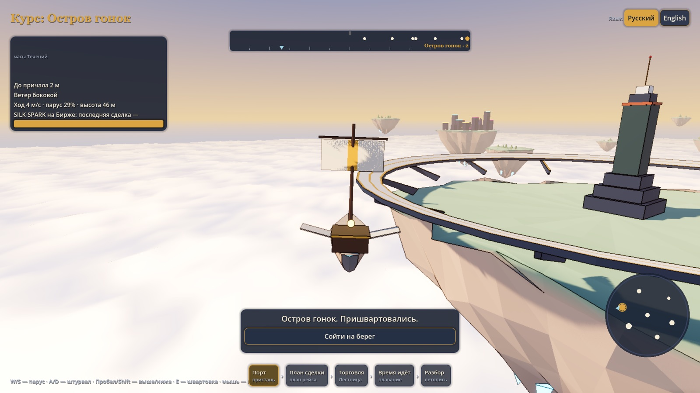

## Its people (sheet 56)
The marshal by the tower, the chief mechanic in the pit lane, and the aviator, the crew member and the spectator
strolling. They talk about what a race has in common with a trade — a rule decided before the start (the stop
order), a cost known beforehand (the fee), the lap on paper (the trading journal), small pay for work, a loss
whose size is known in advance. Nobody recommends anything.

| | |
|---|---|
| 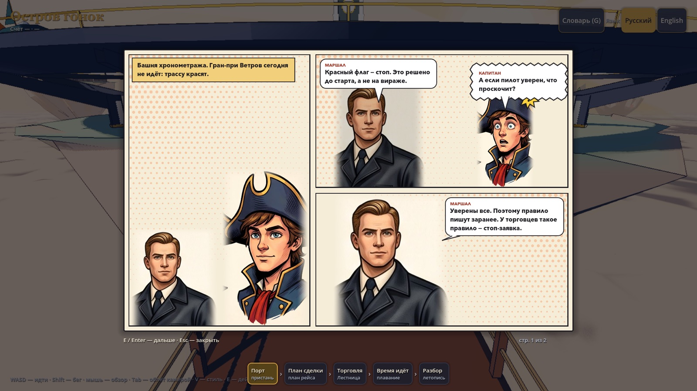 | 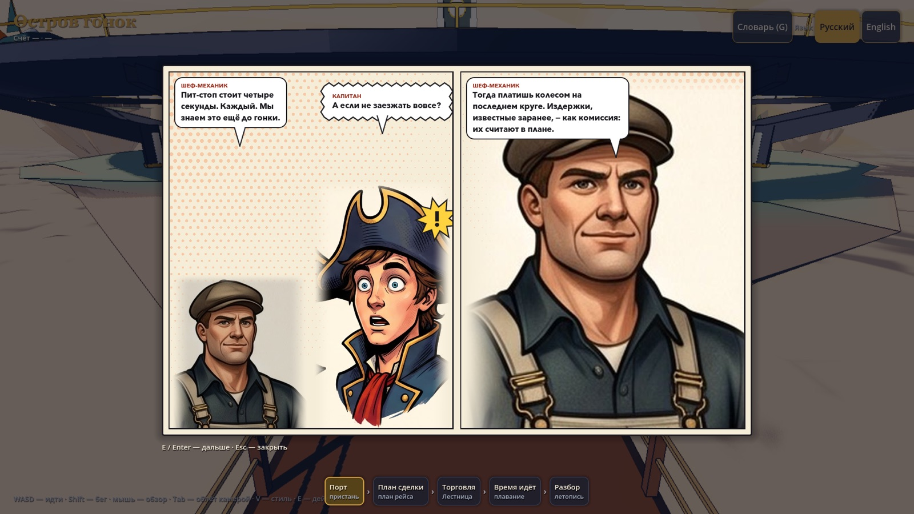 |

## The captain is redrawn in art deco on landing
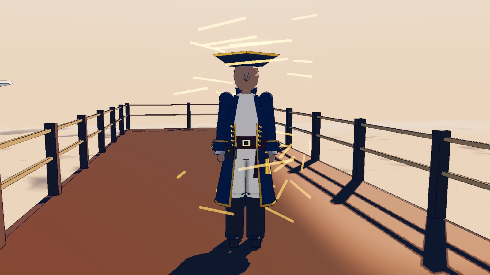

Recording: [captain-deco.gif](g3d-race/captain-deco.gif).

## Numbers
- World audit on the island: **0 findings** (791 free points of 932, 12 352 of 12 468 cells reachable, 36
  villager routes). On the way it caught the pit skiff, whose bow and stern could be walked through: it now stands
  on a lift above every hat.
- Frame rate at 1920×1080: average 118 (the display's cap is 120); 1 % low 59–78 over the captain's camera and
  seven fixed views.
- GUT: 135 tests, all green (5 new; the walk tests and the compass flights cover the new island).

## Not built
- The second islet with hangars and the suspension bridge of sheet 52; the entrance complex with turnstiles of
  sheet 53; the inside of a pit box (sheet 54); the stopwatch and the cup of sheet 57.
- The cloud sea is peach with darker shadows, not the dusk navy of sheet 52: navy under a navy rock hid the island.
- Costumes are approximate (no goggles, no wrench, no signal flags in the marshal's hands); one face each.
- The skiffs on the track have no speed lines.

## How to see it
`godot --path game3d` → sail from the harbour (the chart at the ship) to «Остров гонок»; or
`godot --path game3d -- --views=<dir> --only=race`, `--stroll=<dir> --island=race [--still|--turn]`,
`--attune=<dir> --island=race`, `--talk=<dir> --island=race --only=race_tower`,
`--flight=<dir> --island=harbour --to=race`.
