# G3D — the ship «Попутчик»: the one realistic thing, and her monkey (ADR-0036)

From Aika's six sheets (`docs/design/concepts/67…72`). Every island is drawn in its own technique and the captain
is redrawn on landing; **the ship is not** — she is physically lit wood, brass, iron and canvas everywhere.

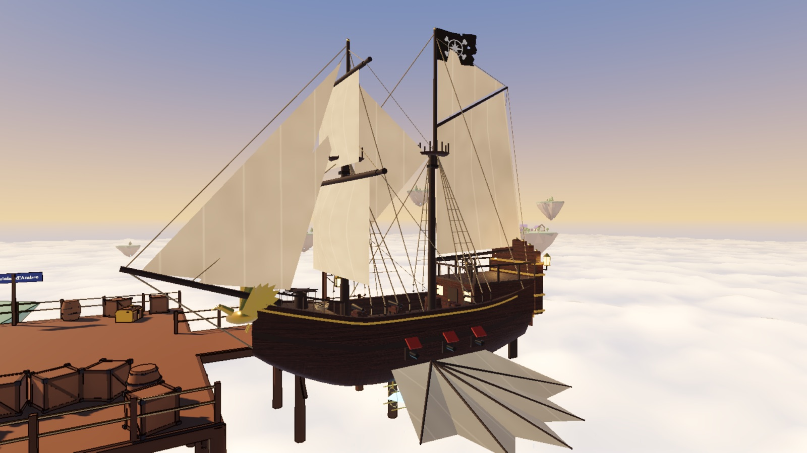

| The carved stern: gallery windows, the wind spirit, the name, two lit lanterns | The bows: the gilded bird under the bowsprit |
|---|---|
| 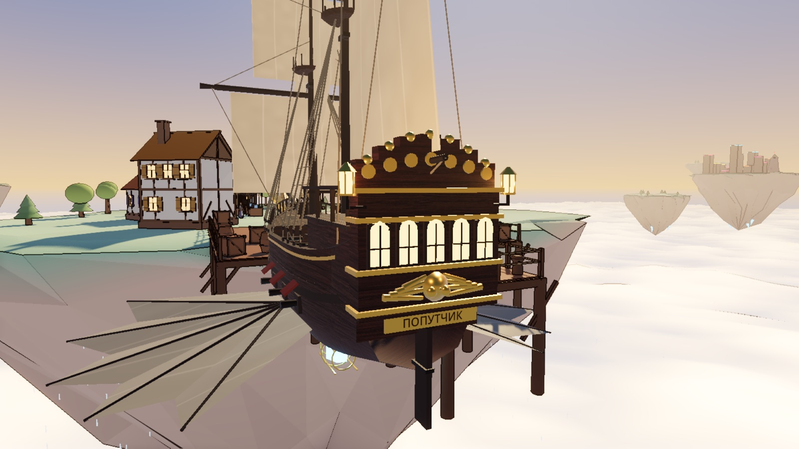 | 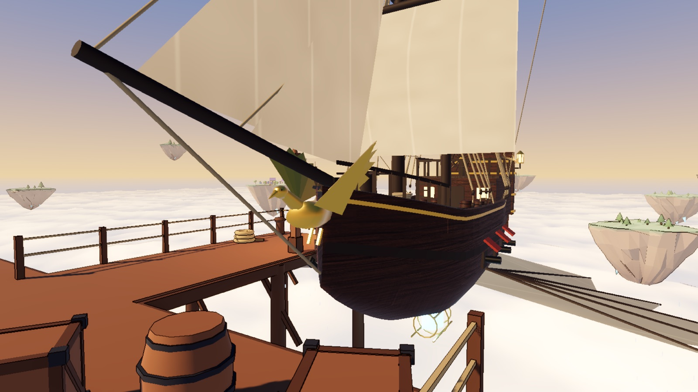 |

| The deck: guns, grating, barrels, shrouds and ratlines | A wing sail from below, and the etherite crystal in its cage |
|---|---|
| 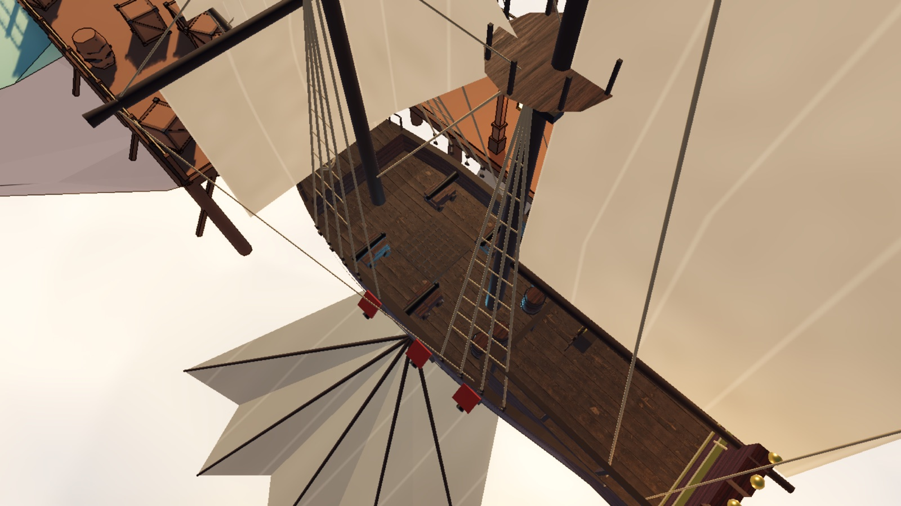 | 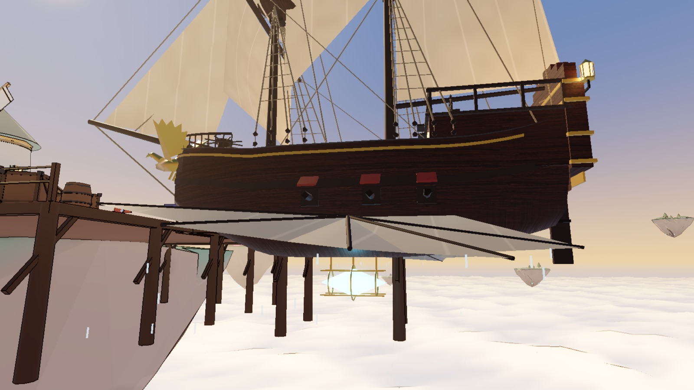 |

## The hull is now Poly Haven's pinnace (amendment to ADR-0036) — before and after
Aika: "yes, the pinnace". Left: the ship built in code. Right: the model, with what the sheets add to it. Where
the model is not downloaded (`make assets`) the left one is still the ship.

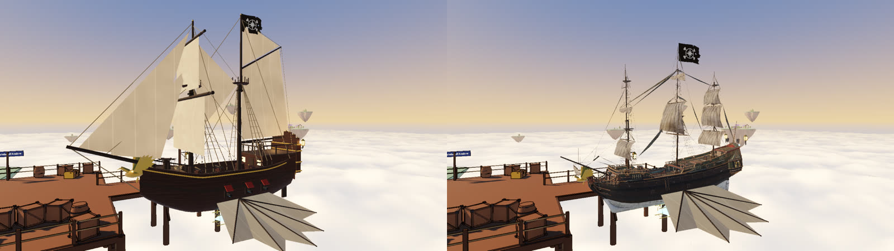
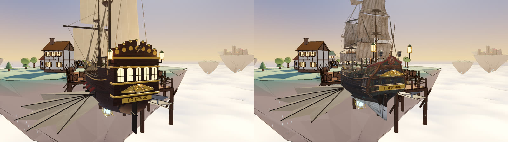
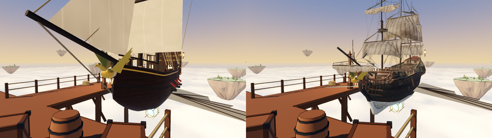
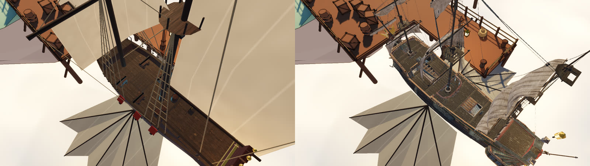
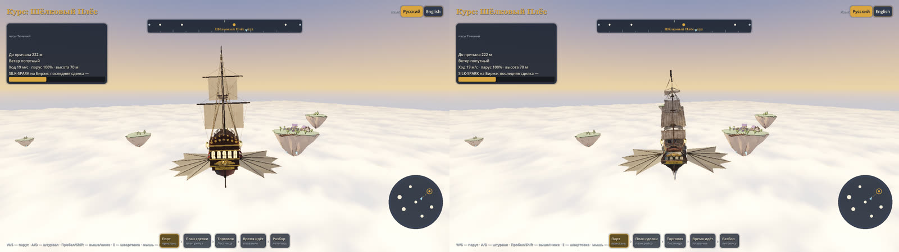

- The model: `ship_pinnace`, CC0, 162 007 triangles in full without its interior, scaled ×0.36 to twelve metres.
- **Still never redrawn**: all her materials are copied into the pass after the island's technique. At the index
  island, painted in oil:

  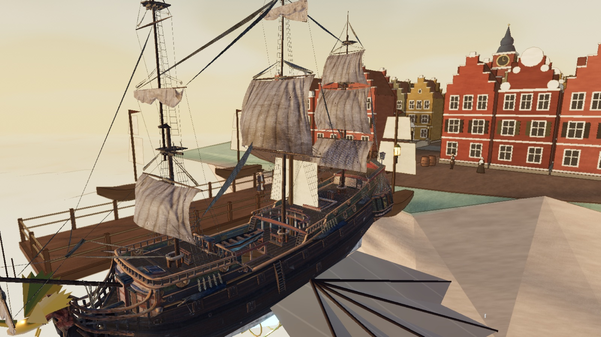
- **Added after the sheets**: wing sails with drops, the etherite crystal in its cage, our flag, the bird under
  the bowsprit, two lit lanterns, the wind spirit and the name on her own carved stern. Her sails ripple.
- **Budget**: from the helmsman's camera she draws about **30 000 triangles in the view** (74 000 with shadows in
  every cascade) — LODs taken early, no shadows from the rigging, the rigging gone beyond 150 m. In flight
  **120 fps** average, 1 % low 101–103. In port 115–119 average; 1 % low 53–69 once settled, and one dip to 43 at
  the first jump to a close view of her.
- Recording: [pinnace-flight.gif](g3d-ship/pinnace-flight.gif).
- GUT: 151 tests, all green (2 new; the tests of the built ship now build her explicitly). World audit of Spark
  Harbour with the pinnace: 0 findings.
- **Differences from the sheets**: three masts, not two; her sails are not furled by the trim; the bird is small
  beside a real hull; her own stern lanterns stand next to ours.

### The monkey, nearer her sheet
A dark cap over a pale face, brows and a muzzle, a waistcoat in two fronts with a brass edge, a ring in her ear,
a long tail that curls up; poses: sitting, sitting with the spyglass, climbing, running.

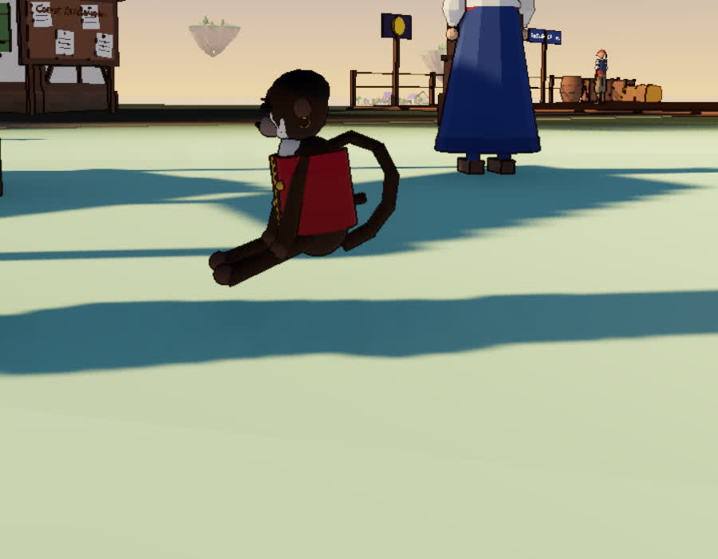

## Real among the drawn
The same ship moored at the race island (an art-deco poster) and at the index island (oil paint). The island
behind her is in its technique; she has no ink line, no flat tones, no haze.

| | |
|---|---|
| 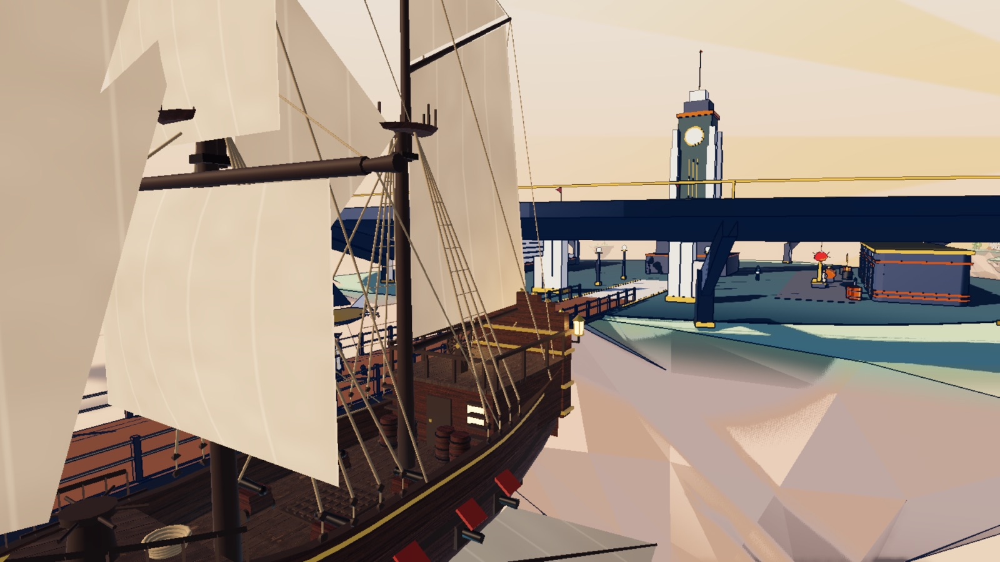 | 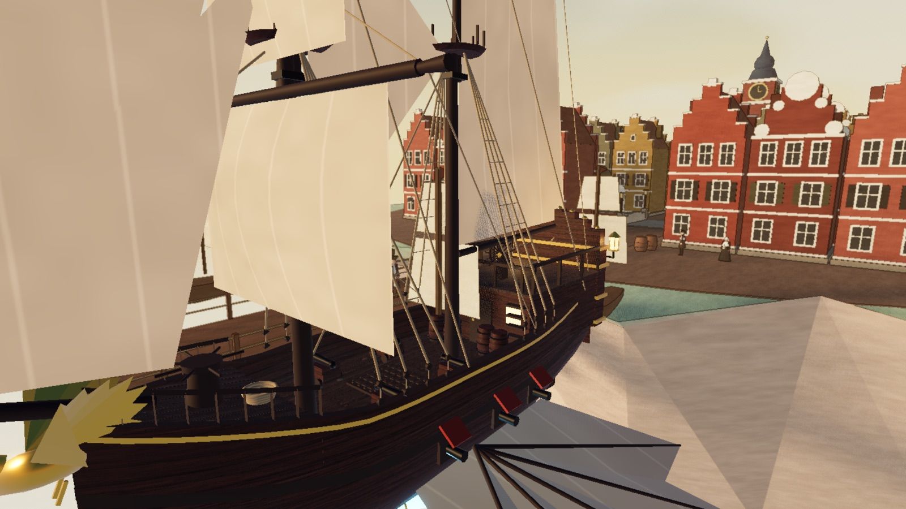 |

**How**: not a mask and not a branch in the effect. The effect is a quad drawn in the transparent pass at priority
100, reading the picture as it was after the opaque pass. Every material of the ship is in the transparent pass at
priority 101–104, fully opaque and writing depth. She is simply not in the picture the effect reads, and is drawn
over it afterwards, hidden correctly by what stands in front of her. A test walks every surface of the ship and
checks this; another checks that the effect's shader does not mention her. A technique added tomorrow leaves her
alone for free.

## What is on her
- **Hull**: a lofted oak shell with sheer, bulwarks and rail, a wale and a gilded strake, six gun ports with red
  lids up and muzzles showing, a rudder with its irons.
- **Decks**: forecastle and quarterdeck with bulkhead, cabin door, lit windows, ladders and rails.
- **Rig**: two masts with tops; two yards on the foremast, a gaff and a boom on the main, a bowsprit; two square
  sails that billow and are **furled by the sail trim** in flight; a gaff sail and its topsail, a staysail, two jibs.
- **Rigging**: four shrouds a side on each mast with ratlines and deadeyes, stays, a bobstay, backstays, lifts,
  braces, vangs. One mesh, not drawn beyond 150 m.
- **Stern** (sheet 69): five arched gallery windows, gilded mouldings, the wind spirit's face with hair blown to
  both sides, the name «ПОПУТЧИК», a taffrail that rises in the middle, two lanterns that give light.
- **Figurehead**: a gilded bird of prey, wings swept up and back.
- **On deck** (sheet 70): the wheel, a capstan, the grating, four guns on carriages, barrels, a coil of rope, the
  anchor catted at the starboard bow.
- **Wing sails**: ribbed like a bat's wing, of wet canvas, low on both sides; drops fall from their trailing
  edges (28 a side).
- **The etherite crystal** in a brass cage under the keel, glowing.

## The flag is ours
A shader, not a picture: black cloth that waves, a ragged fly with a few holes, and our sign drawn from distances —
an eight-pointed **compass rose in a ring over two crossed bones**. No skull.

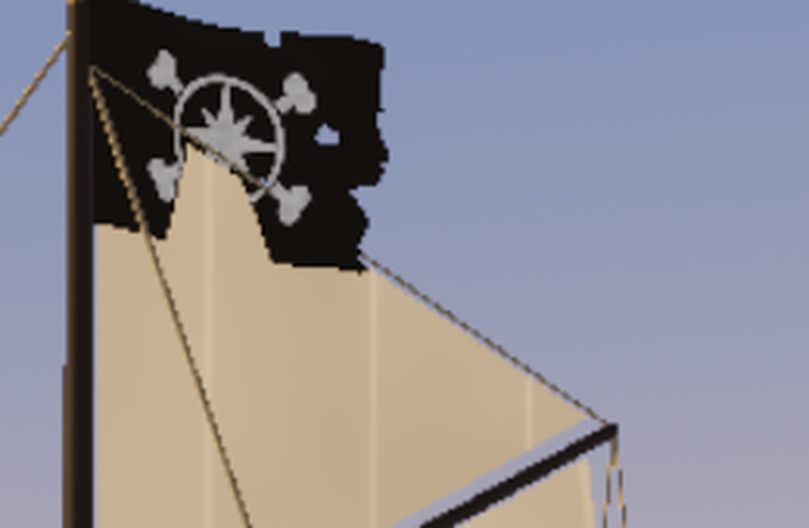

## The monkey (sheet 72)
A small capuchin in a red waistcoat with a brass earring — ours by Aika's sheet. She is a character of the world,
not a part of the ship: each island's technique draws her as it draws the captain. Under way she lives in the rig
(sits on a yard, runs along it, climbs to a top). In port she comes ashore and keeps near the captain: runs after
him when he walks off, sits down beside him when he stands.

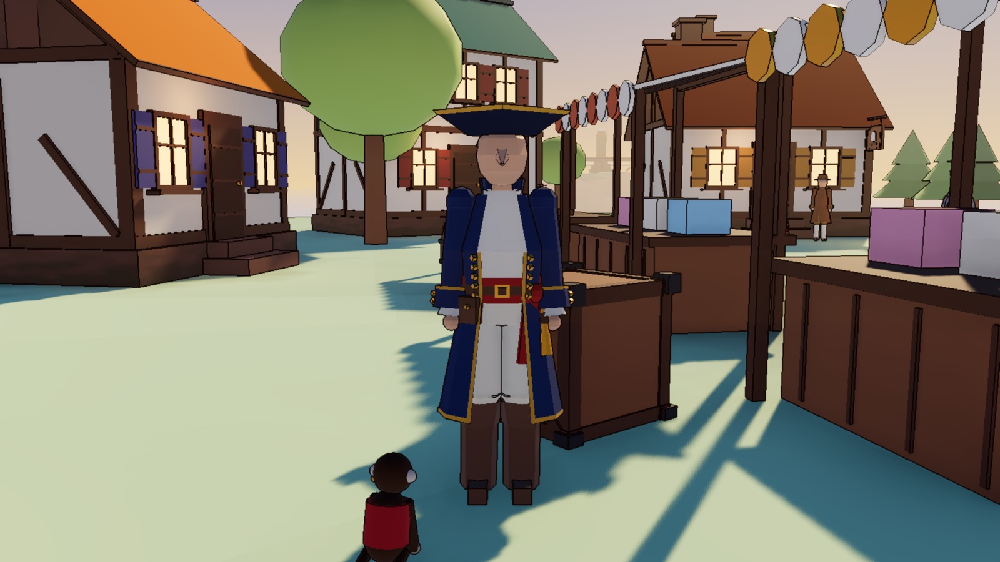

## Under way
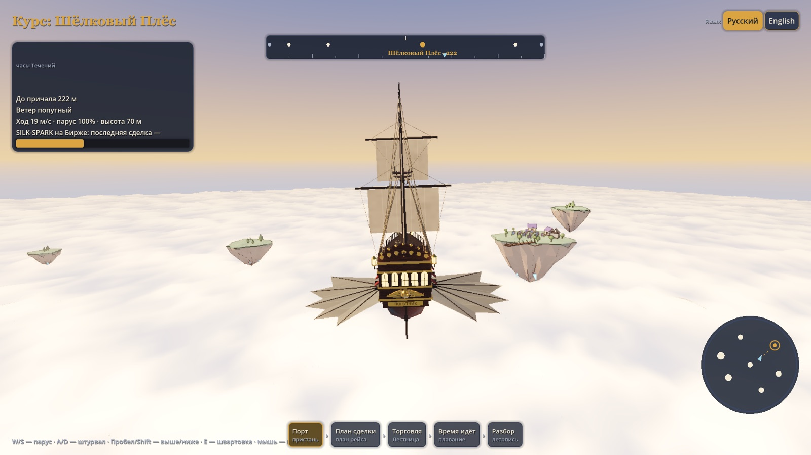

Recording of the helmsman flying her from the harbour to Silk Reach: [flight.gif](g3d-ship/flight.gif).

## Numbers
- **22 840 triangles, 18 materials** at full detail (the budget of ADR-0036: 60 000 and 24). A test counts them.
- Frame rate at 1920×1080 — **in flight**, the ship filling the middle of the screen: average 118, 1 % low 66.
  **In port** (Spark Harbour, the captain's camera and fourteen fixed views, five of them close on the ship):
  average 117–119, 1 % low 61–76.
- World audit of Spark Harbour with the ship and the monkey: 0 findings.
- GUT: 144 tests, all green (8 new).
- Textures: Poly Haven's `dark_wood` and `weathered_planks` (CC0, already in the project's `make assets`) when
  they are downloaded, laid out in the ship's own space; plain physically based colours when they are not. Nothing
  new is downloaded.

## Not built
- Nothing below deck (the cabin, the hold, the gun deck of sheet 70).
- The carving is suggested with mouldings, spheres and rods, not sculpted; the wind spirit is a round gilded face.
- The hull has no separate stem and keel timbers; the bows are fuller than on the sheet.
- The monkey: no spyglass, no coin, no expressions; she does not know walls (she has no collisions) and takes a
  straight line through the rig. Nothing can be done with her yet.
- No screen-space effects on the ship (she is outside the picture they read).
- The Poly Haven model `dutch_ship_medium` and the old stand-in hull are no longer used for the hero's ship.

## How to see it
`godot --path game3d` → the ship lies at the pier of every port; the chart at the ship → any island, and fly;
or `godot --path game3d -- --views=<dir> --only=harbour` (`view-ship*`),
`--flight=<dir> --island=harbour --to=silk [--measure]`.

## Without the code-built parts (ADR-0036, amendment 2)
The bird, the wind spirit, the name board, the code-built lanterns and the wing sails are taken off the pinnace;
the crystal, the flag and the lanterns' light stay. Before | after:

| | |
|---|---|
| 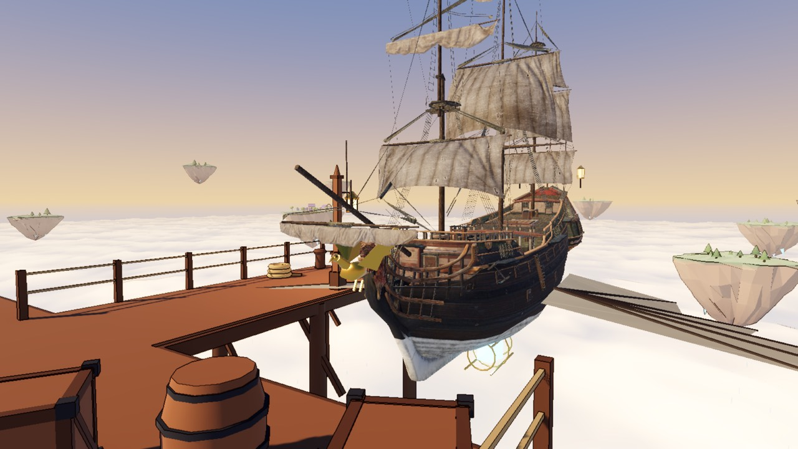 | 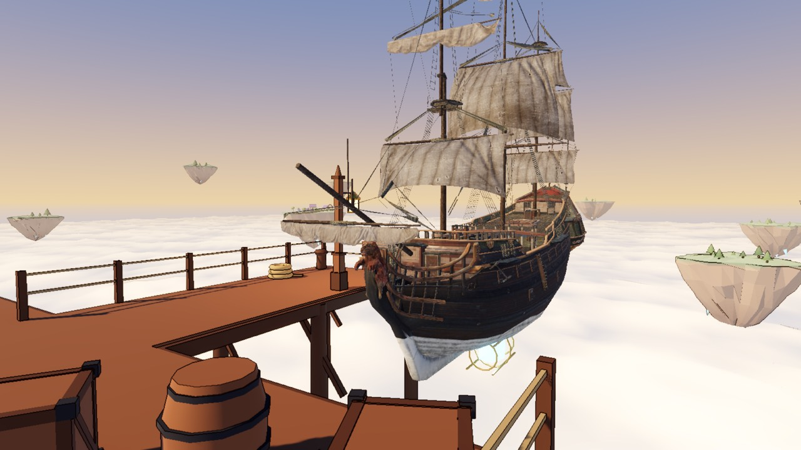 |
| 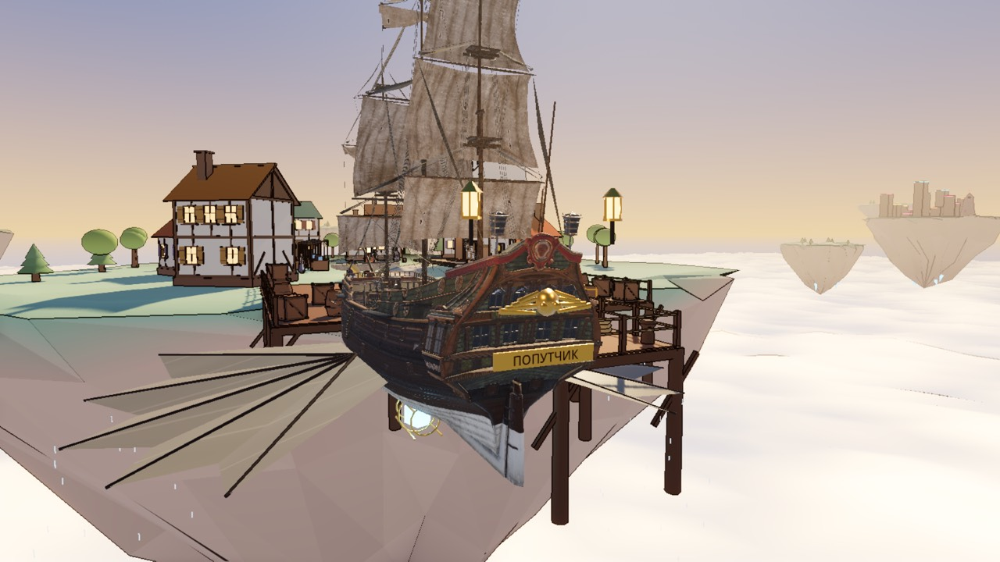 | 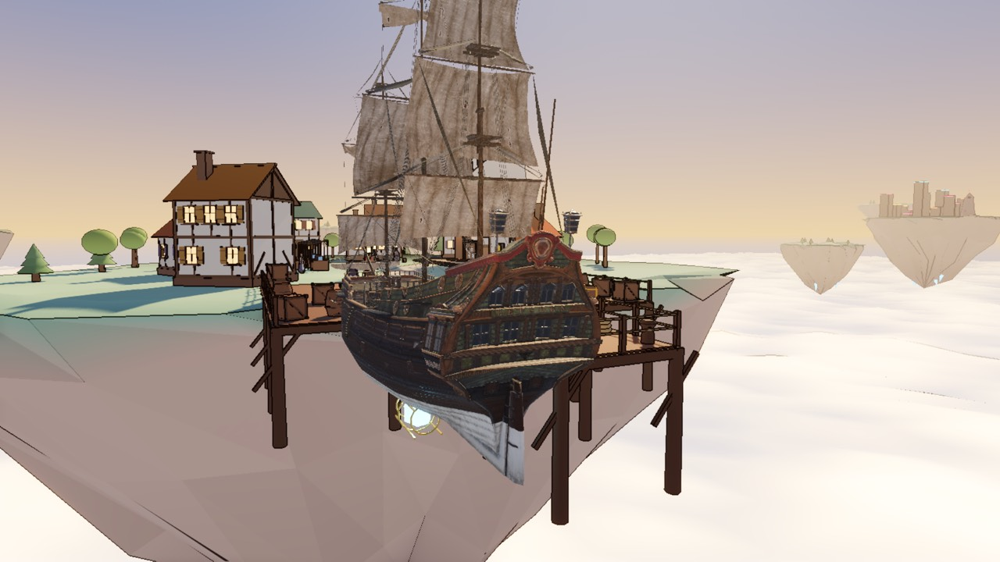 |
| 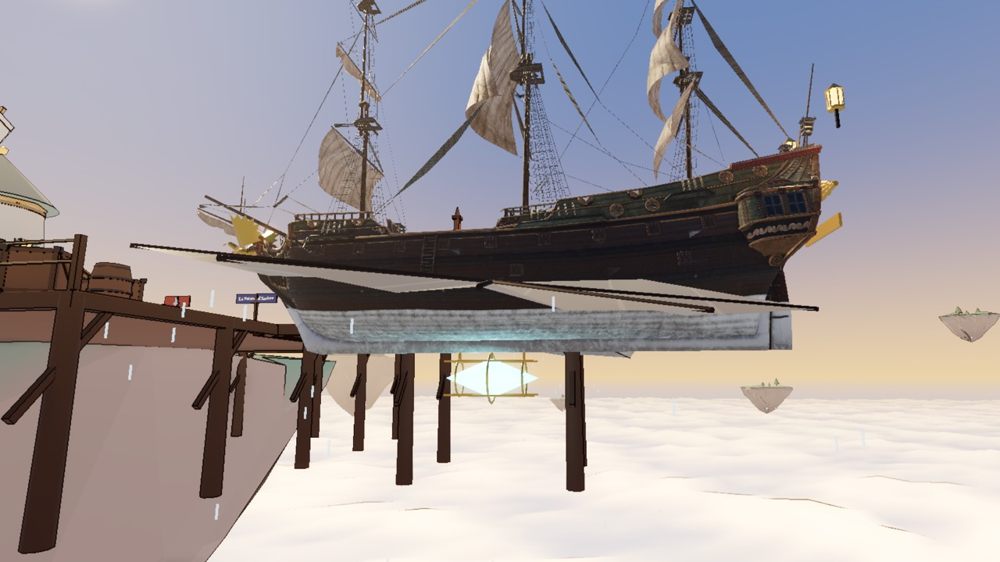 | 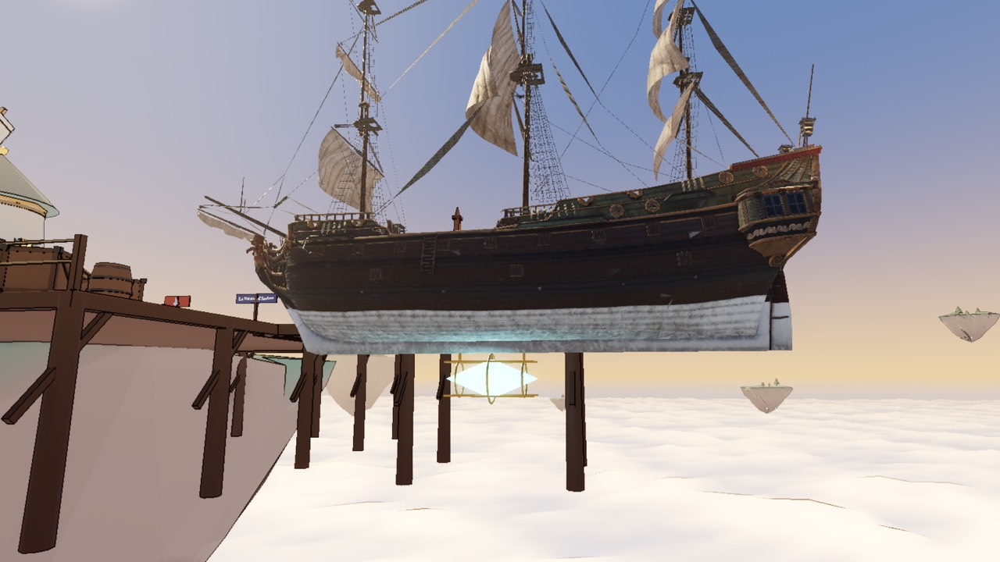 |
| 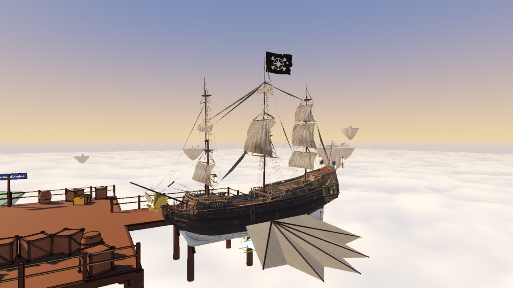 | 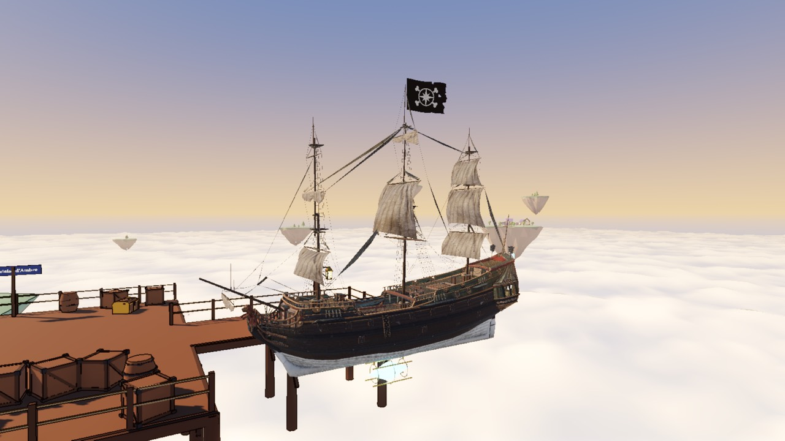 |

In flight (before: `pinnace-flight.jpg` above): 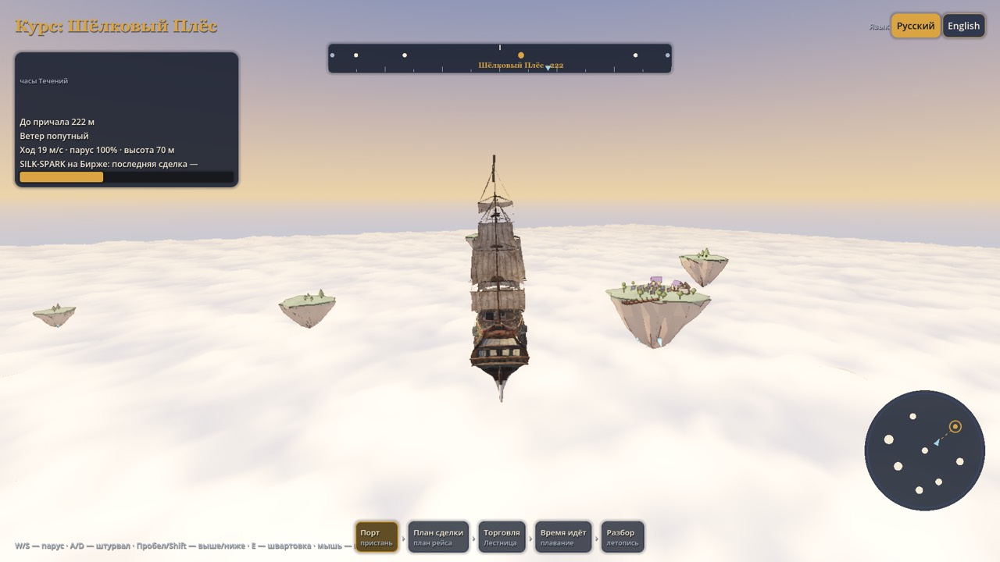
