# G3D — the short sellers' island: a tilted town in noir (ADR-0030)

A fourth island, from Aika's six sheets (`docs/design/concepts/35…40`). **A place and a style only**: nothing is
traded there; how a short works in the game waits for her answers to intent 03.

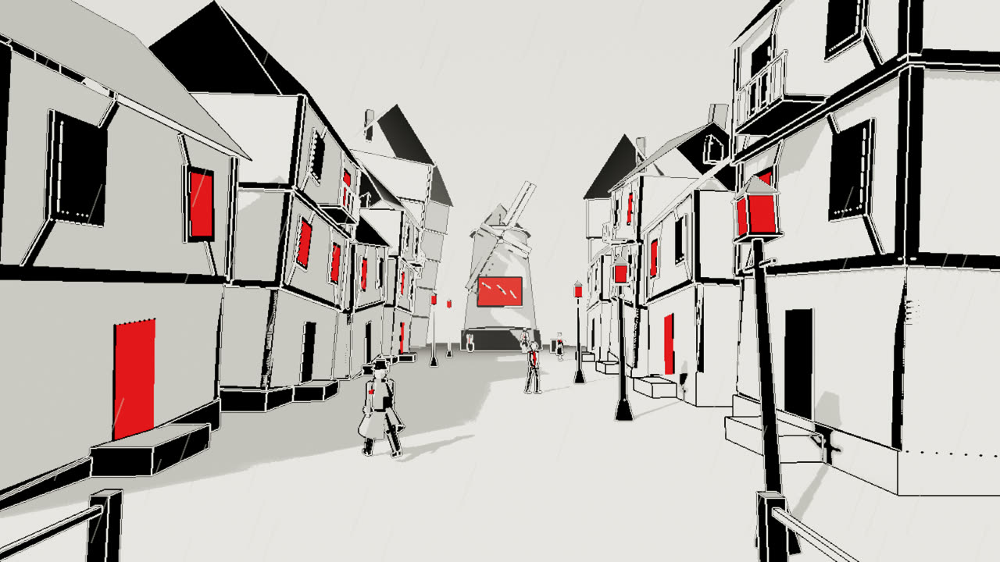

| The town from the pier side | The Exchange of Falling Prices |
|---|---|
| 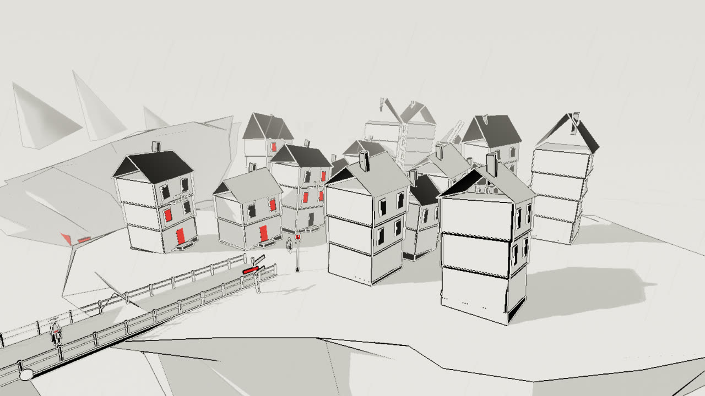 | 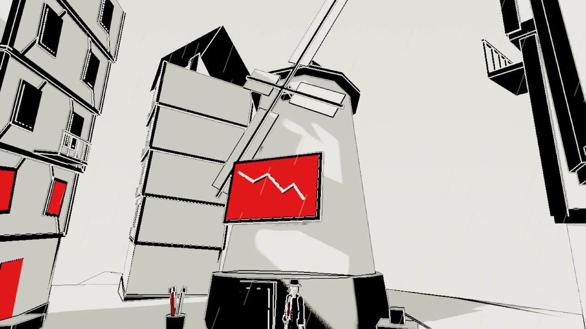 |

| Crooked houses | The slab behind the town |
|---|---|
| 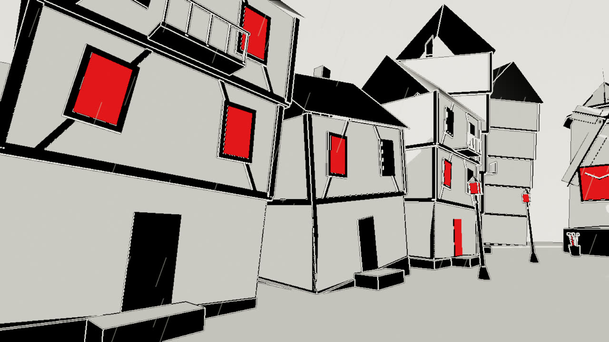 | 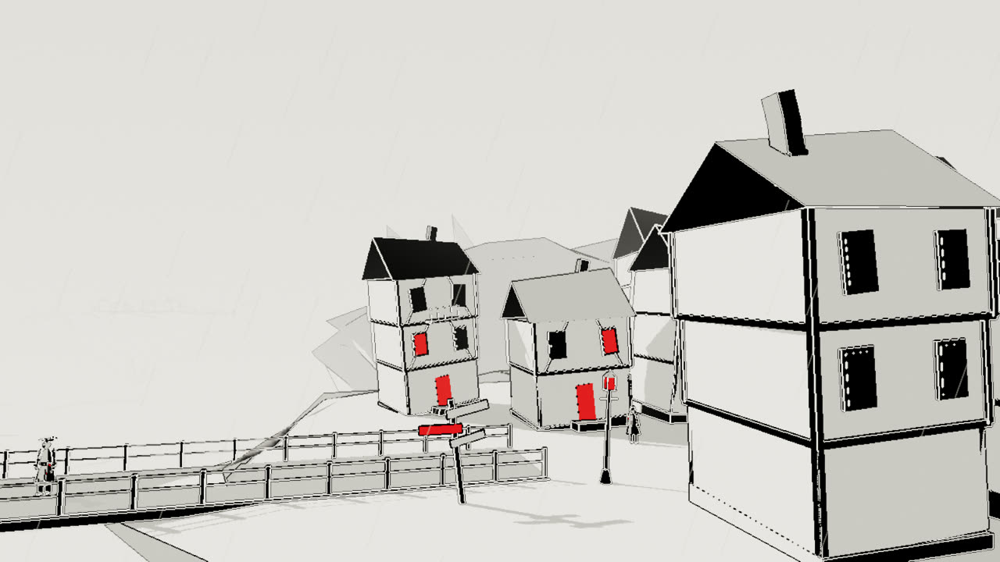 |

## The technique: noir
Paper white in the light, ink black in the shade, one flat grey between them; anything truly red is the one signal
red `#c4302b` (doors, some windows, lanterns, the board, a tie, a scarf, an armband, the crystals); fog fades the
distance to pale paper; thin slanted rain. V gives the strict print — black, white and red, no grey, no rain:

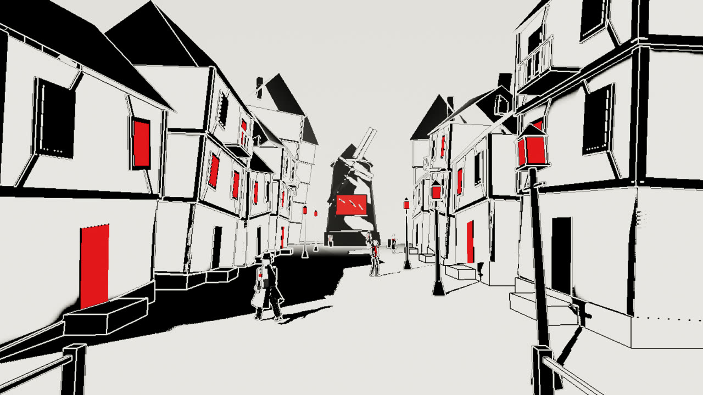

## Easy on the eyes — what was done and measured
The lesson of the first katazome was taken first, not after:
- **The screen is mostly light.** The sky is pale, the lit ground is white, and the ground never goes black (its
  shadows are grey): they are the largest dark shapes and move with every step. Share of dark pixels in the fixed
  views: 3 %, 14 %, 16 %, 19 %, 7 % (strict print: 14–35 %).
- **No hatching.** Half-shade is a flat grey wash: screen-space hatching crawls under a moving camera.
- **Rain that does not flicker.** Streaks slide steadily along their slant; no per-frame randomness. With the
  camera standing still the picture changes by 1.1 of 255 between frames (people walking and the rain together).
- **On the move** (`--stroll --island=shorts`, 12 m along the street, a frame every 0.1 s): 29.7 of 255. That is
  more than the watercolour island on the same walk (11.4): looking at the difference picture, all of it is at the
  moving edges between black and white — nothing blinks on the surfaces — but a black-and-white picture simply
  changes more when it moves. Recording: [walking.gif](g3d-shorts/walking.gif). **Whether this is comfortable is
  for Aika's eyes**; if not, the cure is one number (how dark the shade is).

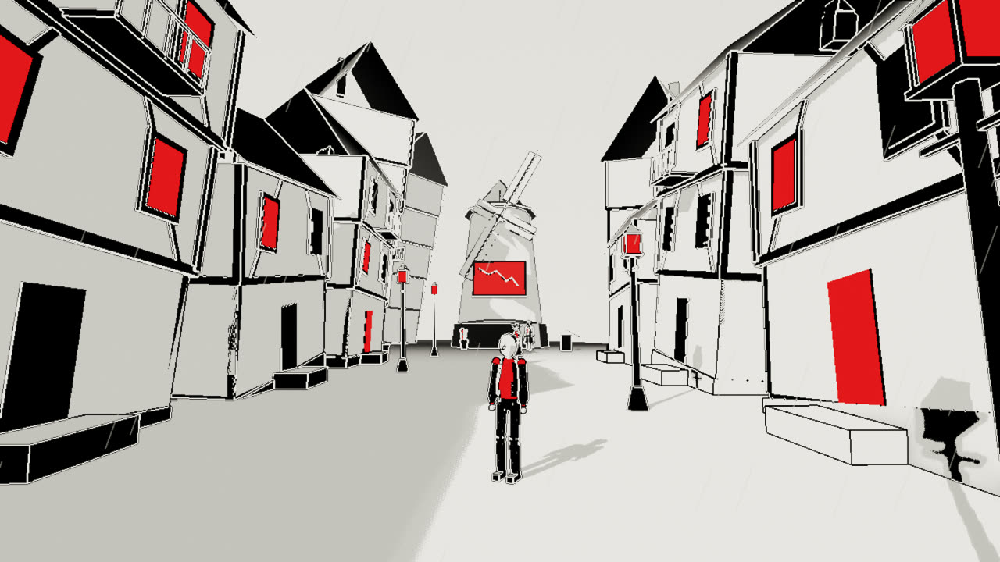

## The island
- **Tilted, by drawing.** People stand on a flat cap (walking, fences, the nav mesh and the audit rely on it). The
  tilt is a great slab of rock rising behind the town to broken peaks, with red etherite under it, and a town where
  nothing stands straight: fifteen houses and towers lean up to 7.5° — each as one piece with its collider.
- **Crooked houses** after sheet 38: skewed plinth, storeys that jut out, crooked windows (one in three red),
  a steep roof with a sagging ridge, a bent chimney, a hanging balcony on the tall ones.
- **The Exchange of Falling Prices** after sheet 39 (outside only): a mill leaning out over the cliff, two of its
  four blades broken, a weathercock askew, and a red board whose line falls. Its door is a talk.
- **Props** after sheet 40: street lamps with red lanterns, a crooked signpost, a black ship's lantern on the pier,
  an umbrella stand, a ticker machine.
- **Getting there**: a second post on the Spark Harbour wharf, a red board with an arrow pointing down; E takes the
  packet boat. On the island, E by the boat goes back.

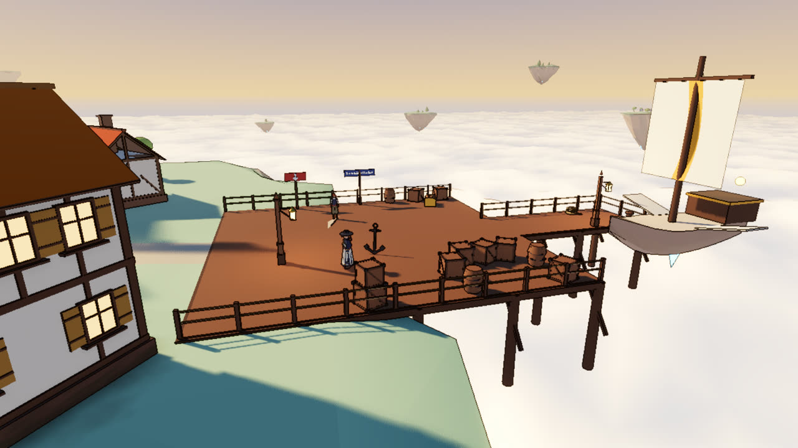

## The captain is redrawn in noir on landing
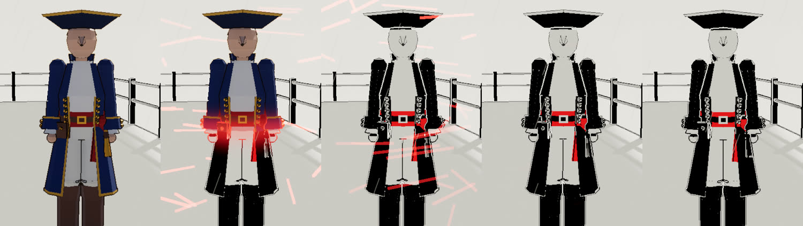

Recording: [captain-noir.gif](g3d-shorts/captain-noir.gif). The contract test of ADR-0029 covers the new technique
without a change; `test_short_isle.gd` checks the landing.

## The islanders (sheet 36) and what they say
Four costume roles from the existing garments, in black, grey and one red. In comic pages they are shown by their
figure from the sheet — **one face each**: there is no expression sheet for them yet.

| The broker at the exchange door, page 1 | page 2 |
|---|---|
| 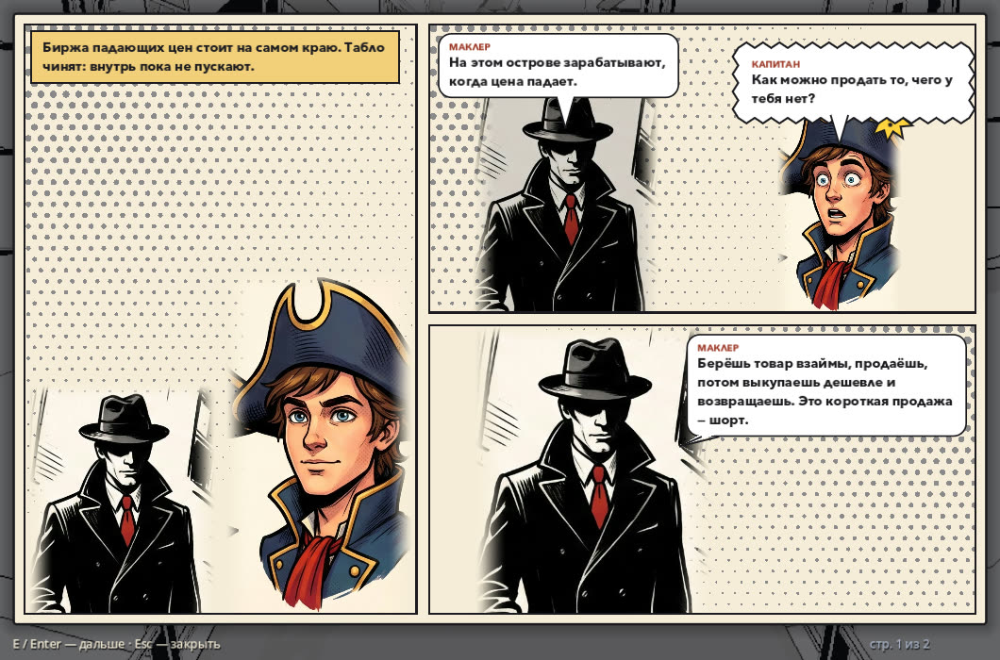 | 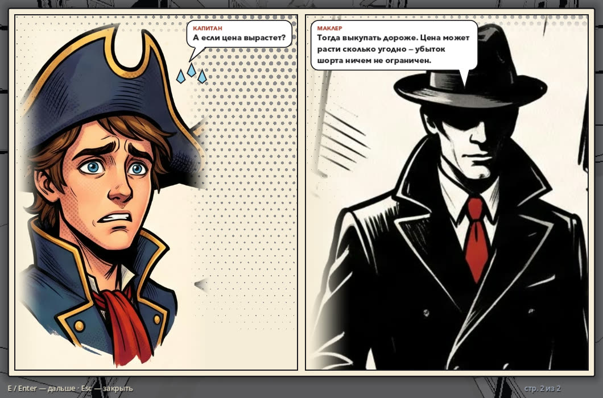 |

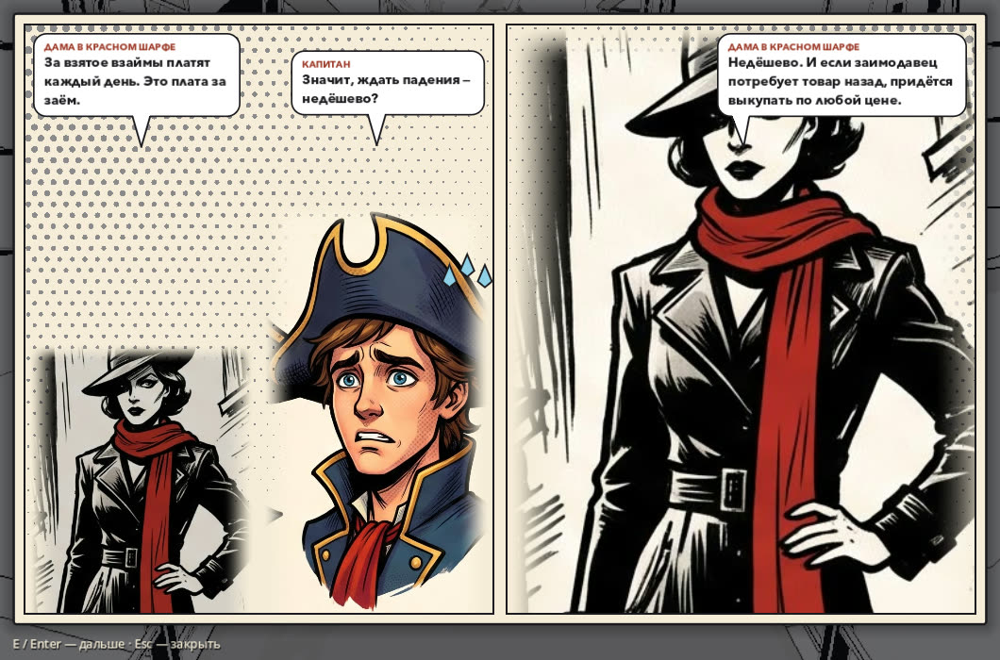

| Who | Idea, real term beside the lore |
|---|---|
| The broker | what a short sale is; that its loss has no limit |
| The old man with the armband | being right too early is the same as being wrong |
| The pale youth | a short seller reads financial reports («ведомости») like an analyst, and is paid for bad news |
| The woman in the red scarf | the borrow fee; the lender can call the goods back |

Words: `game3d/i18n/talk.csv` (`TALK_SHORTS_*`). Nobody recommends shorting and nothing can be traded.

## How to rerun
```
godot --path game3d --resolution 1600x900 -- --views=<dir> --only=shorts --ink=1     # --ink=2: the strict print
godot --path game3d --resolution 1600x900 -- --attune=<dir> --island=shorts
godot --path game3d --resolution 1600x900 -- --stroll=<dir> --island=shorts [--still]
godot --path game3d --resolution 1600x900 -- --talk=<dir> --island=shorts --only=shorts_exchange
godot --path game3d --resolution 1600x900 -- --audit=<dir> --only=shorts
```

## Checked
- World audit of the island: 0 findings (9069 of 9177 lattice cells reached from the pier; 36 villager strolls).
  Found and fixed on the way: house colliders that did not lean with the walls, the exchange door sticking out of
  its collider, and — on Spark Harbour too — a fence that bulged through a one-sample tooth of an island's edge
  (the "escape" reported there earlier). Spark Harbour: 0 findings again.
- GUT 109 green (4 new in `test_short_isle.gd`; the walk tests cover the fourth island).
- Frame rate at 1920×1080: average 118–119 (display cap 120), 1 %-low 63–71, worst frame 17.9 ms.

## Not done, not checked
- Not played by hand.
- No trading, no trading hall: the inside of the exchange (sheet 39, right half) is not built.
- From sheet 40 the card table and the lopsided scales are not built; from sheet 38 the outside stairs.
- The islanders have no expression sheets; their costumes are the old garments recoloured (no real trench coat
  collar, no umbrella for the old man).
- The island has only a working name; which island of the world bible it is, is open.
- Amber Cliff and Silk Reach were not re-audited after the fence change (their fences can only have moved inwards).
