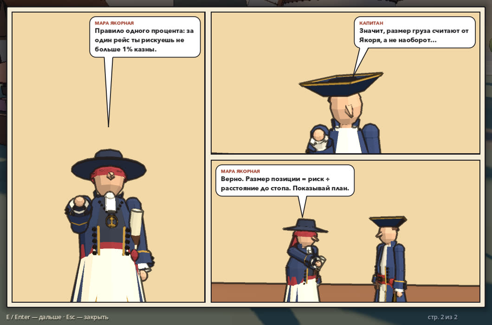
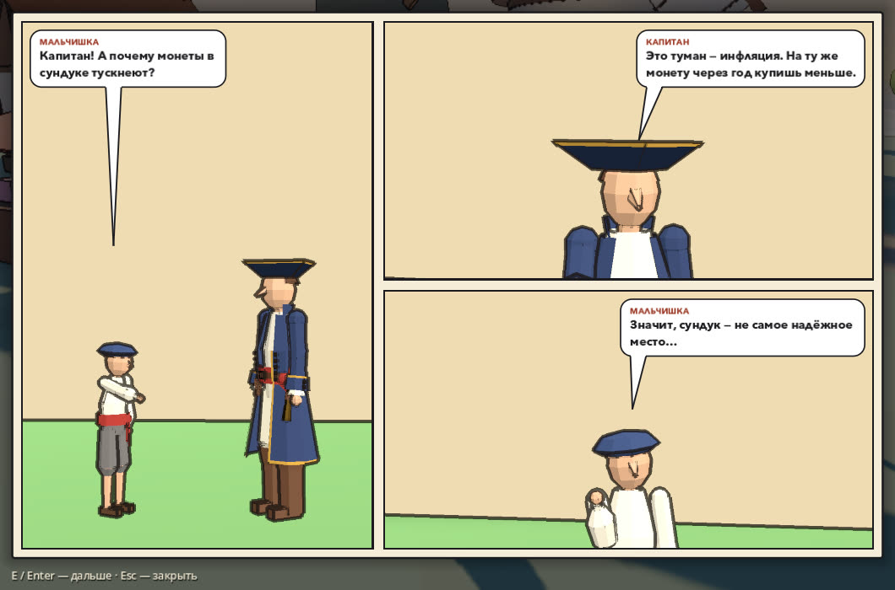
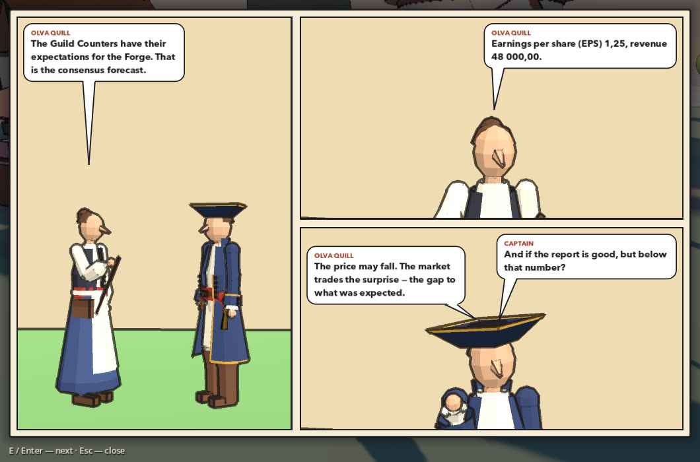
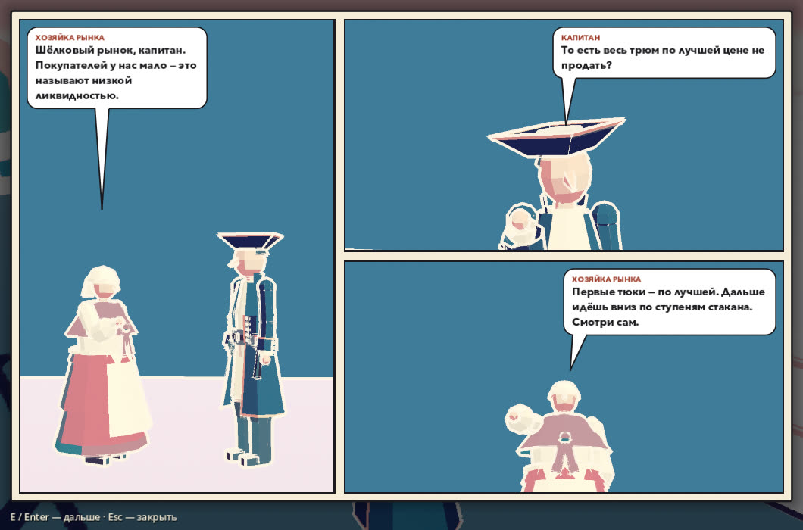
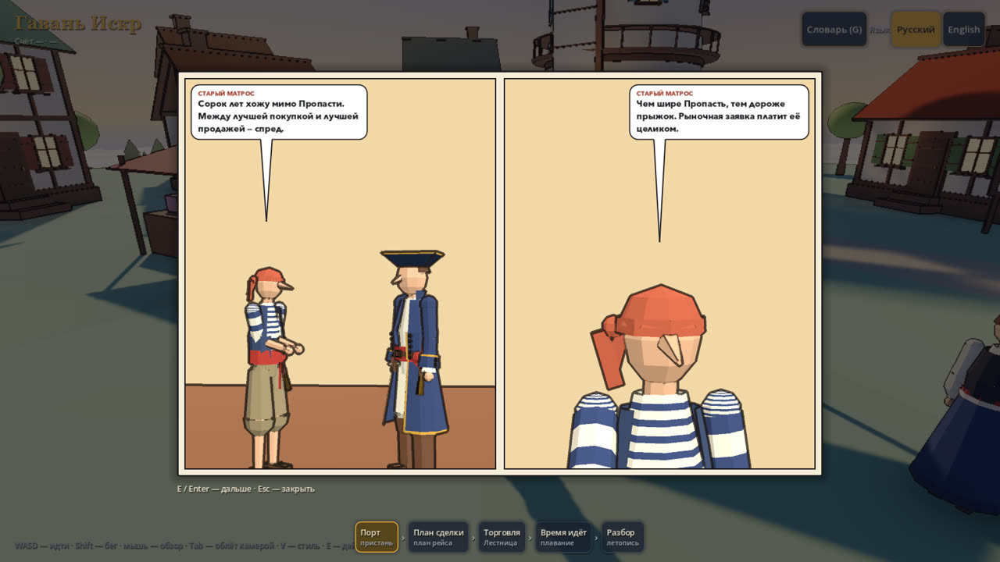

# G3D talk — talking opens a comic page (ADR-0027)

"E — talk" no longer shows a line of text in a box. A paper page opens with frames, the speakers drawn in them and
speech balloons; E / Enter / click shows the next balloon, then the next frame, then the next page; Esc closes.

| Mara, first meeting — page 1 | page 2 |
|---|---|
|  |  |

| A boy on the square (fog = inflation) | The Chronicler by day |
|---|---|
|  |  |

| Olva with the day's numbers, in English | The post keeper, drawn the way Silk Reach is drawn |
|---|---|
|  |  |

The page over the game (the world keeps drawing behind it):



## Where the words and the staging live
- `game3d/i18n/talk.csv` — every word, `keys,ru,en`. `{eps}`-style slots are filled by the game. **Aika rewrites here.**
- `game3d/data/talks.json` — cast (costume role per speaker), backdrops, and per talk: pages → panels → shot
  (`close`, `two`, `wide`, `low`), who is in the frame, poses (`stand talk point think shrug bow`), a caption,
  up to two balloons.
- The portraits are the game's own people (`Proc.figure` in the same costume), posed and drawn once per frame.

## Who talks
| Who | When | Talk |
|---|---|---|
| Mara | the first time, then straight to the plan | `mara_first` (stop-loss, the 1% rule, position size) |
| Olva Quill | every time, with the live numbers | `olva_consensus`, `olva_last`, `olva_wait` |
| The Chronicler | by day (in the evening E opens the review as before) | `chronicler_day` |
| The post keeper, Silk Reach | the first time | `keeper_first` (liquidity) |
| Every stroller | E when one is at arm's length | `stroll_<role>`: order flow, volatility, spread, inflation, compound interest, fees |

## How to rerun
```
godot --path game3d --resolution 1600x900 -- --talk=<dir>                       # every talk, a picture per page
godot --path game3d --resolution 1600x900 -- --talk=<dir> --only=mara_first --lang=en --island=silk
```

## Checked / not checked
- GUT 96 green (`test_comic.gd`: the data is whole in ru and en, slots match, the reader's steps, a pose, a stroller
  talk from E to the captain getting control back, Mara's once-only page).
- Not played by hand with a keyboard: pages were stepped by the tool and by tests.
- With `--pbr` (MakeHuman people) nobody takes a pose: poses are for the people built in code.
- The frame rate with a page open was 78–118 in the tool's runs at 1600×900; not measured with `--fps`.
