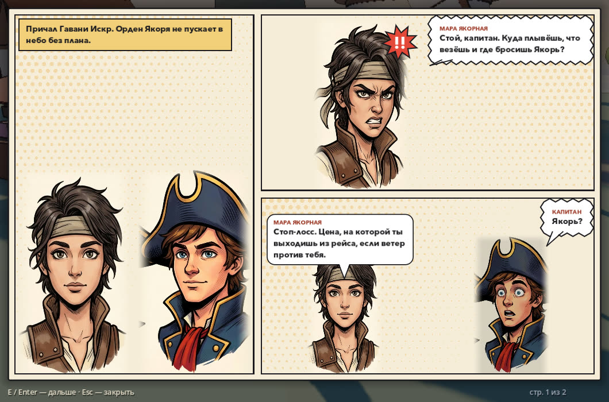
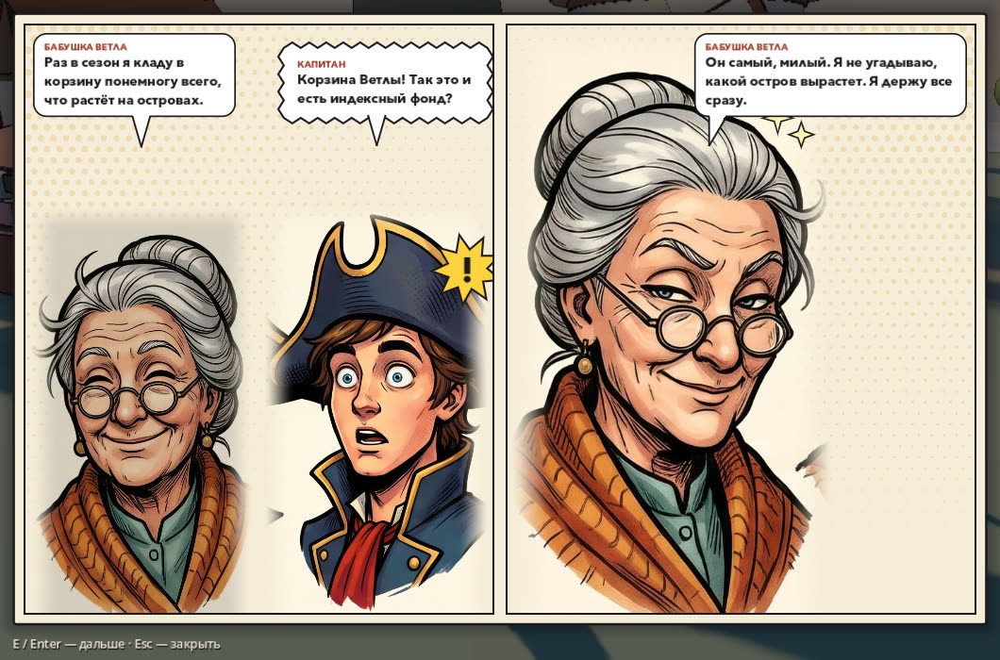
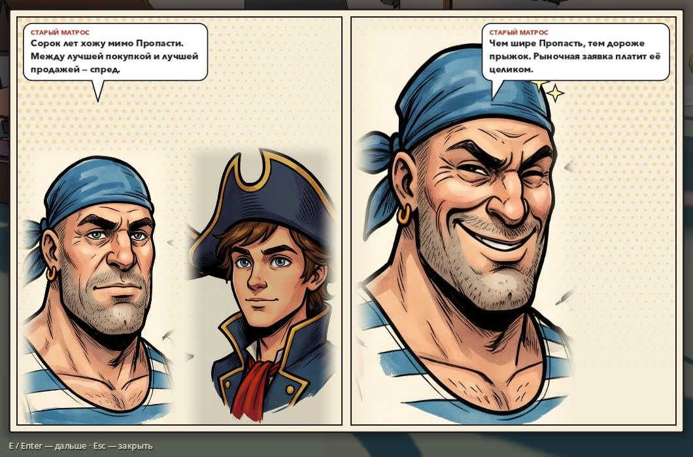
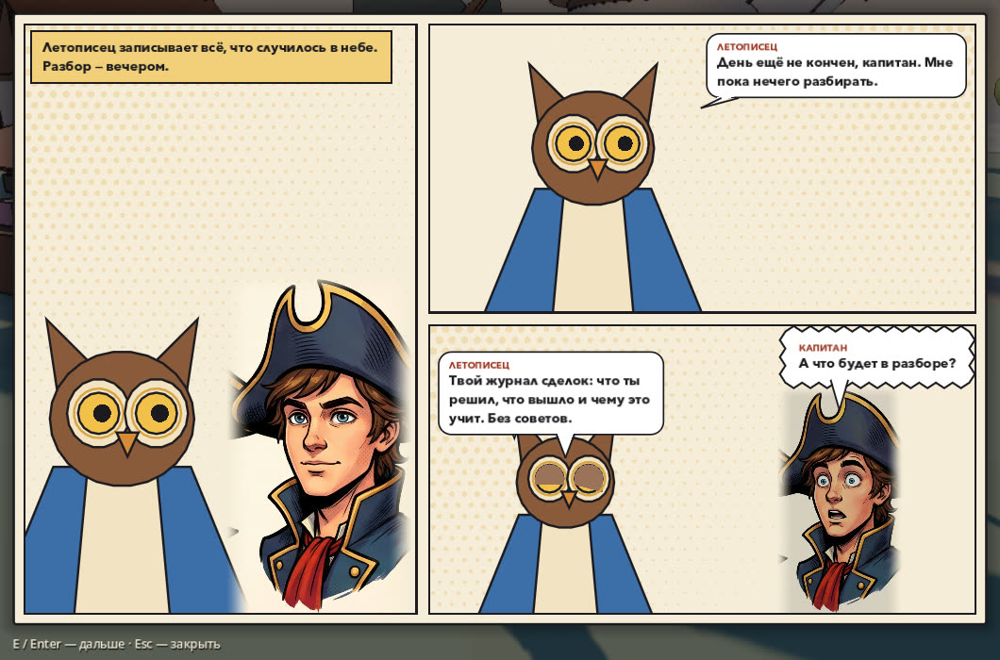

# G3D talk — talking opens a comic page (ADR-0027)

"E — talk" opens a paper page with frames. The speakers are **drawn portraits from Aika's expression sheets**
(`docs/design/concepts/06…12`), and the face changes with every line: the emotion is a word in the data. E / Enter /
click shows the next balloon, then the next frame, then the next page; Esc closes.

| Mara, first meeting — page 1 | page 2 |
|---|---|
|  |  |

| Бабушка Ветла and her basket (an index fund) | The old sailor (the spread) |
|---|---|
|  |  |

| Olva with the day's numbers, game in English | The page over the game |
|---|---|
|  |  |

What a frame does with an emotion: the speaker's portrait is swapped for that face; the listener is dimmed a little;
a mark appears by the head (a yellow burst with "!" for surprise, a red one for anger, drops for worry, sparkles for
a sly or happy line); a surprised or angry line gets a bristling balloon.

People who have **no sheet yet** are drawn by a plain stand-in with the same six emotions — here the boy and the
Chronicler next to the captain's real portrait:

| | |
|---|---|
|  |  |

## Where the words and the staging live
- `game3d/i18n/talk.csv` — every word, `keys,ru,en`. `{eps}`-style slots are filled by the game. **Aika rewrites here.**
- `game3d/data/talks.json` — cast (`"face"`: the expression sheet, or `"look"` for a stand-in), backdrops (the
  colour of the halftone dots), and per talk: pages → panels → shot (`close`, `two`, `wide`, `low`), who is in the
  frame, a caption, up to two balloons as `[who, words, emotion]`, and `mood` for somebody who only listens.
- `game3d/art/portraits/<face>_<emotion>.jpg` — the 36 faces, cut from the sheets with these boxes (centre x of
  each face, top..bottom, half width, in pixels of the sheet scaled to 1584 wide): captain 207 453 705 952 1198 1450,
  140..590, 123; mara 247 474 705 932 1168 1405, 140..500, 113; vetla 187 443 695 932 1158 1395, 105..515, 120;
  olva 277 504 733 957 1188 1420, 115..585, 113; sailor 227 474 710 952 1188 1430, 140..505, 119; merchant
  187 428 670 906 1138 1395, 95..665, 120.

## Who talks
| Who | When | Talk |
|---|---|---|
| Mara | the first time, then straight to the plan | `mara_first` (stop-loss, the 1% rule, position size) |
| Olva Quill | every time, with the live numbers | `olva_consensus`, `olva_last`, `olva_wait` |
| The Chronicler | by day (in the evening E opens the review as before) | `chronicler_day` |
| The post keeper, Silk Reach | the first time | `keeper_first` (liquidity) |
| Every stroller | E when one is at arm's length | `stroll_<role>`: order flow, volatility, spread, inflation, compound interest, the index fund (Бабушка Ветла) |

## How to rerun
```
godot --path game3d --resolution 1600x900 -- --talk=<dir>                       # every talk, a picture per page
godot --path game3d --resolution 1600x900 -- --talk=<dir> --only=mara_first --lang=en --island=silk
```

## Checked / not checked
- GUT 102 green (`test_comic.gd`: the data is whole in every language; every hero with a sheet has all six faces on
  disk; the face on screen changes with the line; a stand-in is drawn for people without a sheet; a stroller talk
  from E to the captain getting control back).
- The data check found one real mistake on the way: a line said by somebody who was not in the frame.
- Not played by hand with a keyboard: pages were stepped by the tool and by tests.
- The frame rate with a page open was 98–119 in the tool's runs at 1600×900; not measured with `--fps`.
- Sixteen speakers are stand-ins. The sheets' sound words (BOOM, POW) are not used: nothing in a talk makes a noise yet.
