# G3D techniques — Silk Reach as katazome, Amber Cliff in pen and watercolour (ADR-0029)

Aika chose the techniques and drew the sheets (`docs/design/concepts/27…34`). They replace the two I had guessed.

## Silk Reach — katazome (sheet 28; sheet 27 for the motifs)
The first version followed the strict sheet 27: indigo and cream only, patterns in every half-tone. Aika: "blue and
white is too simple and hard to look at, the eyes begin to hurt, more colours are needed". It was redone after
sheet 28: **several blues** (deep indigo `#1f2f5a`, middle `#4f6a94`, pale `#a9bcd2`), **ochre `#c79a63` and sand**
for rock, timber and the ground, **rust `#b5523b`** for cloth and accents, **cream paper `#efe6d2`**, soft steps
between tones. Patterns only on cloth, roofs and the cloud sea, large and faint, in world space.

| Before ("printed silk", my guess) | Strict katazome (sheet 27) — too harsh | Now (sheet 28) |
|---|---|---|
| 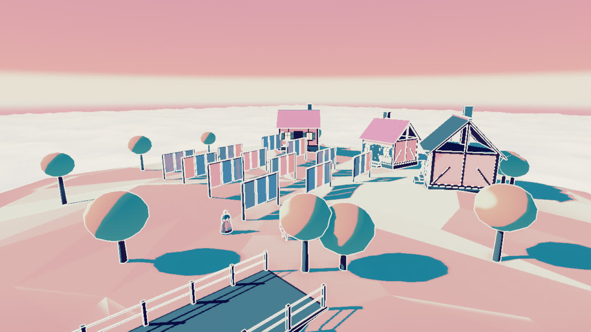 | 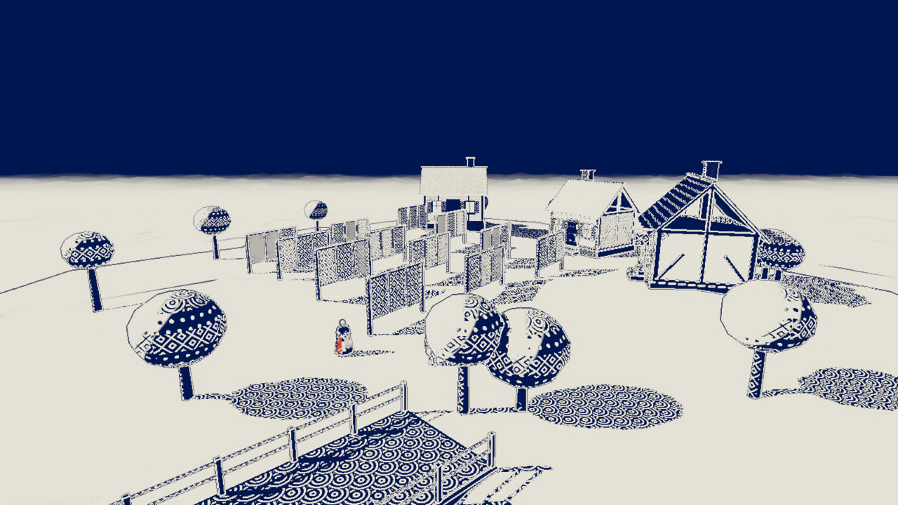 |  |
| 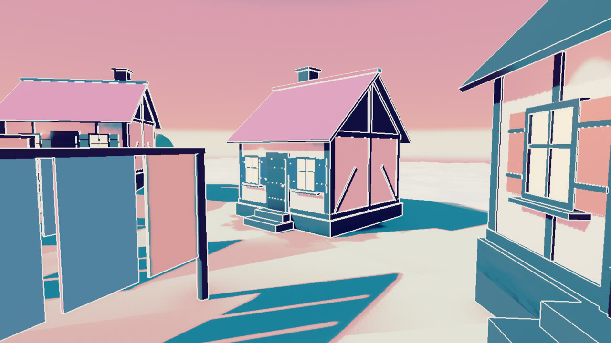 | 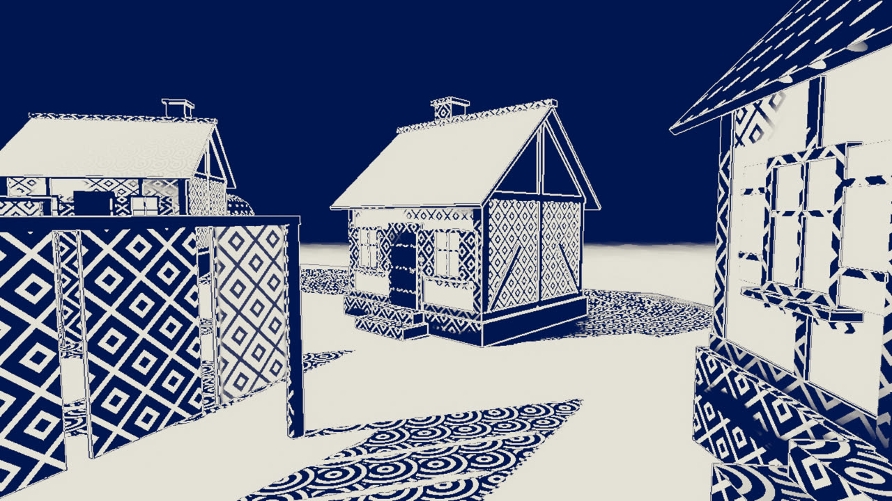 | 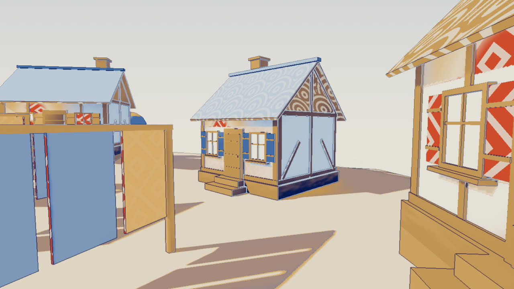 |

The landing; and the second mode (V): the same without rust and patterns.

| | |
|---|---|
| 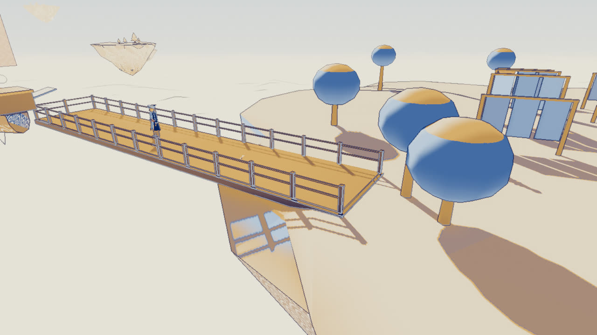 | 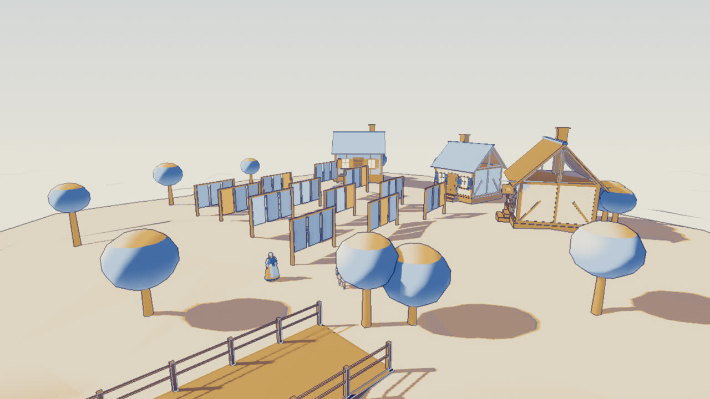 |

**On the move.** A camera walks 12 m across the island, a frame every 0.1 s (`--stroll=<dir>`). The mean change
between neighbouring frames was 30.6 of 255 with the strict version and is 10.9 now; what is left is the motion
itself. Recordings: [strict](g3d-techniques/walking-strict.gif), [now](g3d-techniques/walking-after.gif). Each
pattern is faded out before its cell is smaller than about 14–30 pixels, with the angle of the surface counted in.

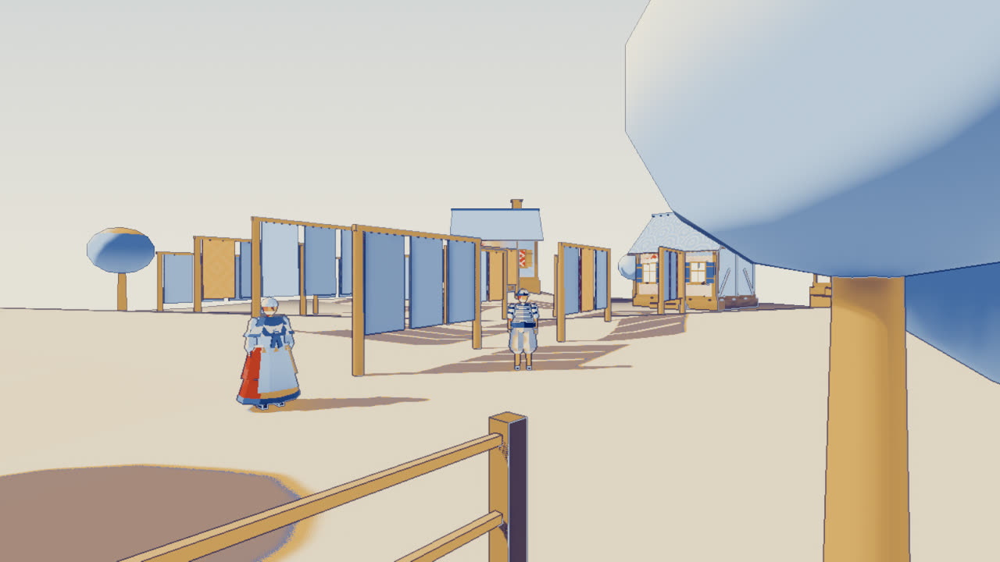

## Amber Cliff — pen and watercolour (sheets 29–34)
A thin warm-grey line that trembles and presses and lifts; washes that run past the line; a lot of bare paper,
most in the light and far away; shade as a violet-grey wash; paper grain. House colours follow sheet 30 (geranium
doors, sea-teal shutters, slate roofs).

| Before (ligne claire) | After (pen and watercolour) |
|---|---|
| 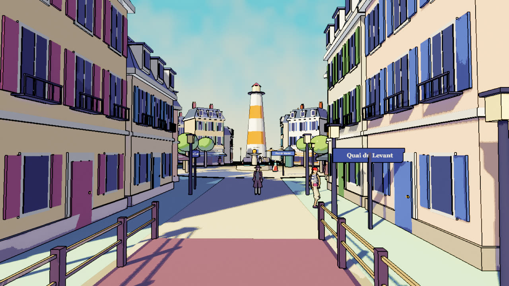 | 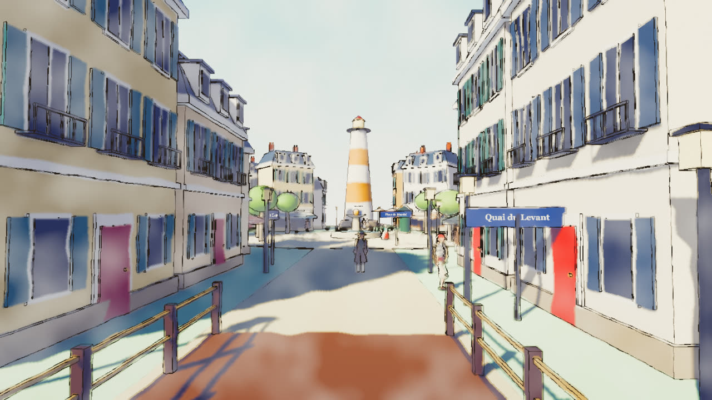 |
| 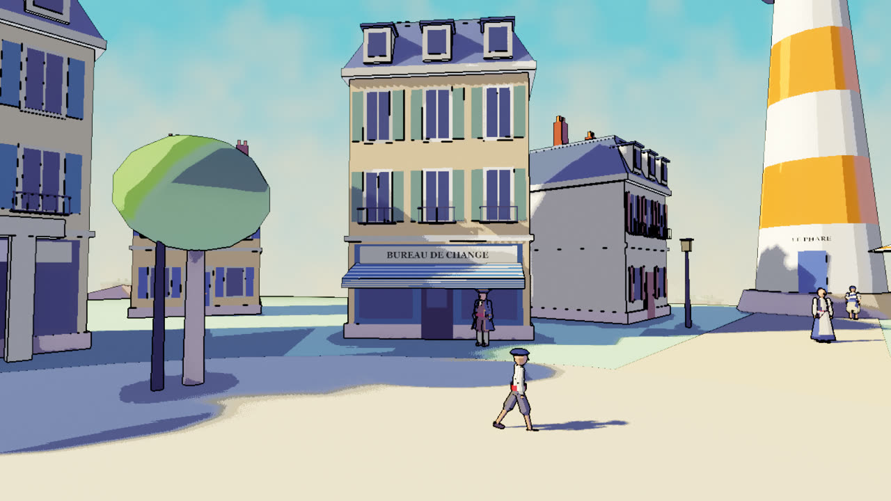 | 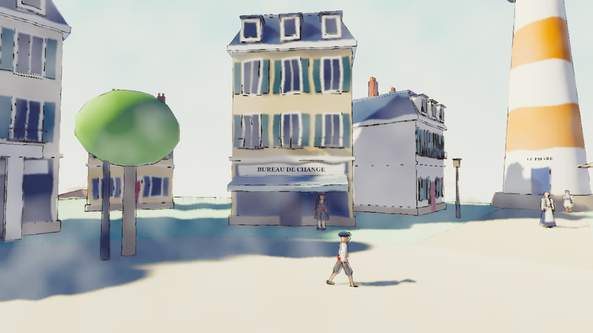 |

The square, and the second mode (V): the pen alone.

| | |
|---|---|
| 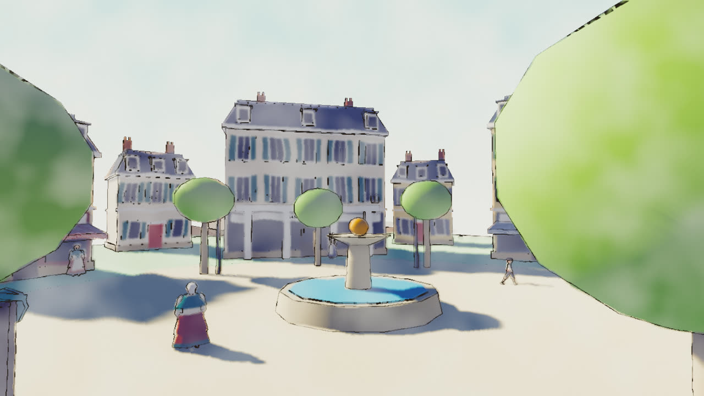 | 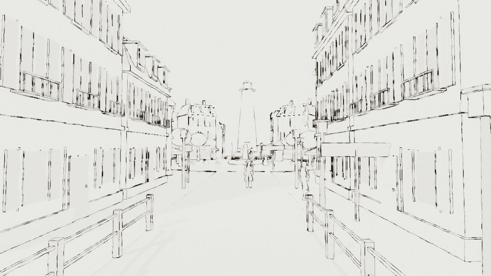 |

## The captain is redrawn in every port
Arriving from Spark Harbour: drawn in pen and ink, then the island's wind, and the wave from boots to hat. On Silk
Reach the pattern on the coat is measured from the captain, so it travels with them. Frames 0.2 s … 3.0 s;
recordings: [katazome](g3d-techniques/captain-katazome.gif), [watercolour](g3d-techniques/captain-aquarelle.gif).

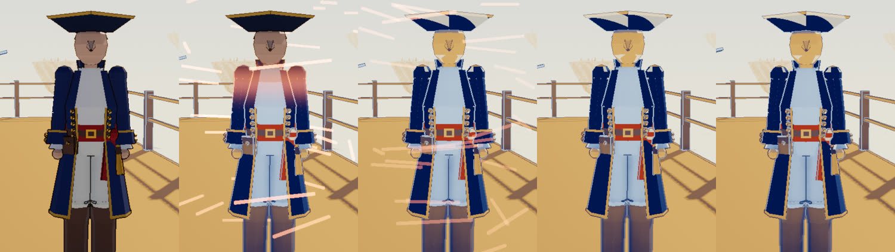
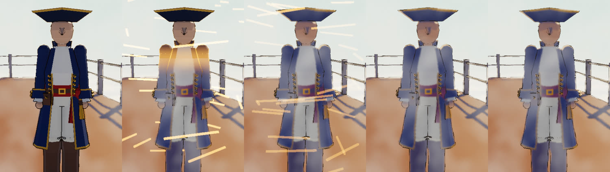

The rule is a test now (`test_island_style.gd`): every technique has its branch in the shader; every number of a
style exists twice (`…_from`); for every ordered pair of islands the wind takes the captain from one technique to
the other and ends with one style; every port tells the effect where the hero stands.

## How to rerun
```
godot --path game3d --resolution 1600x900 -- --views=<dir> --only=silk --ink=1      # or amber, --ink=2
godot --path game3d --resolution 1600x900 -- --attune=<dir> --island=silk --ink=1   # or amber
godot --path game3d --resolution 1600x900 -- --stroll=<dir> --island=silk          # a walking camera, 30 frames
godot --path game3d --resolution 1920x1080 -- --fps=<file.json>
```

## Checked
- GUT 105 green.
- Frame rate at 1920×1080 on the laptop, this run: average 281–370 Spark Harbour, 323–366 Silk Reach, 258–296
  Amber Cliff; 1 %-low 225–293, 260–280, 226–249; worst frame 4.6 ms. (Earlier runs today were capped at 120 by the
  display; this one was not. The watercolour is the heaviest of the three and stays far above 60.)

## Not done, not checked
- Not played by hand.
- On Silk Reach people carry almost no pattern now (patterns are on cloth, roofs and clouds). Whether the new
  palette is easy on the eyes over a long play is for Aika to say; frame rate was not re-measured after this rework.
- The islands' shapes are not rebuilt to the sheets: the Japanese village, vats and banners of Silk Reach (27, 28);
  on Amber Cliff the lighthouse with the keeper's house (32), the newspaper kiosk, carousel, bicycles, flower stand
  and café chairs (33), the small house and outside stairs of the kit (30), the cliff's amber veins (29).
- The comic pages are not drawn in the island's technique (they are Aika's drawn portraits on paper everywhere).
- The world audit was not re-run: nothing that people walk on or into changed in this PR.
