# G3D — the pastel toy town (ADR-0033): the first look of the index island, kept for another island

> **Superseded on the index island by ADR-0035** (a canal town in oil paint, `G3D-index.md`). Aika wants this
> technique on another island; the shader branch (`tech == 5`), the costumes and the portraits are kept. The town
> below is no longer in the game: these are the pictures of it.

A sixth island, from Aika's five sheets (`docs/design/concepts/47…51`): very rich and very boring. **A place and a
style only** — nothing can be bought there; how index investing works in the game waits for intent 03 (question 9).

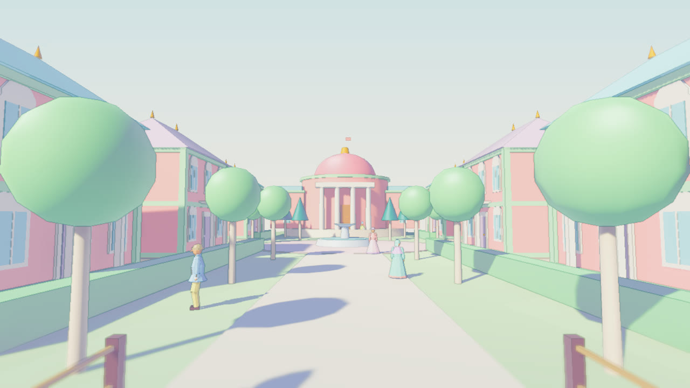

| The town from above the pier: mirror-symmetrical | The Bank Palace |
|---|---|
| 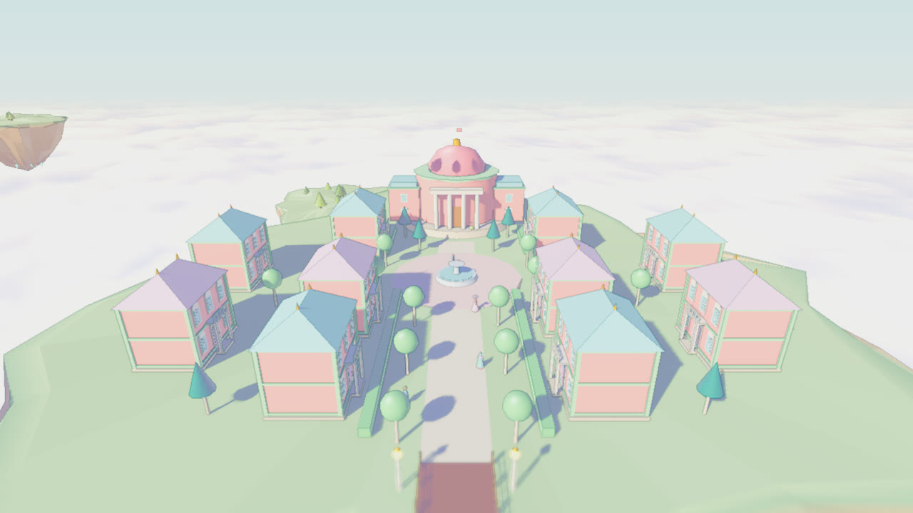 | 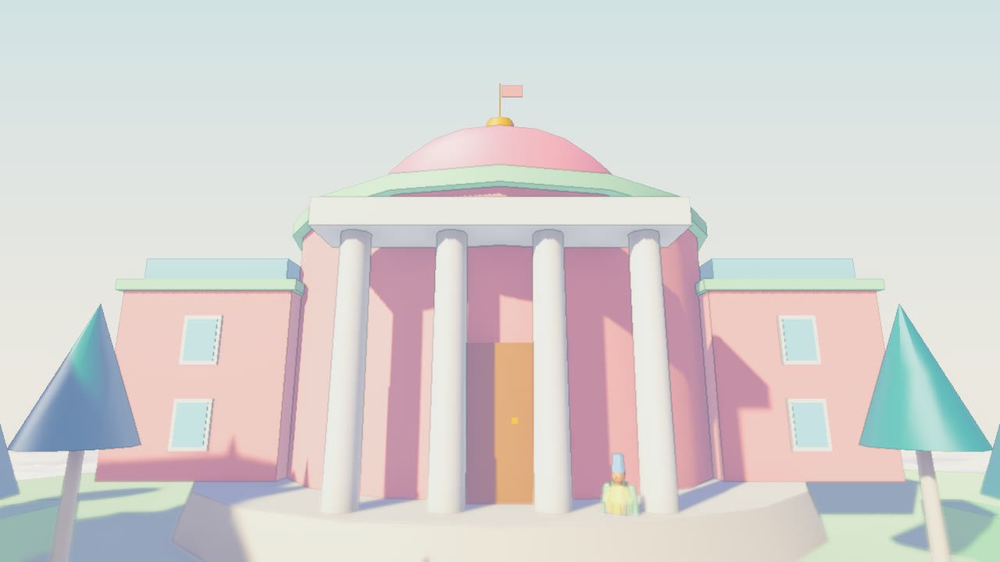 |

| Identical mansions | The pier and the sky yachts |
|---|---|
| 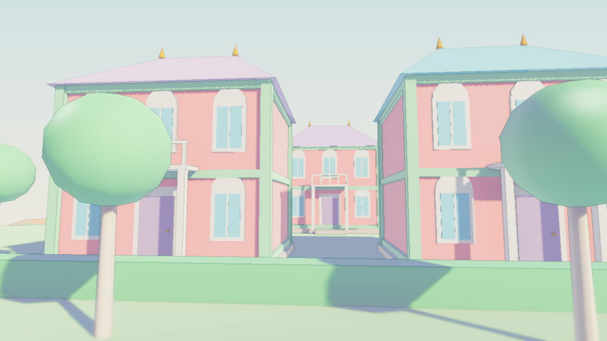 | 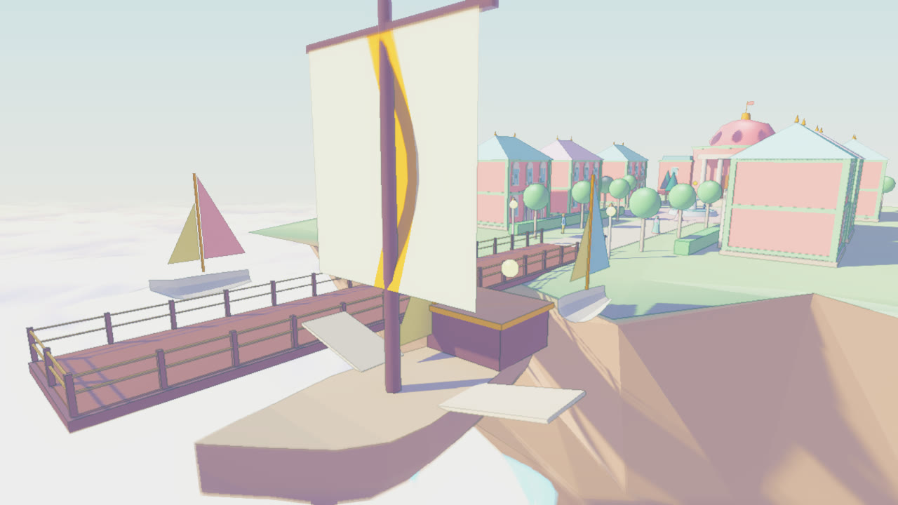 |

## The technique: a toy town
- **Pastel, low contrast**: colours lifted a little towards cream; shade is a lavender veil, never dark.
- **Gloss**: a small white highlight where a surface faces a fixed lamp above the viewer, and a paler rim —
  computed from the surface's normal alone, so it sits still on a still thing.
- **No ink line**: a soft teal seam where parts meet.
- **Tilt-shift, carefully**: the middle half of the screen is exactly sharp; only towards the top and bottom the
  picture softens, up to 5 pixels at the very rim (at 1080p). It depends on the height on screen and on nothing
  else, so it does not swim. The HUD is drawn after the effect and is never blurred. The very top of the screen
  and its middle, enlarged:

  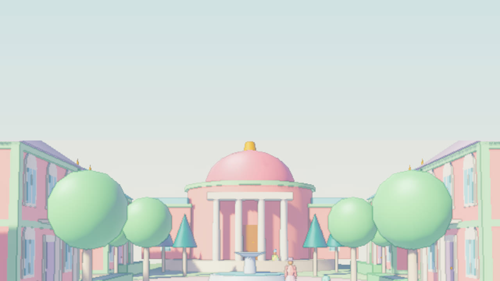
- Nothing is animated by the effect. V gives the plain version — pastel, no gloss, no blur:

  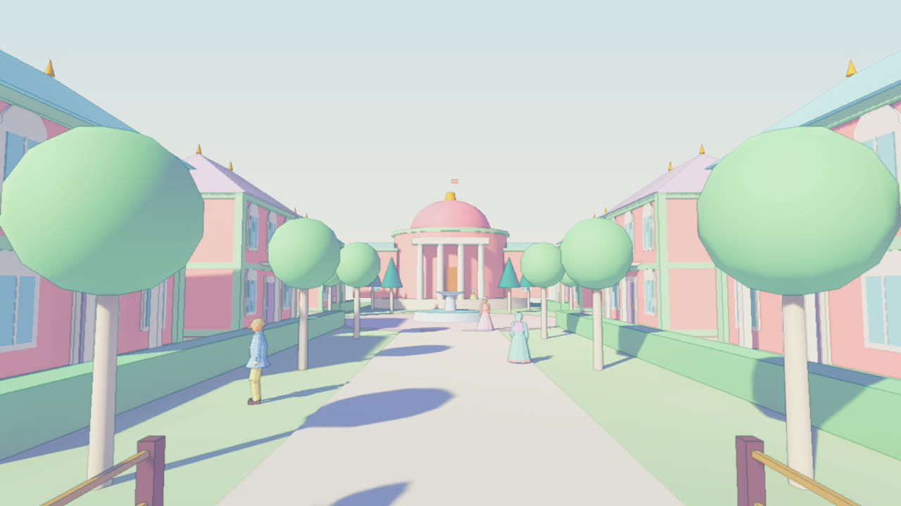

## Easy on the eyes — measured
Mean change between neighbouring frames, of 255 (a frame every 0.1 s):

| | Index island | for scale |
|---|---|---|
| camera standing still | 0.10 | crypto 0.66, noir 1.1 |
| walking 12 m up the avenue | 4.7 | watercolour 11.4, crypto 16.9, noir 29.7 |
| standing and turning 2° a frame | 7.0 | crypto 24.6 |

It is the calmest island so far: low contrast, no pattern, no line, a blur that does not depend on the scene.
Recordings: [walking](g3d-toy-town/walking.gif), [turning](g3d-toy-town/turning.gif).

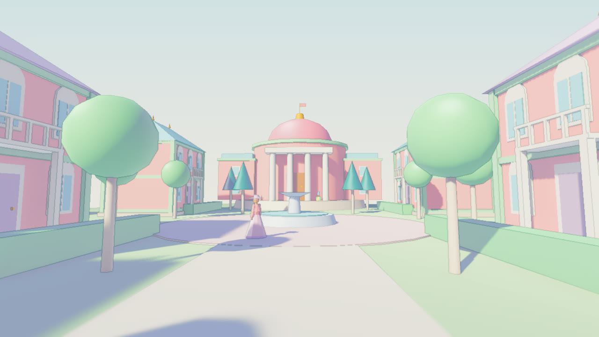

## The island
- **Strict symmetry** about the avenue: ten identical mansions in five mirrored pairs (pink walls, mint trim,
  arched windows, a balcony over the door, a hipped roof with gold finials — only the roof's colour alternates),
  hedges, lollipop trees, lamps and four sky yachts, each with its twin. A test checks that everything on one side
  has its mirror on the other and that every mansion is the same mansion.
- **The avenue** runs straight from the pier across a round square to **the Bank Palace**: a round hall with a
  portico of four columns, two wings, a rose dome with a gold lantern and a flag. Its door is a talk.
- **The fountain drops a coin** every four seconds — a regular contribution. It is the island's only motion.
- **On the flight chart**: a sixth row in `Ports`; the island lies 398 m east of Spark Harbour.

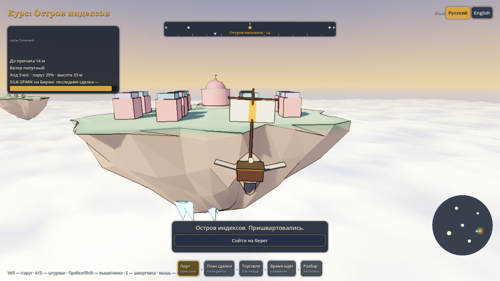

## The captain is redrawn as a toy on landing
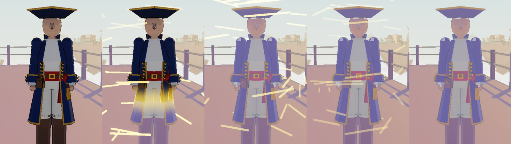

Recording: [captain-toy.gif](g3d-toy-town/captain-toy.gif).

## The islanders (sheet 50) and what they say
Five costume roles from the existing garments; in comic pages their figures from the sheet, one face each.

| The gentleman at the palace door | The lady by the fountain |
|---|---|
| 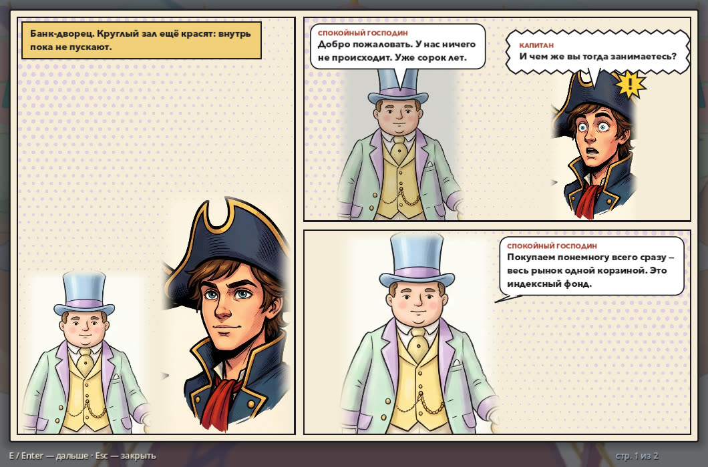 | 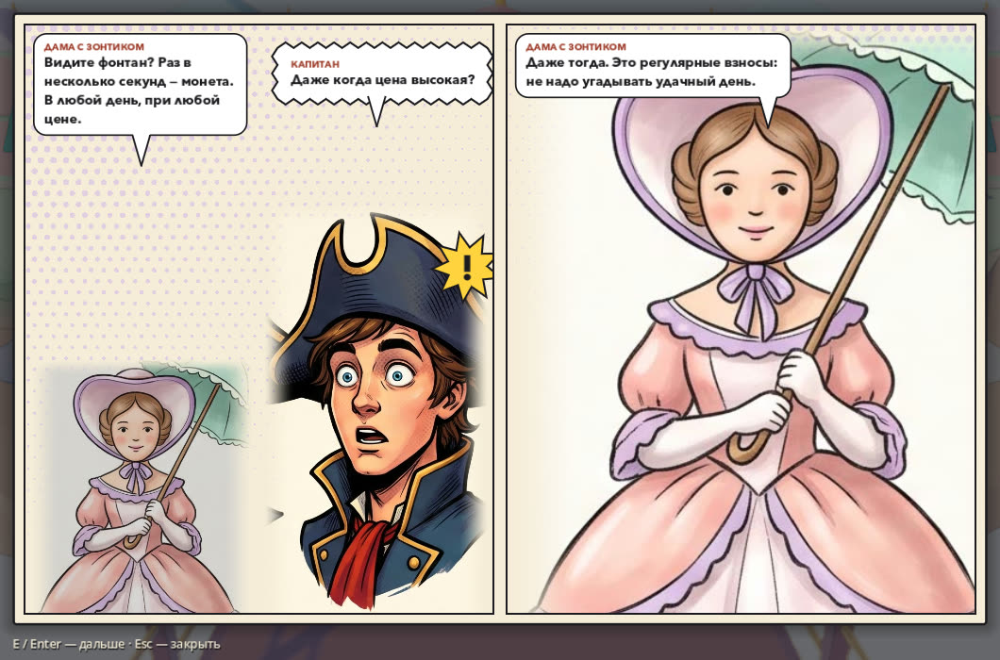 |

| Who | Idea, the real term beside the lore |
|---|---|
| The calm gentleman | the index fund — the whole market in one basket; diversification |
| The lady with the parasol | regular contributions: a coin on any day, at any price |
| The old gentleman | compound interest; time in the market, not timing it |
| The old lady | the fund's fee (TER) and what one per cent a year costs over thirty years |
| The boy in the sailor suit | "with money, boring is good" |

Words: `game3d/i18n/talk.csv` (`TALK_INDEX_*`). No real fund is named (a test checks: whether SPY and BIL may
appear is intent 03's open question 7). Nobody recommends anything.

## How to rerun
```
godot --path game3d --resolution 1600x900 -- --views=<dir> --only=index --ink=1      # --ink=2: the plain version
godot --path game3d --resolution 1600x900 -- --attune=<dir> --island=index
godot --path game3d --resolution 1600x900 -- --stroll=<dir> --island=index [--turn | --still]
godot --path game3d --resolution 1600x900 -- --flight=<dir> --island=harbour --to=index
godot --path game3d --resolution 1600x900 -- --audit=<dir> --only=index
```

## Checked
- World audit of the island: 0 findings (10 401 of 10 577 lattice cells reached from the pier; 48 villager
  strolls). Found and fixed on the way: a porch collider wider than the porch, and tree crowns at head height.
- GUT 130 green (5 new in `test_index_isle.gd`; the walk tests, the captain contract and the 90 compass flights —
  six islands, three winds — cover the new island).
- A helmsman flew harbour → index and moored (300 m).
- Frame rate at 1920×1080: average 118–119 (display cap 120), 1 %-low 62–67, worst frame 22.4 ms.

## Not done, not checked
- Not played by hand.
- **The glass dome and its wooden base are not built** (ADR-0033 says why): the sheet's main image is missing.
- Not built from the sheets: the inside of the palace, picket fences, the terraced steps and bridges round the
  square, the hedge maze, the palace as the round "mill" of sheet 49 (it follows sheet 47).
- Costumes are approximations in the old garments (no real top hat brim, no parasol, no crinoline shape); one face
  each in the talks.
- The far view of the island is plain pastel blocks (the town is built only when the captain is there).
- The other five islands were not re-audited: nothing of theirs changed.
