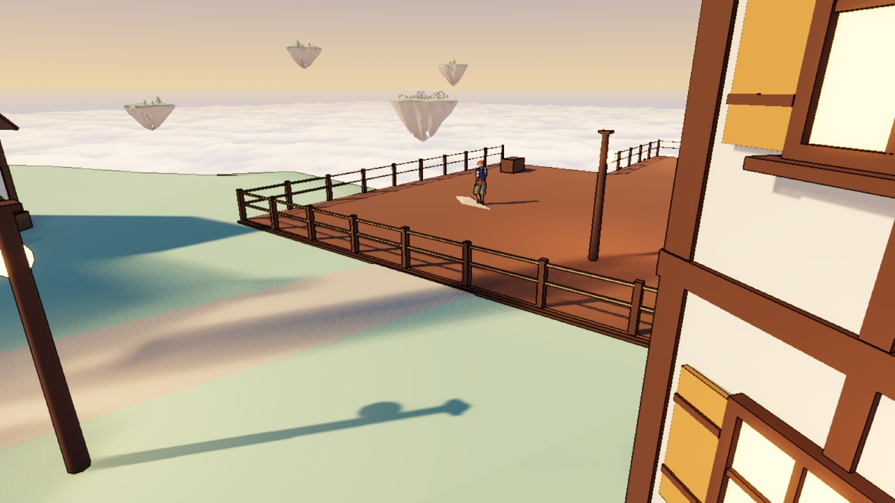
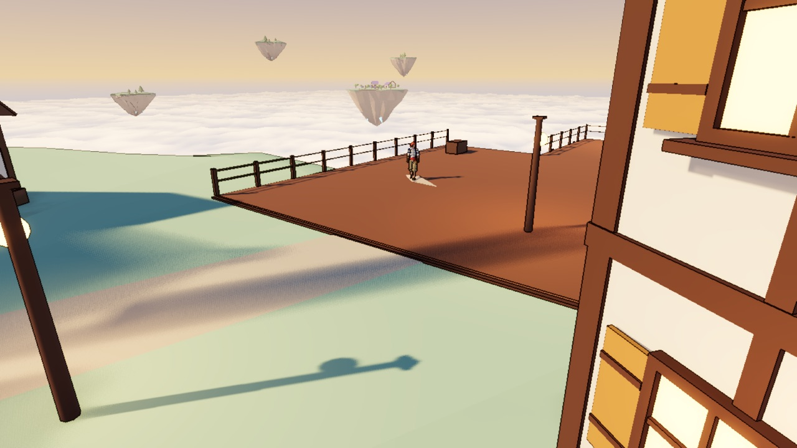
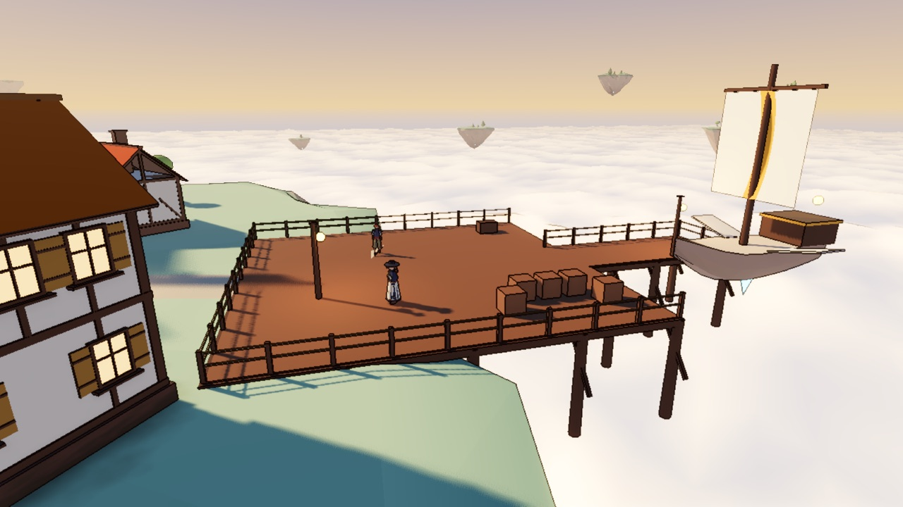
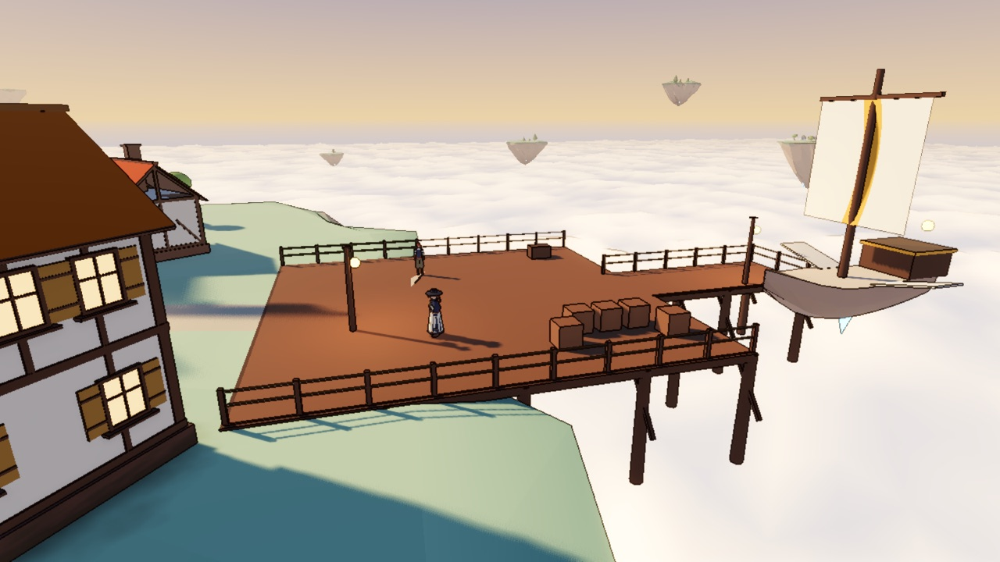
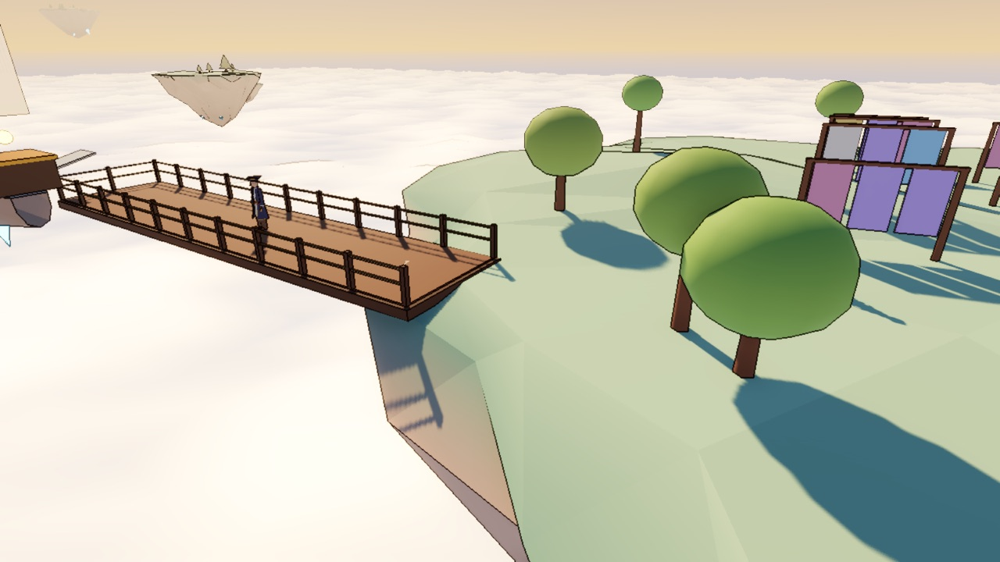
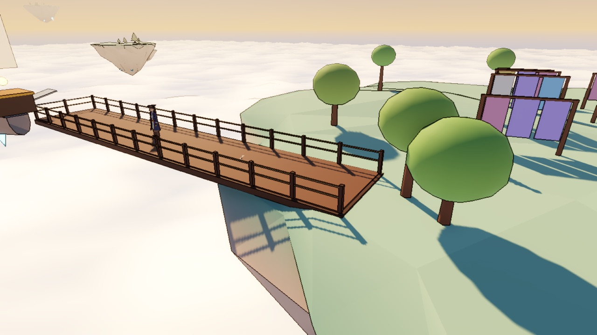
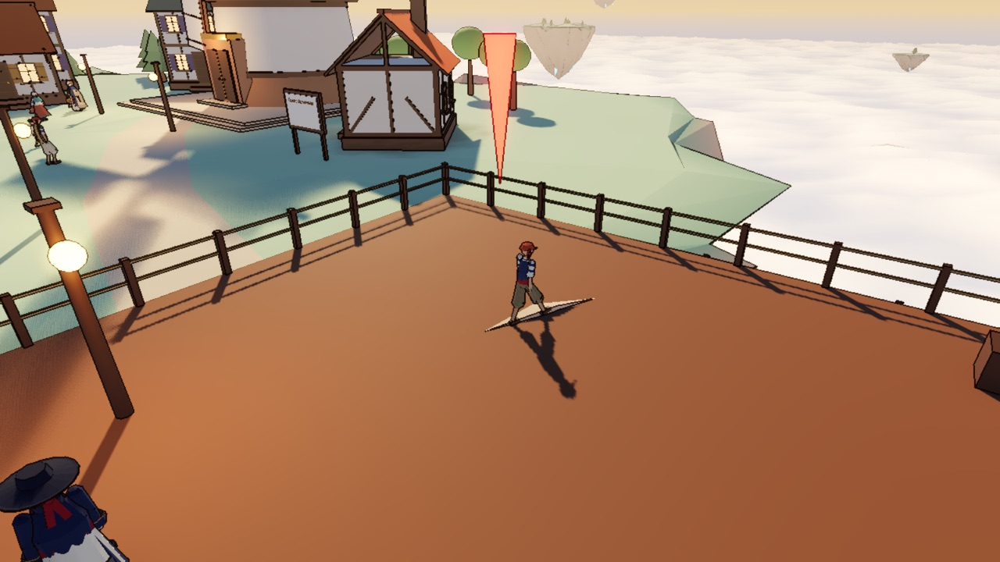

# G3D: places where people got stuck or walked through things

Aika's report: in a few places the captain and the villagers get stuck and cannot get out, and in places the captain
walks through fences and walls. The world audit of `docs/demo/G3D-polish.md` said 0 problems, so it was looking at
the wrong things. It now looks at these, found the places, and they are fixed.

## What the audit did not see, and what it does now

The old audit walked 45 steps in 8 directions from points 2 m apart and compared colliders with the triangles you
see only for things standing on the ground. Three kinds of fault pass through that net. `WorldProbe` got a fifth
section, "routes" (`scripts/world_probe.gd`):

| New check | How | Finds |
|---|---|---|
| `trap` | A lattice of every standing place 0.5 m apart; a walk from each cell to each of its 8 neighbours with the captain's own body. What can be reached from the spawn points but has no way back is a trap. Free cells nobody reaches are counted (`unreachable`) | pockets, one-way drops, an island cut off from its pier |
| `walk-through` | On every step of every walk a ray along the body's path at knee, chest and head height against the triangles you see (decks and terraces included now). The body's front may be 0.22 m in what you see, no more | rails and walls that are drawn but have no collider, colliders well inside their walls |
| `fuzz` | 40 000 steps of a player: random directions, walking and running, pushing into every corner; every 1.5 s it must be able to walk back to the lattice | traps between lattice cells, tunnelling at a run |
| `npc-stuck` | Every villager's strolls ahead of time: 12 wander targets each, the navmesh path walked with the villager's capsule and pace | paths the navmesh offers and the body cannot finish |

Run: `godot --path game3d --resolution 1600x900 -- --audit=<dir>` (add `--only=harbour|silk|hall` for one place).
It takes about a minute. The same checks on a 1 m lattice are GUT tests (`tests/unit/test_world_walk.gd`).

## What it found

Before, on `main` (the style of ADR-0024):

| Place | Finding | Count | Cause |
|---|---|---|---|
| Spark Harbour | `walk-through` Wharf | 20 | the rope rails had no collider at all; the rail on the island side of the wharf stood across the only way in, so everybody walked through it |
| Spark Harbour | `trap` along x = 23.5 | 29 | the same rail line: cells on it could be entered and not left without crossing the rail |
| Spark Harbour | `trap` on the wharf, `npc-stuck` sailor | 2 | Godot's own 3D physics froze a capsule on the wide flat box of the deck in patches (about 1 m across; one of them was the old sailor's home, so he stood there for good, and the captain stopped dead when walking east over it) |
| Spark Harbour | `walk-through` Wayfarer | 2 (in the test run) | the ship's wind vane hung over the pier at head height |
| Silk Reach | 5153 of 5410 cells unreachable | — | the low-poly island has its own outline (30 straight sides), and the pier ended up to 2.8 m short of its walkable cap; the invisible wall round the cap closed the pier, so a captain who arrived by ship could not leave it |
| both | `escape` | 2 | not a fault of the world: the probe's own rule was stricter than the fence (the rule now is "fell, or 1.5 m past the fence") |

After: 0 findings. Spark Harbour 9552 of 9572 cells reachable, Silk Reach 5448 of 5459 (the rest are tops of rails
and corners behind props), 84 villager strolls walked to the end.

## Fixes

- **Rails are solid** (`Archipelago._deck`): one thin box per railed side. The wharf has no rail on the island side.
- **Silk Reach pier** reaches 4.5 m further onto the island (`SILK_PIER_TO`): its end is inside the walkable cap
  of the low-poly island (walked by the audit) and of the `--pbr` one (by the outline formula, not walked).
- **Physics engine is Jolt** (`project.godot`, built into Godot 4.7): no frozen patches on wide floors. Stairs needed
  one change in `Mover._climb` — it looks 0.2 m ahead instead of 0.12 m, so a walker takes a step before the riser
  stops it (with 0.12 m the body lost all its speed at every step under Jolt).
- **The ship** is moored 1 m further from the Spark Harbour pier: the vane no longer sweeps the heads on the pier.
- The shape check lays its rays out from the parts a walker can touch, so the turning mill blades no longer shift
  them (that made one test fail now and then: once in eight runs here).

## Before / after

| | Before | After |
|---|---|---|
| The way onto the wharf |  a rail across it, no collider |  open; the other rails are solid |
| The wharf from above |  |  |
| Silk Reach landing |  the pier ends at the rim, an invisible wall behind it |  the pier reaches the grass |
| The sailor's frozen patch |  the audit's marker over the patch | no patch (Jolt); `test_nobody_freezes_on_the_wharf` |

## Numbers

- GUT 79 → 83, green five runs in a row. Without Jolt two of the new tests fail (frozen walkers, the sailor's
  stroll), so they do guard the choice of engine.
- fps at 1080p with Jolt: 120 average (display cap) in every view, 1%-low 88–102.
- Audit time: about 75 s for the three places; the route scans are 20 s and 12 s of it.

## Not covered

- The Exchange hall is not walked (the camera orbits there, nobody walks).
- The audit walks one body at a time: villagers blocking each other or the captain in a narrow place are covered
  only by the live test `test_villagers_keep_to_the_ground_and_walk`.
- The lattice is 0.5 m; a pocket smaller than that is found only if the fuzz walk happens to enter it.
