# G3D demo — «Летопись Ветров» in 3D (`game3d/`)

Second game client, same world and genre (ADR-0017). Art: painterly realism with Poly Haven CC0 PBR assets — HDRI sky,
textured wood/stone/plaster/cloth, a detailed ship, trees, rocks, cargo, furniture (ADR-0019, list in `game3d/ASSETS.md`).
The assets are not in git: `make assets` downloads and MD5-checks them.

## Run
```
make dev            # exchange + bots on :8080
make assets         # once: CC0 art into game3d/assets/ (git-ignored)
make game3d         # opens the 3D client
```
Another port: `cd game3d && godot --path . -- --server=http://localhost:8090`. `F3` shows fps.

Self-run demo that produced the screenshots below (Apple M5, 1920×1080, Forward+/Metal, FSR 2 at 0.8; fps is in the top-left corner of each shot: menu, hall and voyage 90–120, harbour 41–56 — the harbour is below the 60 fps target in some views):
```
cd game3d && godot --path . --resolution 1920x1080 --always-on-top -- --server=http://localhost:8090 --demo=../docs/demo/g3d
```

## 1. Main menu over the live archipelago — ru/en on the fly
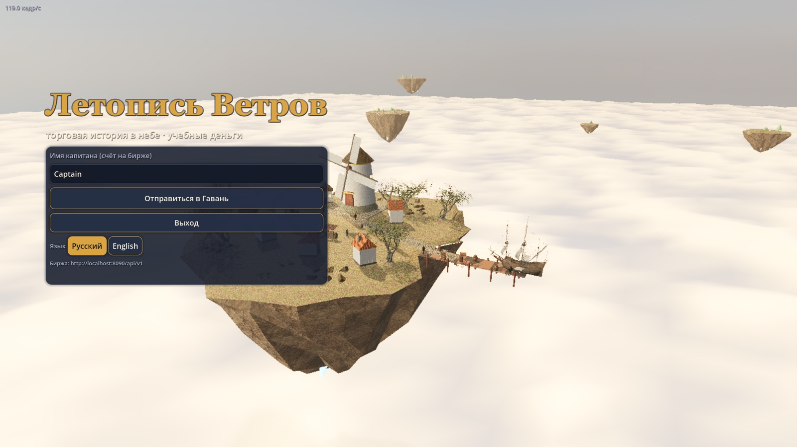
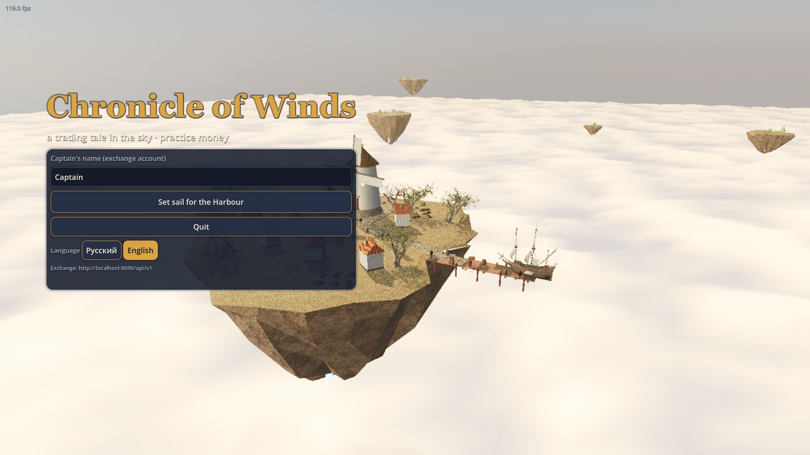

## 2. Spark Harbour — walk the captain (WASD + mouse), talk to Mara (E), fly the camera (Tab)
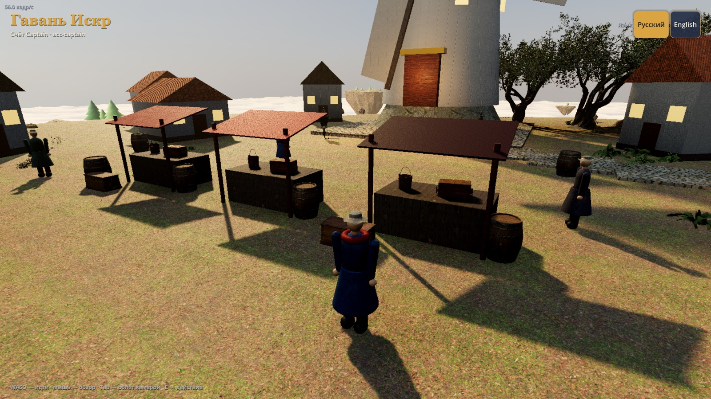
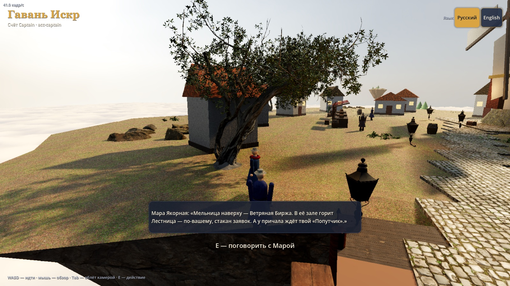
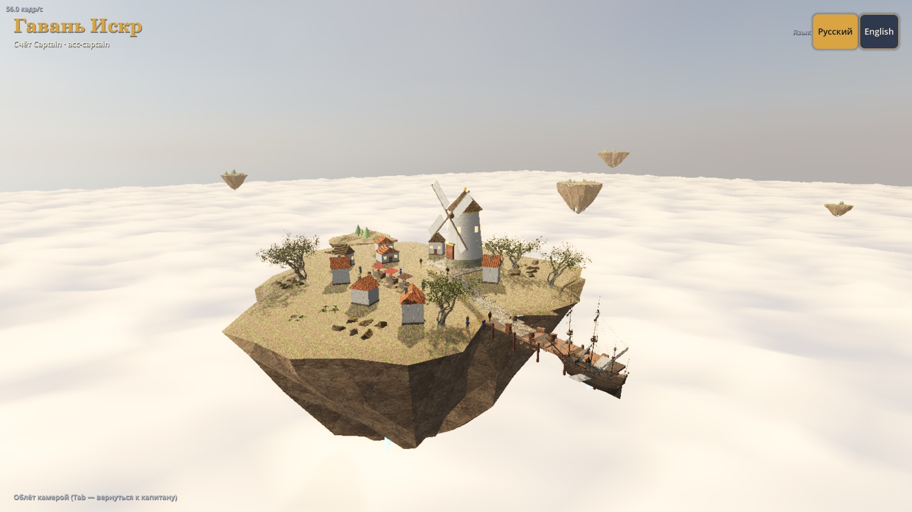

## 3. Exchange hall — the live order book on a 3D board (WebSocket), limit and market orders
Real terms lead (order book, spread, limit/market order), lore names are small captions (the Ladder, the Chasm, step onto a rung, leap over the Chasm).
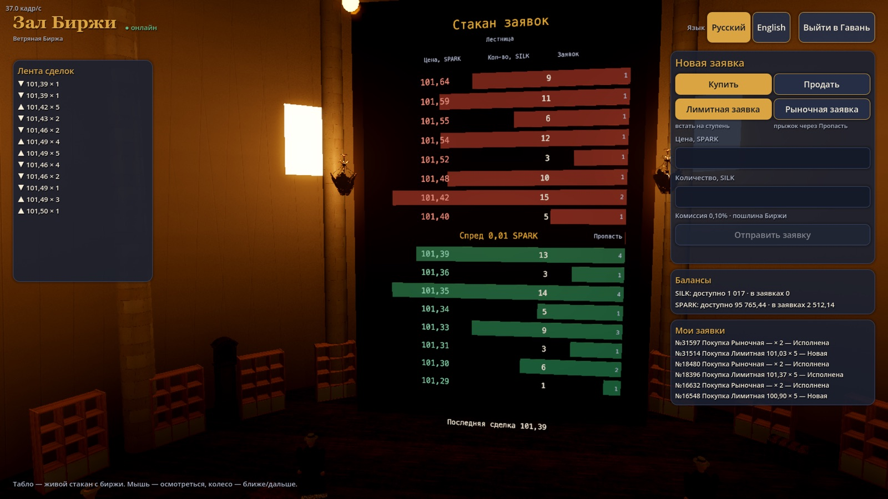
Limit buy below the best bid — stays in the book as `New`, funds go to "in orders":
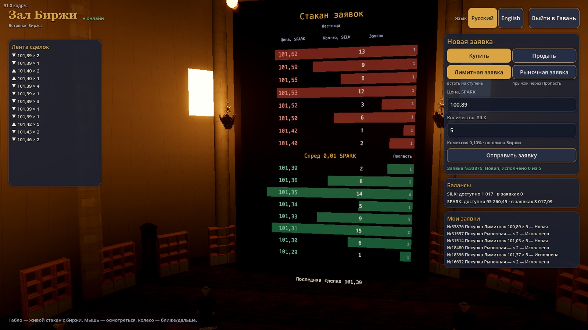
Market buy of 2 — `Filled 2 of 2`; English switched on the fly:
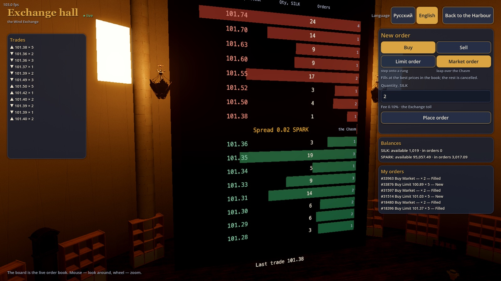

## 4. Voyage to Silk Reach — the exchange clock runs (GET /clock + `clock` channel), the market keeps trading
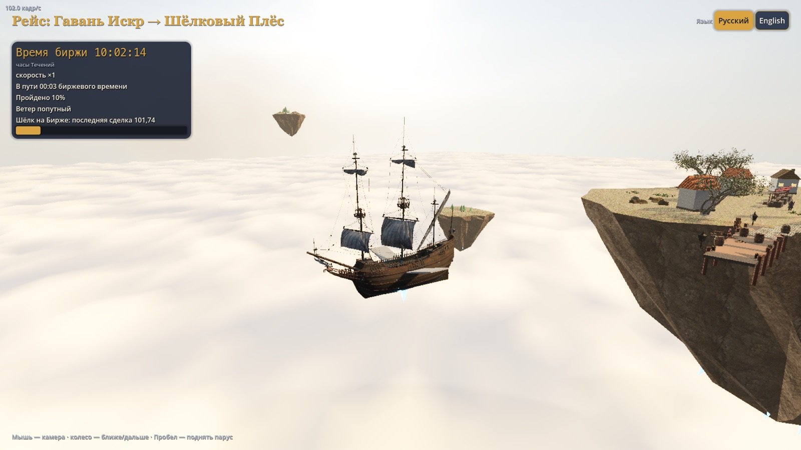
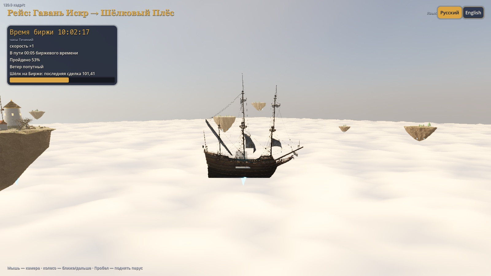
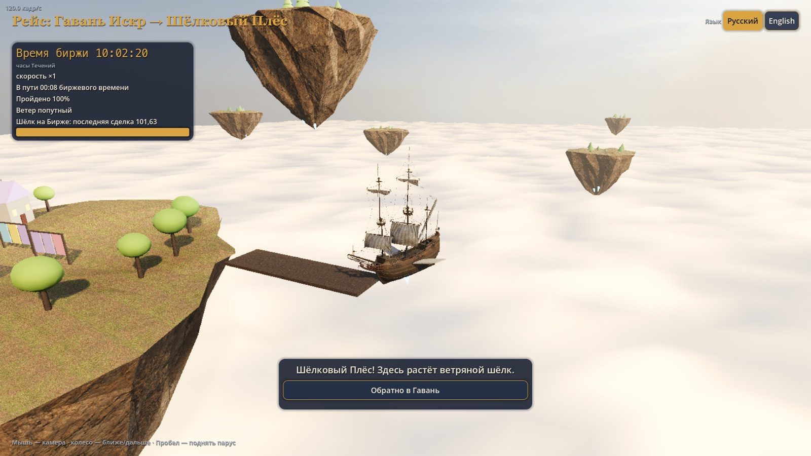

## Tests
`make test-game3d` — 22 GUT tests headless, green both with and without `make assets`: sim clock, voyage route and wind, board layout, the 3D stream's clock
extension, procedural meshes, the assets fallback, i18n (every key in ru and en, every key used in code exists, contract codes translated).
