# M1 demo — walking skeleton

One backend with bots, three clients (web debug, mobile «Ветрило», game «Летопись Ветров»), one account seen from all of them.

## 0. Tests (optional, ~1 min)
```
make test
```
Backend: 43 tests (engine, application, bots, app: contract, WebSocket, ArchUnit, journal). Web: 4 unit tests + type check.
Mobile: 5 tests (i18n keys, design tokens, money) + type check. Game: 20 GUT tests headless (needs Godot 4: `brew install --cask godot`). Web E2E: `make e2e` (needs step 1 running).

## 1. Start the exchange with its bots
```
make dev
```
Wait for `5 bots from bots.yaml (seed 42)` and `Started ExchangeApplication`. REST + WebSocket on http://localhost:8080.
The market maker and four noise traders start trading at once. Events go to `data/journal.jsonl`;
`make reset` forgets everything.

## 2. Web client
In a second terminal: `make web` → open http://localhost:5173, log in as **Aika** (any name works; no password).
Expect: the ladder (asks ▼ above, bids ▲ below, spread and last trade in the middle) moving, the trades tape filling,
balances 100 000.00 SPARK and 1 000 SILK. Switch Русский/English in the header. Pause or speed up the clock
(×1…×60) — the bots stop while paused.

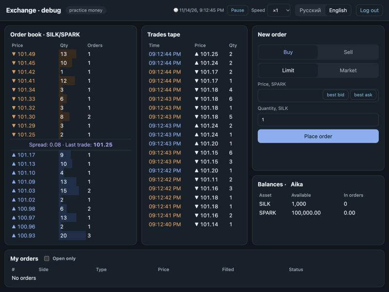

## 3. Mobile app
In a third terminal: `make mobile` and press `i` for the iOS simulator (needs Xcode), or `make mobile-web` and open
http://localhost:8081 in a browser with a phone-sized window. Log in as **Aika** too.
- Home: cash balance with the «учебные деньги» badge, current and brokerage accounts.
- Инвестиции: last price, order book with spread in SPARK and %, trades tape.
- Купить → ticket: Лимитная, price `90.00`, quantity `3` → «Заявка №…: Новая». Total and fee are shown before sending.
- Ещё: language switch, log out.

| Home | Instrument | Ticket |
|---|---|---|
| 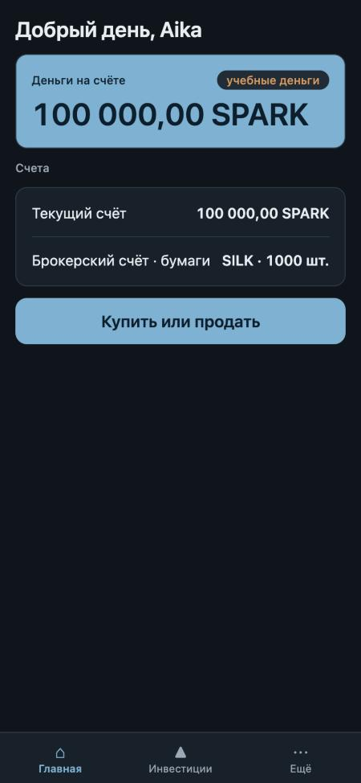 | 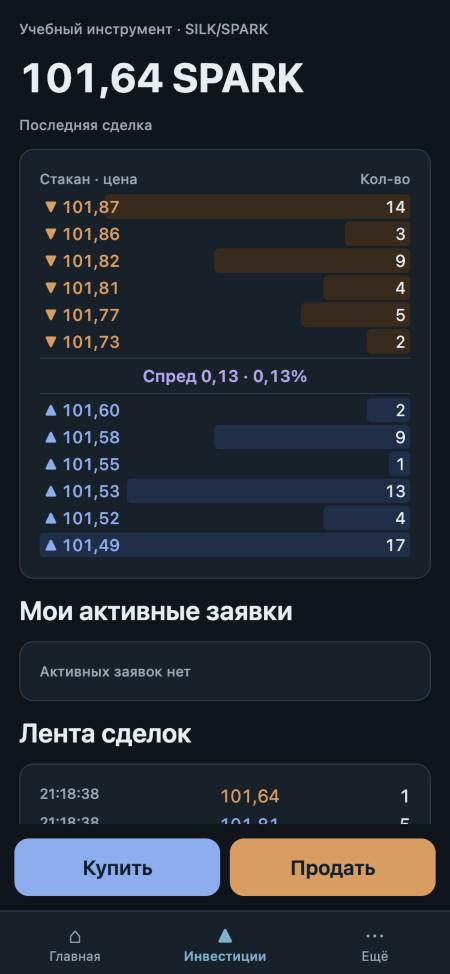 | 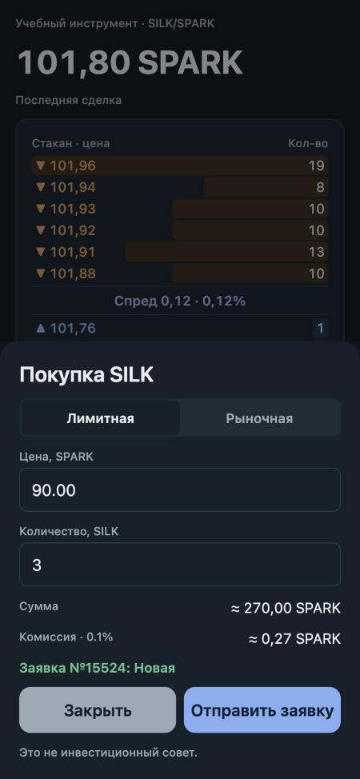 |

## 4. The same order in the other client
Back in the web client, «My orders» shows the order placed on the phone (status New, 270.27 SPARK in orders = 3 × 90.00 + fee 0.27).
Cancel it on the web: the phone's «Мои активные заявки» empties within a tick (the account channel nudges both clients).

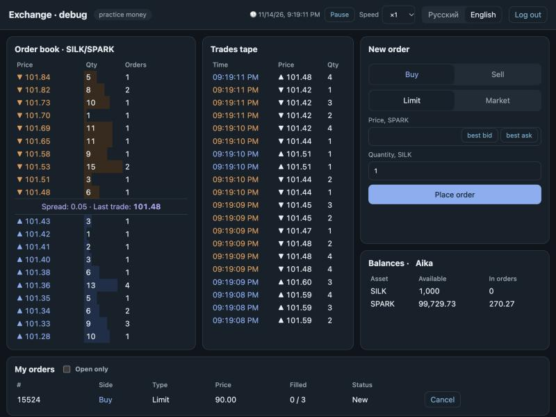

## 5. The game «Летопись Ветров»
In another terminal: `make game` (Godot 4.7; `make dev` must be running).
- Main menu: switch Русский/English — every text changes at once. Captain's name is the exchange account: type **Captain**
  (or the name you use in web and mobile) → «Отправиться в Гавань».
- Гавань Искр: Mara calls the Ladder by its real name, order book. «На Биржу: стакан заявок».
- Стакан заявок · *Лестница*: the live book from the WebSocket (asks above, bids below, «Спред … · Пропасть» in the middle),
  trades tape, balances. Real terms lead, lore names are the small grey captions.
- «Лимитная заявка», price below the best bid, quantity `3` → «Заявка №…: Новая, исполнено 0 из 3», SPARK moves to «в заявках».
- «Рыночная заявка», quantity `1` → «Заявка №…: Исполнена, исполнено 1 из 1», SILK balance +1.

| Menu (en) | Harbour | Limit order rests | Market order fills (en) |
|---|---|---|---|
| 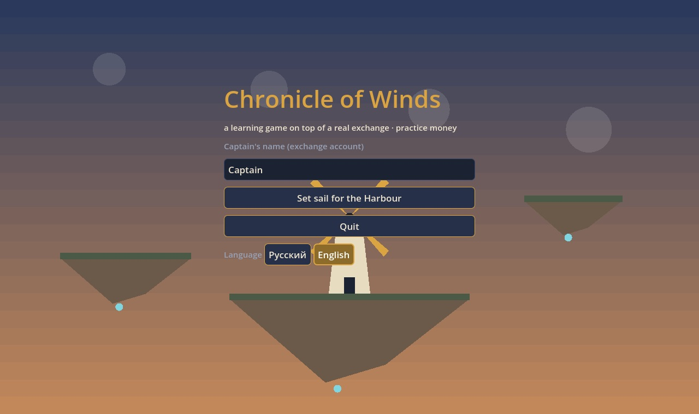 | 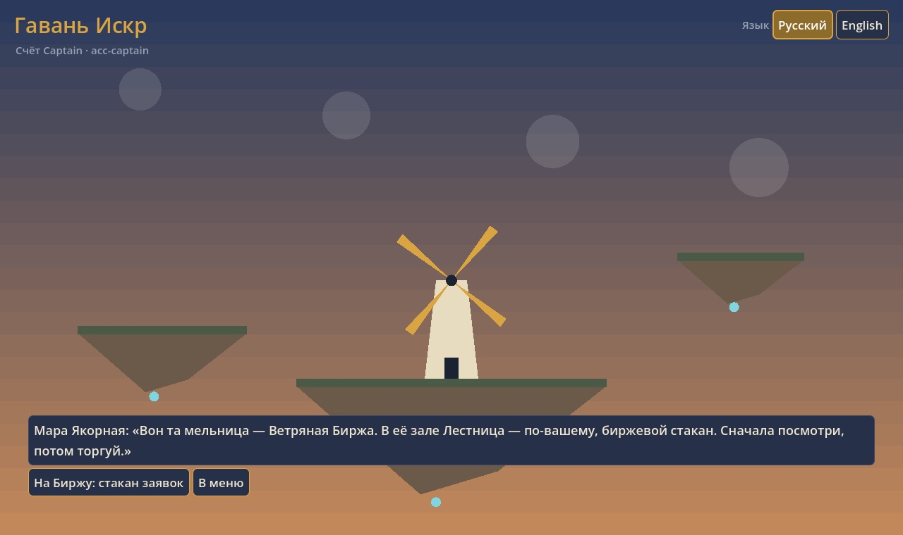 | 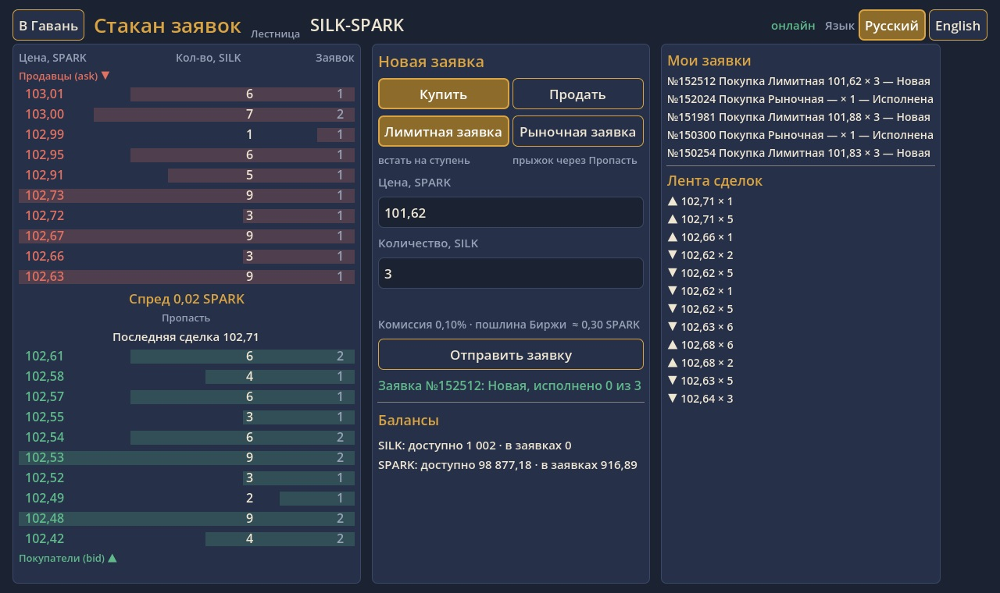 | 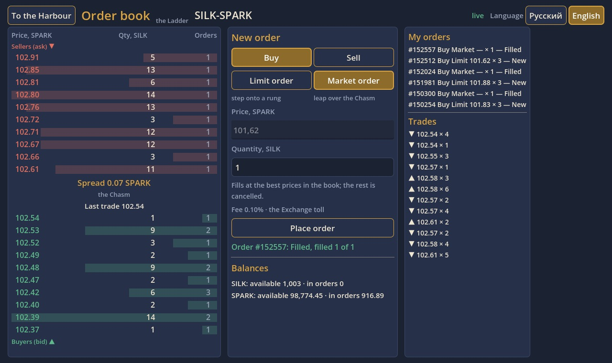 |

## 6. The game's order in web and mobile
Log in as **Captain** in the web client and in the mobile app. The limit order placed in the game (here №152512, buy 3 × 101.62)
is in «My orders» on the web and in «Мои активные заявки» on the phone; the market order is there as Filled.
Cancel it in either client — the game's «Мои заявки» and balances update within a tick (account channel).

| Web | Mobile |
|---|---|
| 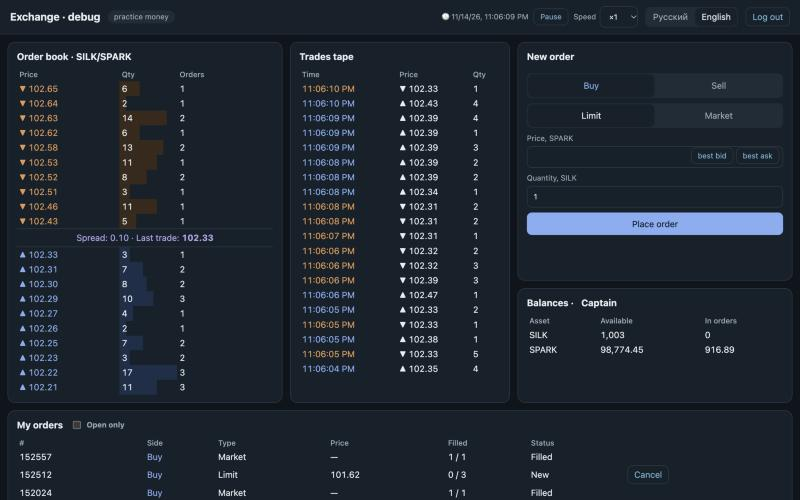 | 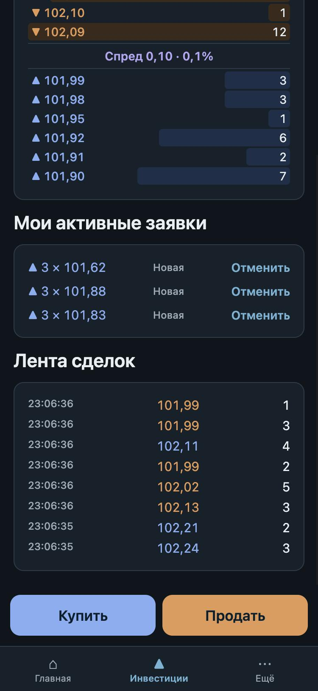 |

Without clicking: `cd game && godot --path . -- --demo=/tmp/shots --name=Captain` walks the same path and saves screenshots.

## 7. Restart without losing anything
Stop `make dev` (Ctrl+C) and start it again: the journal is replayed, the open order and the reservation are still there.

## What to read while it runs
- Single writer: `backend/application/.../Sequencer.java`, the race in `engine/OrderBookRaceTest.java` (ADR-0006).
- Event sourcing: `engine/Event.java`, `Exchange.replay`, `app/journal/FileJournal.java` (ADR-0005).
- Strategy / Template Method / Factory: `backend/bots` (ADR-0007), parameters in `bots.yaml`.
- Game: `game/scripts/market_stream.gd` (Observer over the socket), `locale.gd` (message catalogue, ADR-0014), `ladder.gd` (ADR-0011, ADR-0012).
- Contract: `api/openapi.yaml`, `api/asyncapi.yaml`, `ContractTest` (ADR-0003, ADR-0016).
