# M2a demo — stops, leverage, statement, deposits

Second instrument `AMBER-SPARK` (FX), conditional orders outside the book (ADR-0008), leverage ×4 with stop-out at 50%,
a statement with fee, spread and 10% tax, savings deposits with compound interest. Web and mobile; the game is unchanged.
Old journals do not replay (new event fields): run `make reset` once.

## 0. Tests (~1 min)
```
make test
```
Backend: engine examples for stops, margin and savings + jqwik properties (money conserved across stops, loans and interest;
replay gives the same state; stops fire only on a trade price meeting their condition; no open position below half its
collateral), statement projection, contract test for every new endpoint. Web 12, mobile 10 tests + type checks.
Game tests run if Godot is installed, otherwise skipped. CI runs the same `make test` (`.github/workflows/ci.yml`).

## 1. Start
`make dev` (now 9 bots on two markets: `5 bots … 9 bots on 2 markets`), `make web`, `make mobile-web`. Log in as **Aika**.

## 2. Stops: «сработала ≠ исполнена» (web → «Стопы и тейк-профит»)
- Stop-market SELL 5 SILK, stop 99.90: fired at trade price **99.56** (a print below the stop, not a book quote) → «Исполнена 5/5».
- Stop-limit SELL 3, stop 105.00, limit 120.00: fired at 101.66, its sell rests above the market → «Сработала, заявка не исполнена», 0/3.
- Trailing take-profit: waits for 103.00, then follows the best price and sells on a pull-back of more than 0.50.

| Stops (ru) | Stops (en) |
|---|---|
| 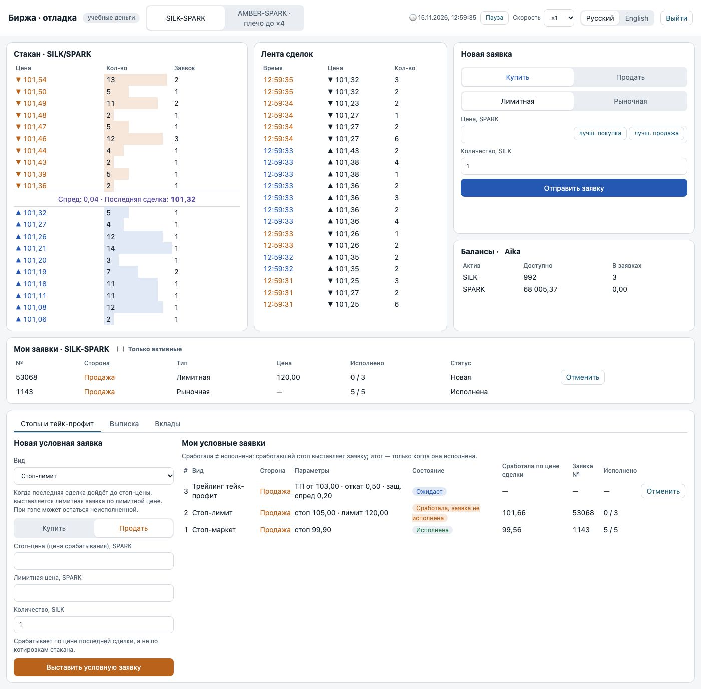 | 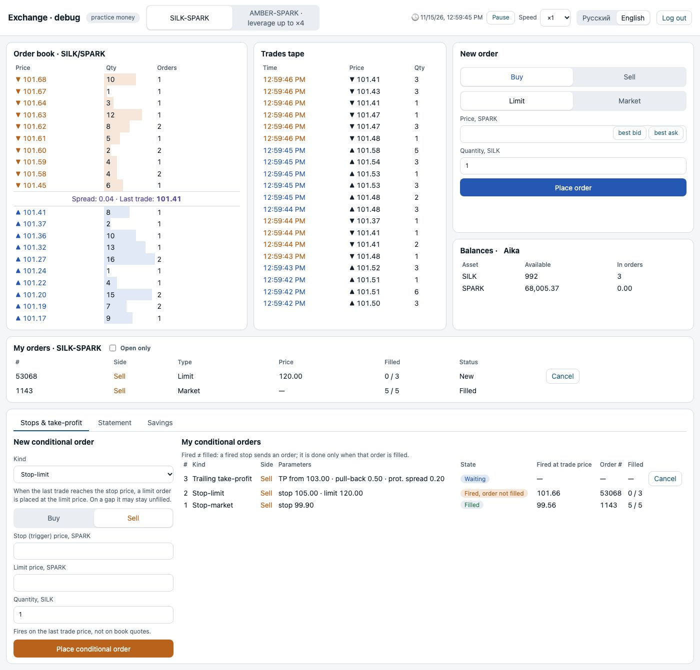 |

## 3. Leverage ×4 on AMBER-SPARK (web → «Плечо и маржа»)
Long 100 AMBER ×4 at ≈500.56: collateral 12 539.02 SPARK (¼ of notional + fee), the bank lends 37 542.00.
The table shows equity against the stop-out line (50% of collateral) and the stop-out price (≈438.11).
Stop-out and a gap through it are shown by `MarginTest` (the live market rarely moves 12%).

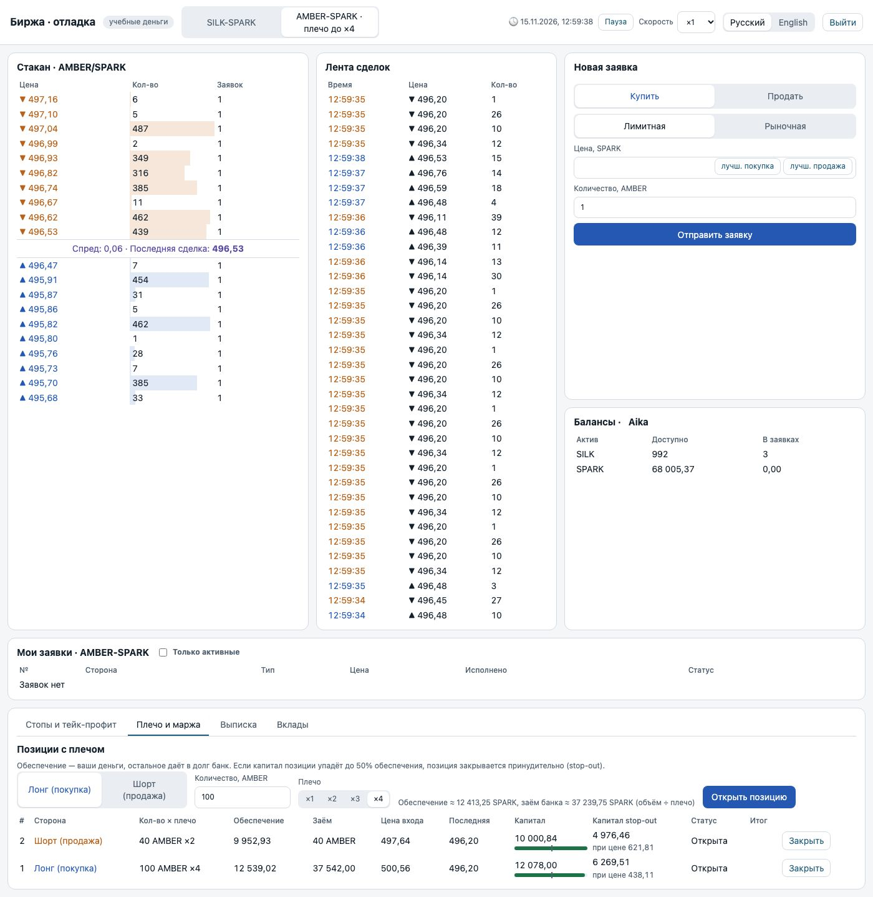

## 4. Statement and deposits
Statement: every trade with fee, mid and spread paid (negative = earned by the resting side), realised profit (average
cost) and «Налог 10%» on the period's profit. Deposits: 14% a year compounding daily; a bank day = 1 minute of simulation
time, so at ×60 the balance visibly grows every second.

| Statement (web) | Deposits (web) |
|---|---|
| 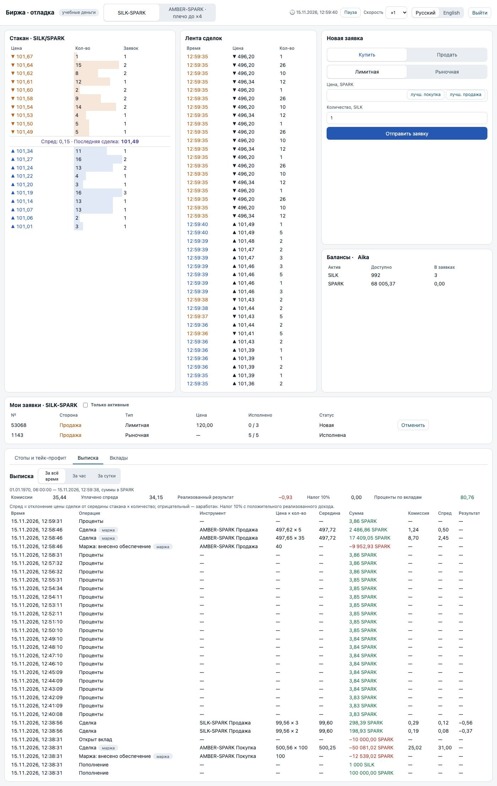 | 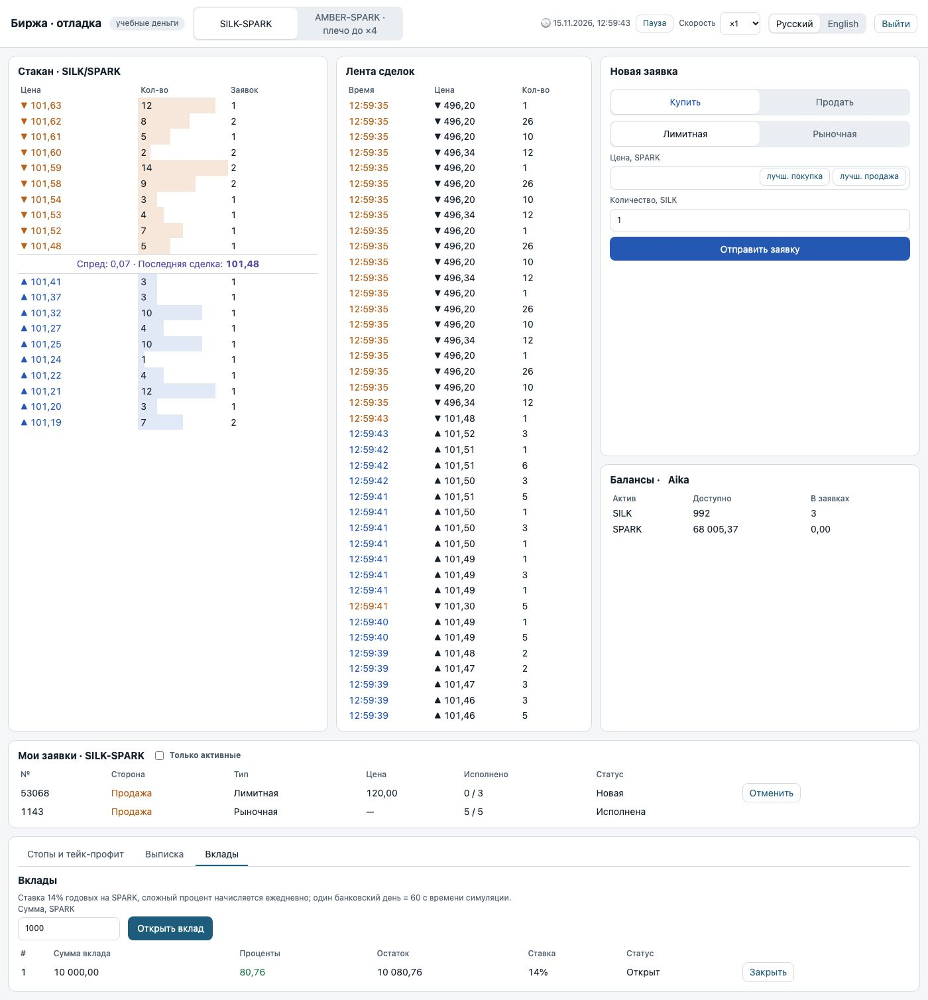 |

## 5. Mobile «Ветрило»
- Обмен: buy rate (best ask) and sell rate (best bid), mid, spread in SPARK and %, the cost before sending.
- Инвестиции: SILK/AMBER, stop ticket, my stops with states, position-size helper `qty = capital × risk% / (entry − stop)`.
- Вклады: rule of 72 (14% → ≈5.1 years). Ещё → Выписка.

| FX | FX (en) | Stops | Position size |
|---|---|---|---|
| 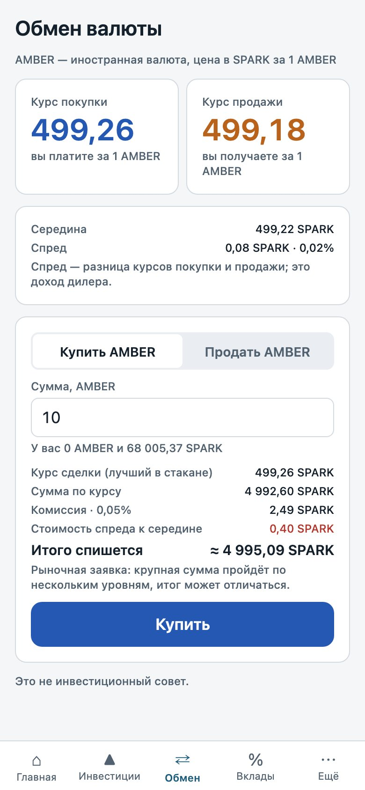 | 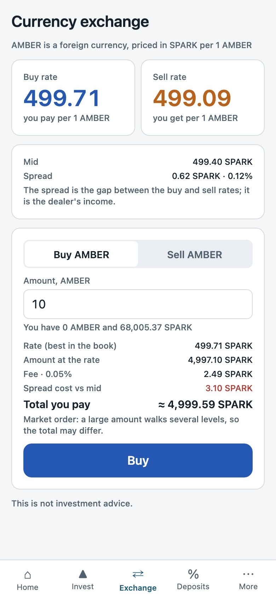 | 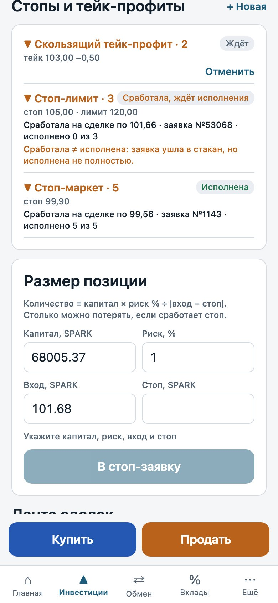 | 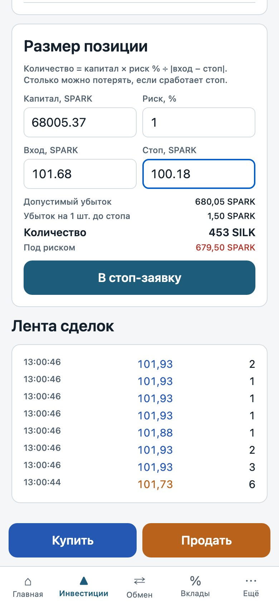 |

| Stop ticket | Deposits | Statement |
|---|---|---|
| 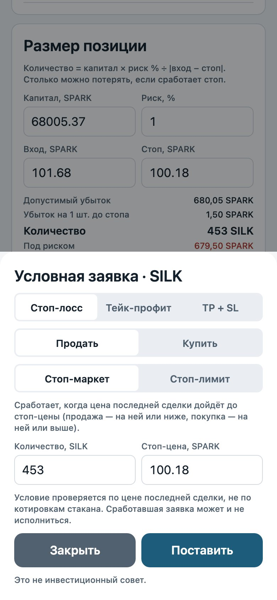 | 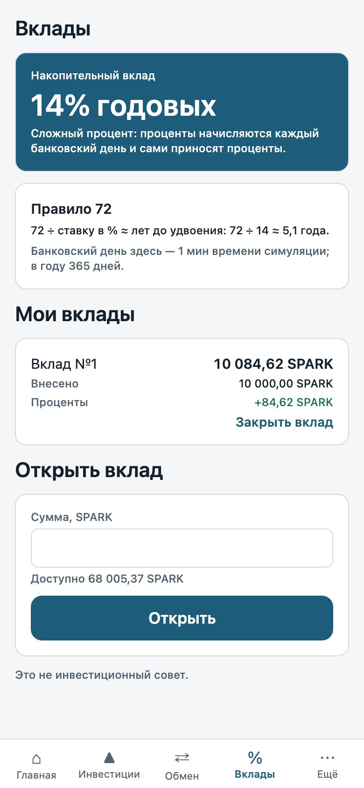 | 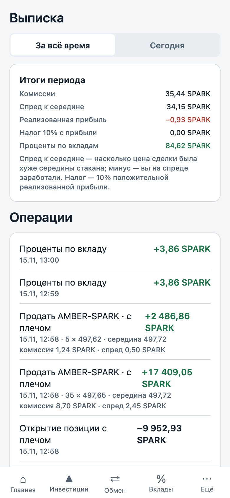 |

## 6. Restart
Stop and start `make dev`: stops, positions, deposits and the statement come back identical (checked on a 78 735-event journal).

## What to read
- `engine/Conditional.java` (state machine), `Exchange.drain` (Observer over trade prices, cascade), `Exchange.openMargin` / `tryClose`.
- `application/StatementProjection.java` (projection / CQRS read model).
- ADR-0008 (accepted), ADR-0017 (one writer), `DECISIONS.md` → M2a.
