# M2b demo — companies, central bank, bonds, real world

Companies with quarterly reports (consensus → report at night → gap by the surprise), the central bank with 8 rate
decisions a year, bonds with YTM/duration/coupons/default, four new bot strategies and storms, catalogue and glossary via
BFFs, «Реальный мир» with paper positions. Tails of review №2: versioned journal (an M2a journal replays, no
`make reset`), `Idempotency-Key` on every creating POST. Games unchanged. ADRs 0020, 0021; 0004, 0012, 0015 accepted.

## 0. Tests
`make test` — backend: engine payouts/halts/default with a jqwik property (money conserved, replay equal), idempotency
keys, M2a journal replay (`JournalVersionsTest`), economy schedule determinism (jqwik), a simulated year (8 decisions,
GBND defaults on the 4th coupon, restart publishes nothing twice), bots, contract tests for every new endpoint,
catalogue/glossary completeness. Web 17, mobile 15 tests + type checks.

## 1. Start
`make dev` (26 bots on 5 markets), `make web`, `make mobile-web`. Log in as **Aika**, set the clock to ×60:
a bank day passes every real second, a season (91 days) in about 1.5 minutes.

## 2. A report night (web → «Компании», mobile → company card)
Consensus is published 5 days ahead; the stock is halted in the evening, the report comes out, it reopens next morning.
SILK season 1: EPS 1.11 vs consensus 0.98 → surprise +13% → the price opened ≈109 from ≈100. Insiders bought
days before (they buy more often before good hidden news). Dividend 0.44 paid at the ex-date; price drops by it.

| Web company | Mobile: gap warning for my stop | Mobile: chart with ex-date |
|---|---|---|
| 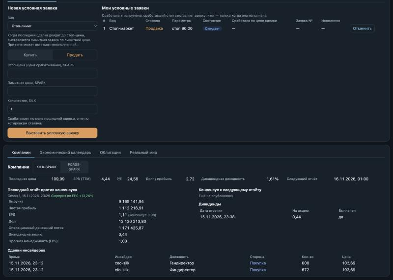 | 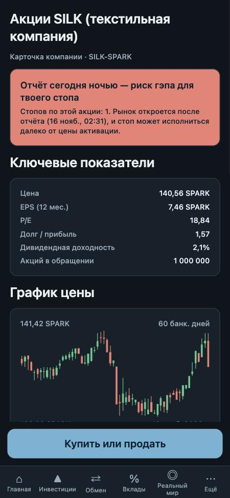 | 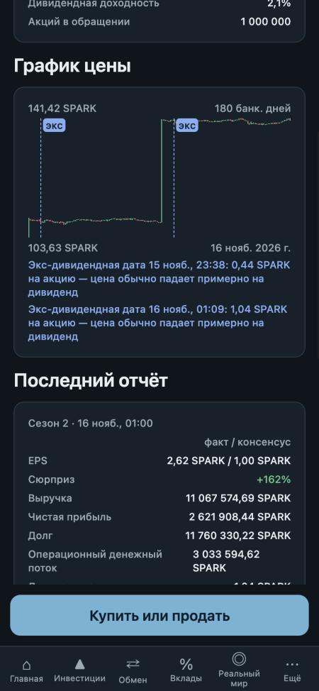 |

## 3. Economic calendar and the central bank
Policy rate, inflation, real rate, deposit rate (policy − 2%: new deposits follow the bank), regime (storm = 2–4×
volatility). Future rows show dates only; results appear when they happen.

| Web | Mobile ru | Mobile en |
|---|---|---|
| 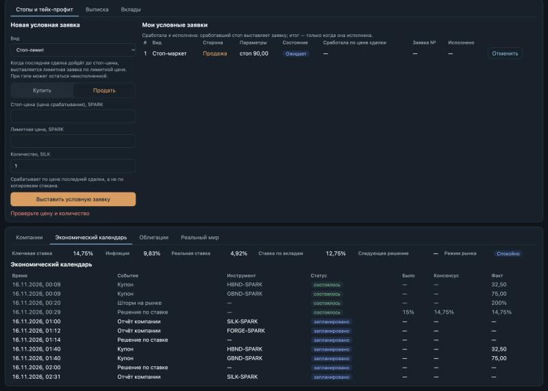 | 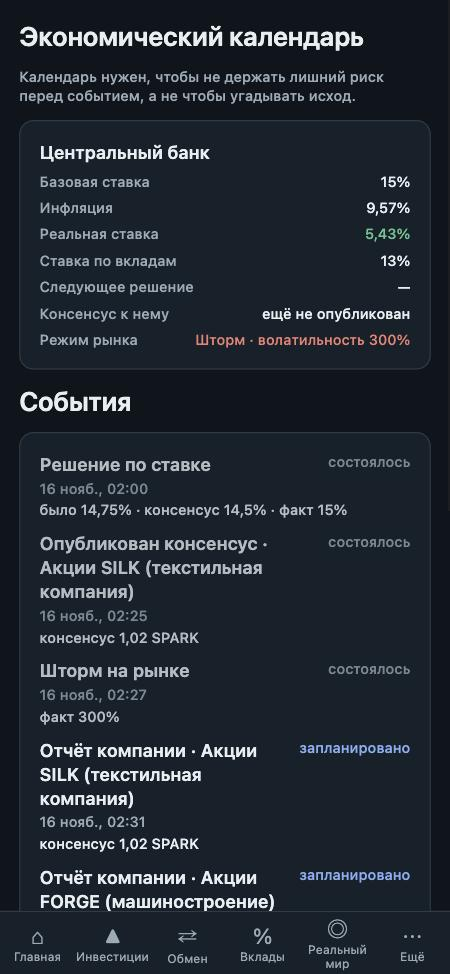 | 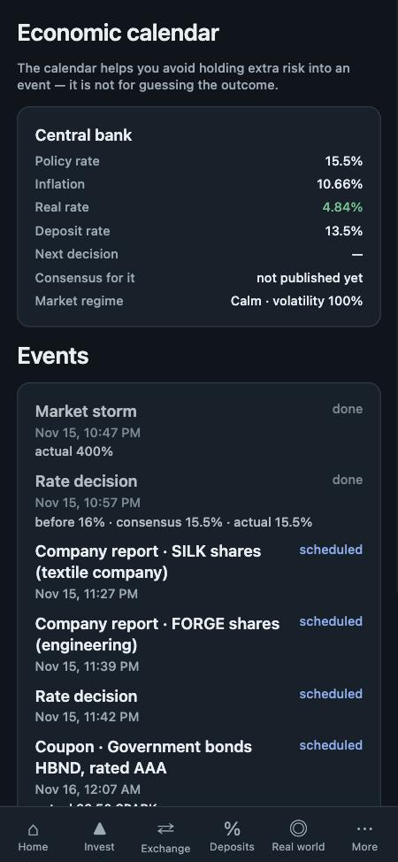 |

## 4. Bonds
HBND (AAA, 13%, 3 years) and GBND (CCC, 30%, 2 years). YTM always shown, modified duration, coupons paid/left.
A rate surprise re-prices them through duration; GBND's issuer runs out of cash and defaults on the 4th coupon
(about 6 real minutes at ×60) — holders get almost nothing at maturity.

| Web | Mobile |
|---|---|
| 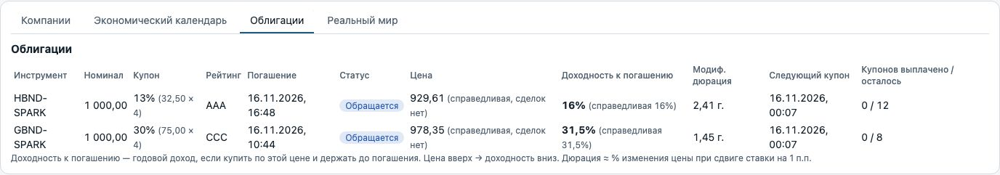 | 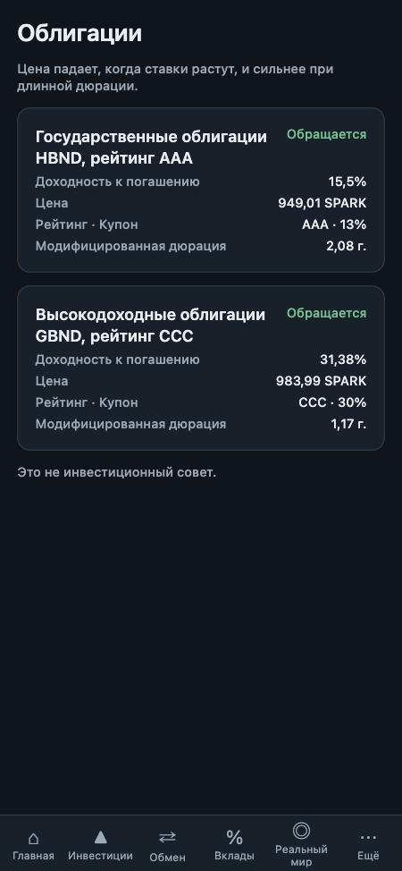 |

## 5. «Реальный мир»
USD/KZT, EUR/KZT and the base rate from **recorded sample data** (terms of live sources not checked — see STATUS);
source, quote time and a «образец данных» badge on every screen. Paper positions: no money moves.

| Web | Mobile | Mobile paper |
|---|---|---|
| 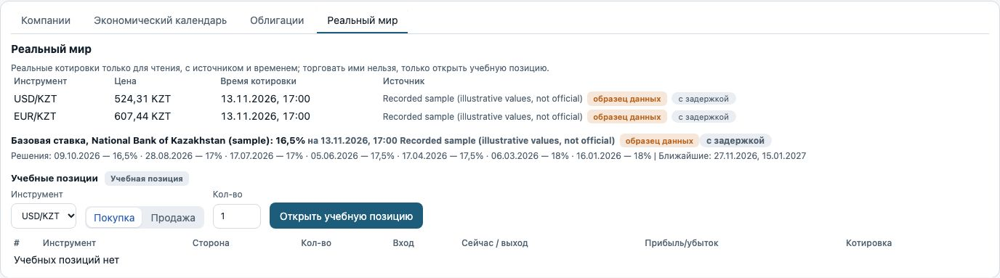 | 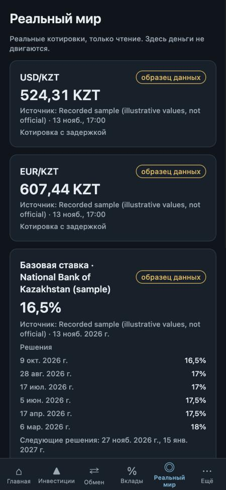 | 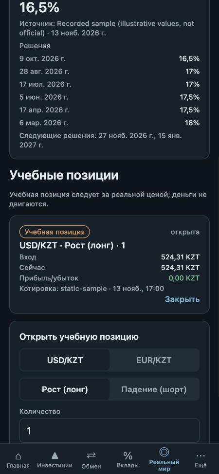 |

## 6. Old journal
Start the M2b build on an M2a `data/journal.jsonl`: it replays (lines without `"v"` are lifted by the upcaster).
