# M2c demo — ATR, trade journal, dividends with dates and tax, funds

Closes M2. ATR(14, Wilder) per instrument and a «стоп = k × ATR» mode in the position-size helper (risk still in R);
a trade-journal note on every order (why, market state, mood, planned risk) and a session review by mood and market
state in money and R; dividends with ex/record/pay dates, the reference price lowered at the ex-date open, 10% tax
withheld at source and visible in the statement; an index fund and an active fund with TER charged by the simulation
clock and compared with their own basket. ADR-0022 (Accepted). Tail: the `WebSocketTest` CI flake is fixed. Games unchanged.

## 0. Tests
`make test` — backend: `engine.M2cTest` (notes, ex-date entitlement survives a sale, tax withheld, fund fee; jqwik property:
dividends + fund fees conserve money and replay to the same state), `AtrTest`, `M2cContractTest` (journal note, review,
ATR, funds with fees after 120 bank days, dividend tax in the statement), all M2a/M2b tests unchanged. Web: vitest 24
(M2c math: ATR sizing, R text, journal note) + `tsc`. Mobile: 16 `node --test` + `tsc`. i18n key tests ru/en in both.

## 1. Start
`make dev`, `make web`, `make mobile-web`. Log in as **Aika**, clock ×60 (a bank day per real second). An M2b
`data/journal.jsonl` replays as is: M2c only adds new event types (the line format stays v2).

## 2. Position size from ATR and the trade journal
ATR(14) of SILK ≈ 0.25–1.2 SPARK in the demo; with 1 R = 200 SPARK and k = 2 the helper offers 400 SILK at a
0.50 stop distance. The order carries a note; the plan risk (1 R) comes from the helper.

| Web: order form | Mobile: helper, ATR mode | Mobile: ticket with the note |
|---|---|---|
| 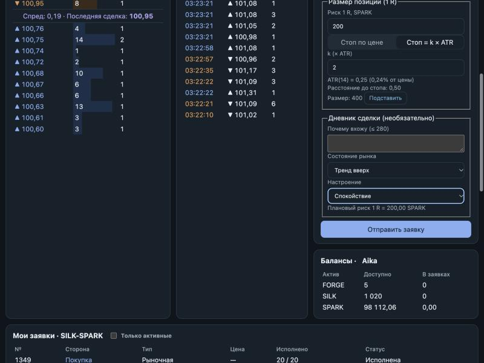 | 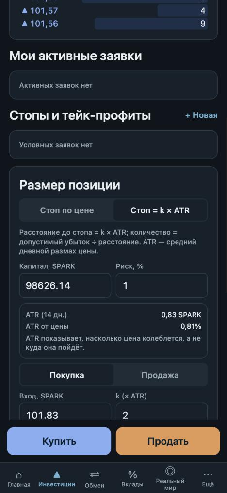 | 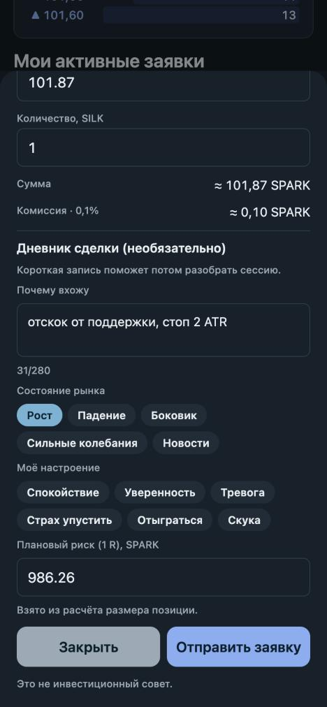 |

## 3. Session review
Every order with its note, result against the last price (fees included) and R; grouped by mood and market state.

| Web | Mobile |
|---|---|
| 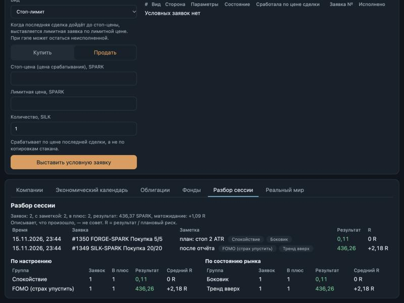 | 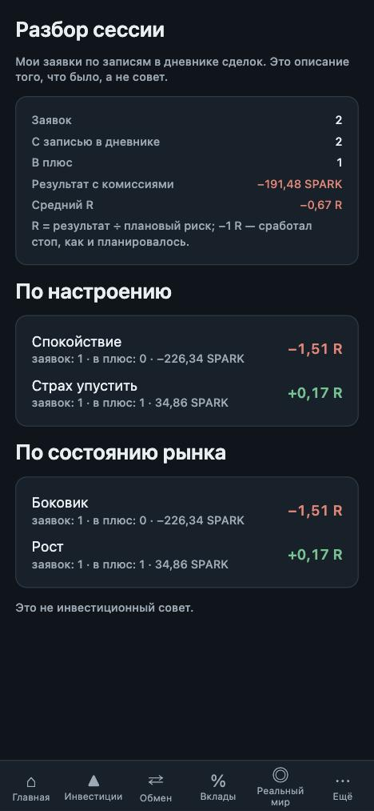 |

## 4. Dividends
SILK declares 0.44 / 1.04 / 0.56 per share. Ex-date at the open of report day +10 (entitlement fixed, price lowered by
the dividend), record date the next day (T+1), payment 4 days later; 10% withheld (`DIVIDEND_TAX` lines, «Удержано
налога» in the totals; the 10% period tax only asks for what was not withheld).

| Web: company | Web: statement | Mobile: chart with ex / record / pay |
|---|---|---|
| 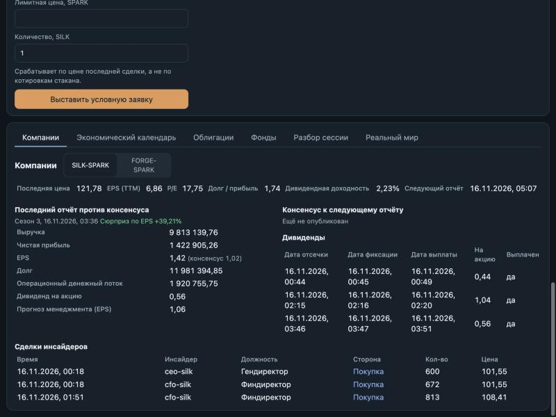 | 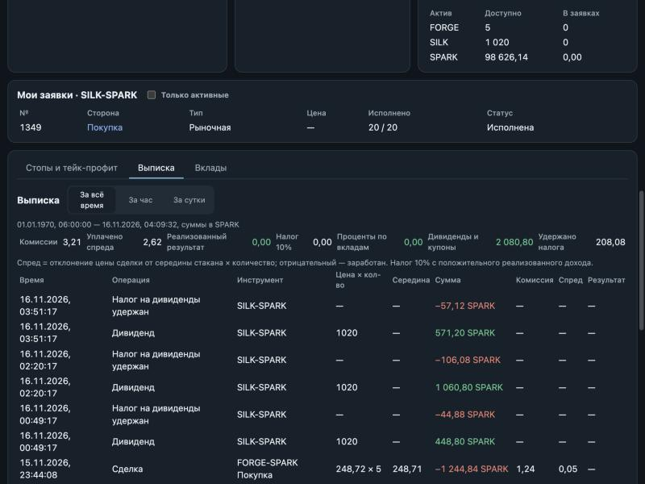 | 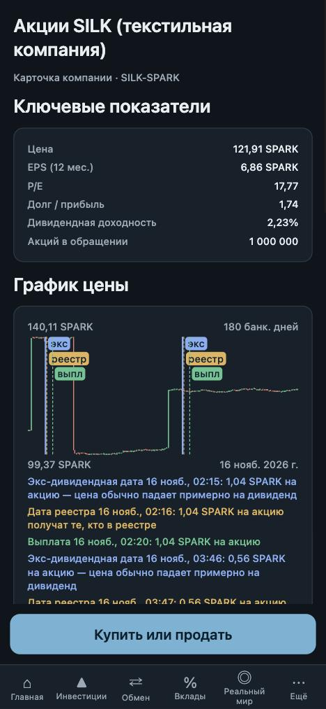 |

## 5. Funds
IDX (index, TER 0.20%) and ACT (active, FORGE-heavy, TER 2%). NAV per unit vs the unit price (premium), holdings with
weights, fees paid, and the fund against the same basket held without the fee. In the demo ACT returned +8.27% vs its
basket's +10.11% — the 1.84% gap is the fee; TER 2% takes 18.3% of the money over 10 years at zero growth.

| Web: IDX | Web: ACT | Mobile: ACT card | Mobile: fund vs basket |
|---|---|---|---|
| 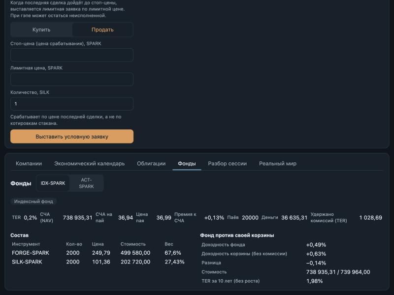 | 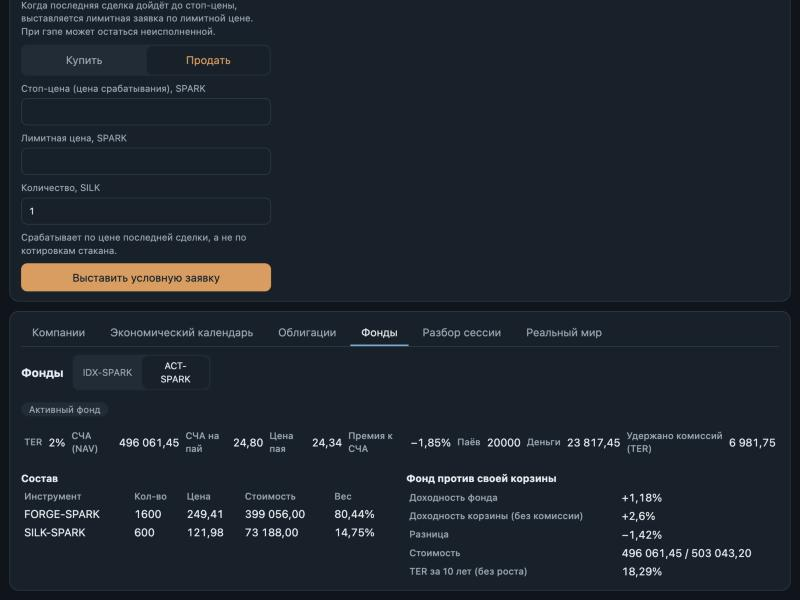 | 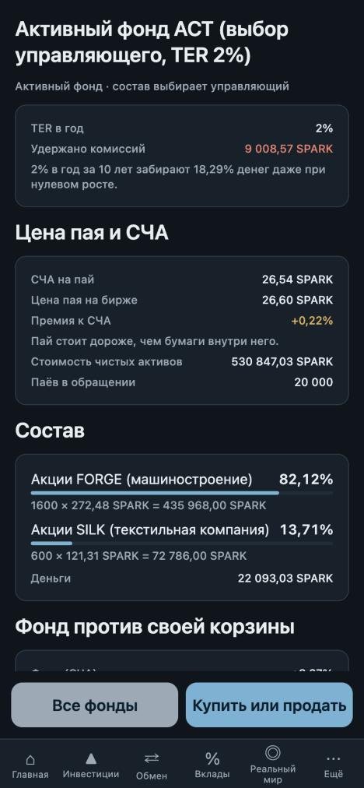 | 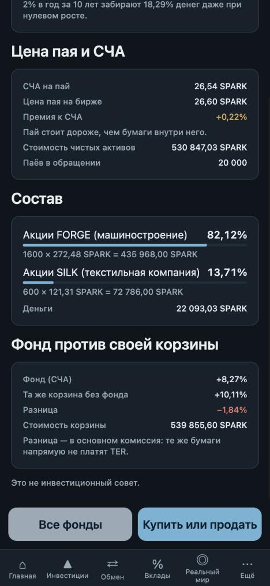 |

## 6. The WebSocket flake
`sendText().get()` returns when the frame leaves the client, not when the server registered the channel; the orders
could trade before `account.acc-ws-b` was registered, so the account nudge went to nobody. The test now waits for the
answer to every subscribe before trading.
