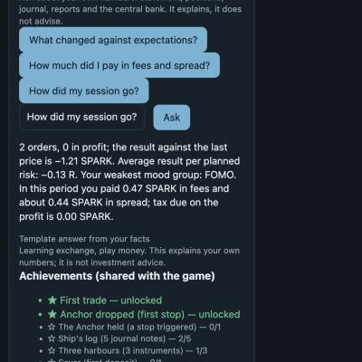
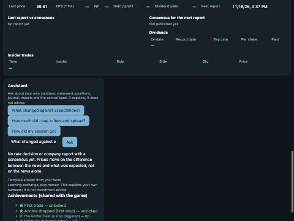
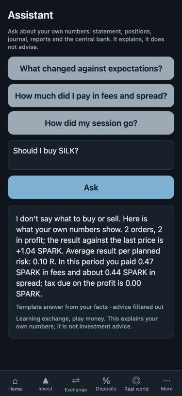
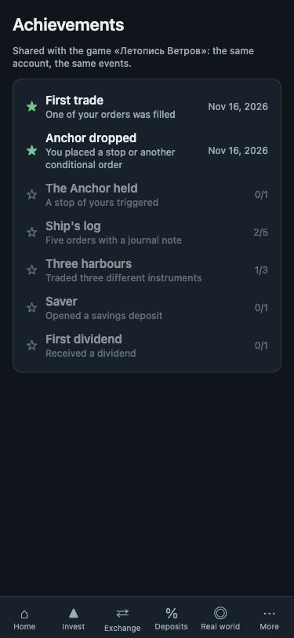
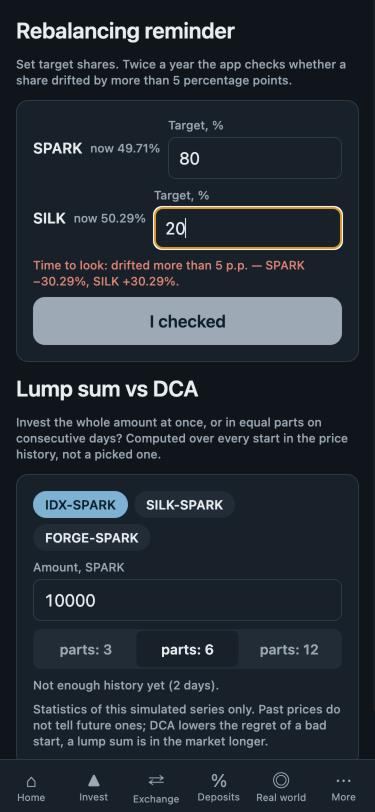

# M4 demo — assistant and polish

Run (any free ports; no API key needed — without `ANTHROPIC_API_KEY` the template assistant answers):
```
./gradlew :backend:app:bootRun --args='--server.port=8095 --exchange.journal=memory'
cd clients/web && VITE_API_URL=http://localhost:8095 npx vite --port 5180
cd clients/mobile && EXPO_PUBLIC_API_URL=http://localhost:8095 npx expo start --web --port 8097
```
With a key: `export ANTHROPIC_API_KEY=…` before `bootRun` (model `assistant.model`, default `claude-haiku-5-5`).
The demo below never called the real API.

## 1. «Помощник» in the web client
Quick questions and free text; the answer is built from the account's facts (statement totals, review, rate decision,
reports). Source and disclaimer are always shown. Achievements below are shared with the game.

| Session question | «What changed against expectations?» on a fresh exchange |
|---|---|
|  |  |

## 2. Mobile «Ветрило»: assistant, achievements, my plan
An advice question («Should I buy SILK?») never reaches the model: the template says it doesn't advise and shows the
numbers; `guarded` is shown as «advice filtered out». The rebalancing reminder: targets 80/20 against an actual ~50/50
→ both shares drifted more than 5 p.p. The lump sum vs DCA block needs ≥ parts + 1 daily closes: on a fresh exchange it
honestly says there is not enough history (at ×60 a bank day passes every second; the unit test covers the maths).

| Assistant + guard | Achievements | My plan |
|---|---|---|
|  |  |  |

## 3. game3d evening chronicle
`Chronicler.Remote` posts the day's SessionFacts (integers only) to `/assistant/ask` with persona `CHRONICLER` and adds
the narration under the template lines; offline, the template lines are the whole chronicle. Covered by a GUT test of
the request body (`test_session_facts.gd`) and `M4ContractTest`; no new screenshot of the game was taken in M4.

## Tests
`./gradlew test` (new: `AchievementsProjectionTest`, `AdviceGuardTest`, `TemplateAndFallbackTest`,
`ClaudeAssistantTest` with a fake HTTP transport, `BookThrottleTest`, `M4ContractTest`), `make test-web`,
`make test-mobile` (new `m4.test.mjs`), `make test-game3d` (59 GUT).
